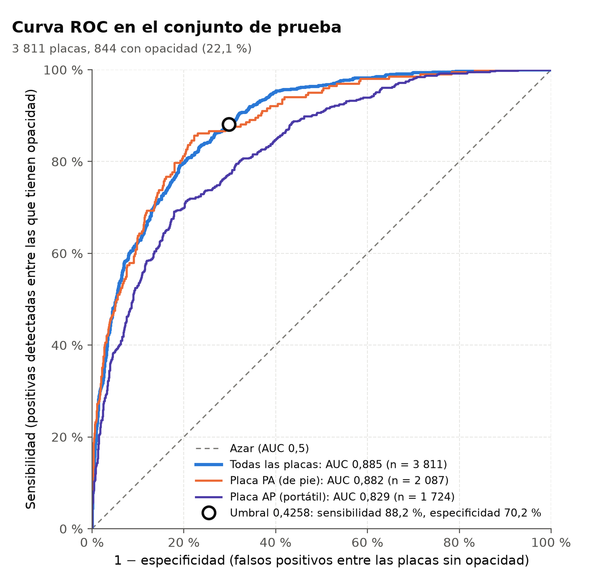
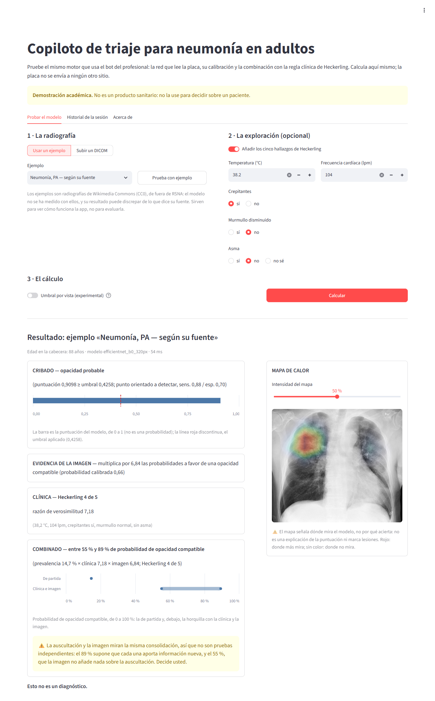
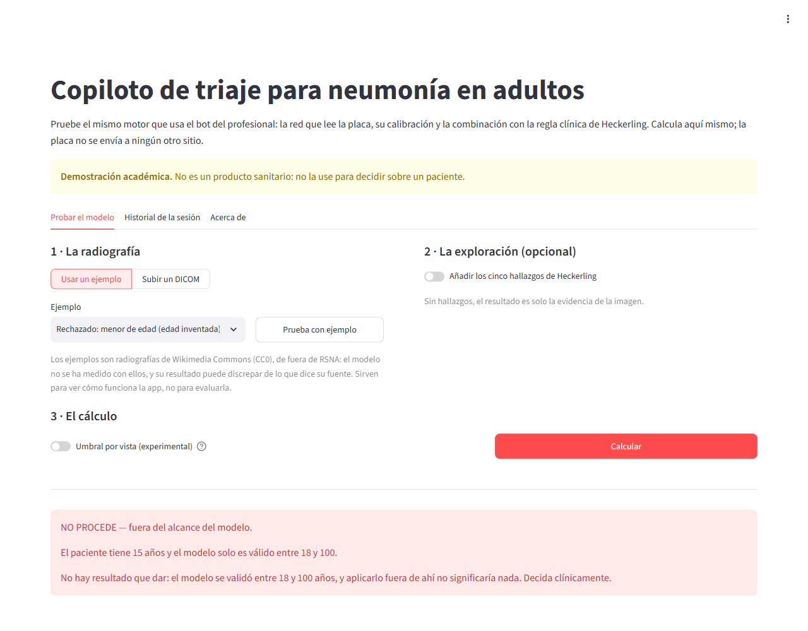
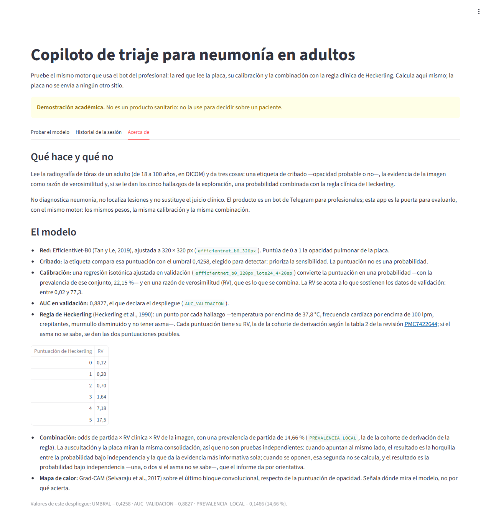
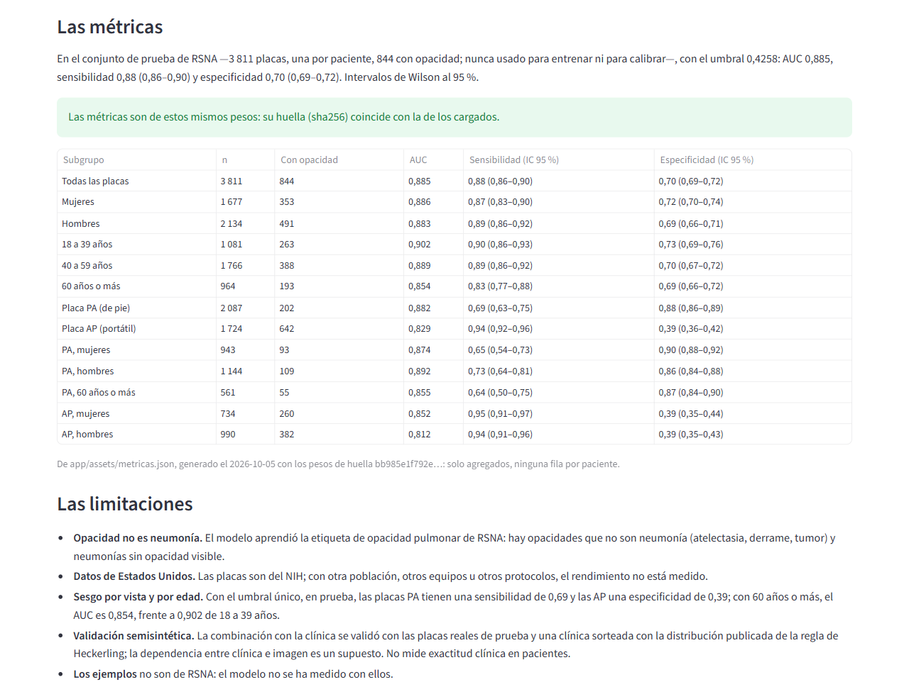
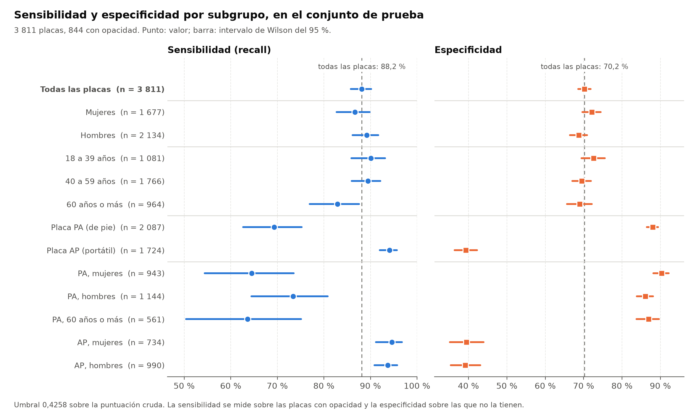

# Copiloto de triaje para neumonía en adultos

[](https://www.python.org/)
[](LICENSE)
[](docs/desarrollo.md#6-pruebas)
[](app/app.py)
[](docs/consideraciones_eticas.md#17-lo-que-falta-antes-de-cualquier-uso-clínico)

Un copiloto que ayuda al profesional de triaje a priorizar a los adultos con sospecha de
neumonía: una red convolucional calibrada lee la radiografía de tórax, una regla clínica
publicada (la de Heckerling) puntúa la exploración, y una combinación bayesiana explícita
devuelve la probabilidad de una opacidad compatible con neumonía, con sus avisos. Funciona como
dos bots de Telegram orquestados con n8n sobre un servidor de inferencia propio, y como una
aplicación web de demostración (Streamlit) con el mismo motor. Es un prototipo académico, no un
producto sanitario: **el profesional decide siempre**.

Proyecto Integrador de la Maestría en Inteligencia Artificial de la UEES, 2026.

## Tabla de contenidos

1. [Descripción del problema](#descripción-del-problema)
2. [Dataset](#dataset)
3. [Metodología](#metodología)
4. [Resultados](#resultados)
5. [Instalación y uso](#instalación-y-uso)
6. [Interfaz de usuario](#interfaz-de-usuario)
7. [Estructura del proyecto](#estructura-del-proyecto)
8. [Consideraciones éticas](#consideraciones-éticas)
9. [Autores y contribuciones](#autores-y-contribuciones)
10. [Licencia](#licencia)
11. [Agradecimientos y referencias](#agradecimientos-y-referencias)
12. [Videos](#videos)

## Descripción del problema

**Qué resuelve.** La neumonía se sospecha en el triaje con datos clínicos y se confirma con una
radiografía de tórax que alguien tiene que leer a tiempo. En urgencias saturadas y en zonas sin
radiólogo de turno, el médico general decide el triaje de la placa sin apoyo especializado, y
eso retrasa la priorización de los casos sospechosos. Ninguna de las dos fuentes basta sola:
las reglas clínicas discriminan de forma moderada y la placa depende de quién la lea y de
cuándo. El copiloto junta las dos en un pre-informe para el profesional: qué dice la imagen,
qué dice la clínica y qué dicen juntas.

**Por qué importa.** La neumonía es una de las principales causas de muerte por infección y
afecta más a los adultos mayores y a quien tiene peor acceso a la atención. Los clasificadores
de imagen publicados ignoran la historia clínica, que es lo que el médico integra al decidir, y
las alternativas comerciales en la nube exigen enviar la radiografía a servicios externos. Aquí
la imagen se evalúa en un servidor propio (aunque llega por Telegram, un tercero: ver
[Consideraciones éticas](#consideraciones-éticas)), y la parte clínica es una regla publicada
con razones de verosimilitud explícitas, que se pueden auditar.

**Para quién.** Médicos generales y personal de triaje de urgencias, de atención primaria y de
telemedicina (usuarios principales); los pacientes adultos que registran sus síntomas antes de
la consulta (secundarios); y la dirección médica que decidiría adoptarlo. El planteamiento
completo, con el objetivo SMART, el alcance, el cronograma y los riesgos, está en
[`docs/planificacion.md`](docs/planificacion.md).

## Dataset

| | |
| :--- | :--- |
| **Fuente** | [RSNA Pneumonia Detection Challenge](https://www.kaggle.com/competitions/rsna-pneumonia-detection-challenge) (Kaggle, 2018). Imágenes del NIH ChestX-ray14 (NIH Clinical Center); anotaciones de radiólogos de la RSNA y la STR |
| **Tamaño** | 26 684 estudios DICOM de tórax, uno por paciente, de 1024 × 1024 píxeles y 8 bits (unos 3,9 GB) |
| **Variables** | La imagen; de la cabecera DICOM, la edad, el sexo y la proyección (PA, de pie, o AP, portátil); y la etiqueta, con cajas sobre las opacidades. El modelo aprende la etiqueta binaria «opacidad / sin opacidad» |
| **Clases** | 6 012 con opacidad (22,5 %), 11 821 anormales sin opacidad (44,3 %) y 8 851 normales (33,2 %) |
| **Lo que se usa** | Los adultos de 18 a 100 años: 25 403 pacientes, 22,15 % con opacidad, partidos **por paciente** en 70 / 15 / 15 (17 782 / 3 810 / 3 811 placas) con la semilla 42 y la comprobación automática de que ningún paciente cae en dos particiones |
| **Licencia y reglas** | Las [condiciones de uso de la RSNA](https://www.rsna.org/-/media/files/rsna/education/ai-resources-and-training/ai-image-challenge/pneumonia-detection-challenge-terms-of-use-and-attribution.pdf) permiten el uso con fines de investigación y educación, sin intentar identificar a nadie y citando a sus autores; las [reglas de la competición](https://www.kaggle.com/competitions/rsna-pneumonia-detection-challenge/rules) (cláusula 7.B) prohíben redistribuir los datos |

**El repositorio no redistribuye los datos**: ni una radiografía, ni los DICOM, ni los PNG, ni
los manifiestos. Del conjunto solo se publican agregados (`results/`, `app/assets/metricas.json`).
Quien quiera reproducir el trabajo los descarga de la fuente, aceptando las reglas con su propia
cuenta, y los prepara con los guiones del repositorio: [`data/README.md`](data/README.md).

**Un sesgo que se sabe desde el principio:** la proyección predice la etiqueta. La placa AP se
toma con un equipo portátil, en la cama, a quien no puede levantarse; entre los adultos, el
37,9 % de las AP tiene opacidad, frente al 9,2 % de las PA. Es un confusor, y por eso todo se
mide también por vista. El análisis exploratorio está en
[`docs/analisis_datos.md`](docs/analisis_datos.md) y en
[`notebooks/01_exploracion.ipynb`](notebooks/01_exploracion.ipynb); la ficha de los datos, en
[`docs/ficha_datos.md`](docs/ficha_datos.md).

## Metodología

**El modelo y por qué.** Detectar opacidades en una placa no se resuelve con reglas: hace falta
visión por computador. Se usa una red convolucional preentrenada en ImageNet y ajustada a la
radiografía (aprendizaje por transferencia), con una sola salida. La arquitectura se fijó
**midiendo**, no a priori: DenseNet121, MobileNetV3-Large y EfficientNet-B0 a 320 px empatan en
AUC de prueba (0,874 a 0,889), un margen del orden de lo que varían dos ejecuciones de la misma
configuración. Se despliega **EfficientNet-B0 a 320 px** (corrida 6), que entrena unas 3,2 veces
más barato que DenseNet121 y tiene su calibrador propio. Junto a la red, la **regla clínica de
Heckerling** (temperatura, frecuencia cardiaca, crepitantes, murmullo disminuido y asma) aporta
su razón de verosimilitud, y una **combinación bayesiana** explícita da la probabilidad final:
`odds(prevalencia local 0,1466) × RV clínica × RV imagen`, como una horquilla entre los
supuestos de independencia y de dependencia total de las dos evidencias. Detalle en
[`docs/arquitectura.md`](docs/arquitectura.md).

**Preprocesamiento.** Del DICOM de 8 bits a PNG, en escala de grises replicada a tres canales,
redimensionado a 320 × 320 y normalizado con las estadísticas de ImageNet; idéntico en
entrenamiento y en servicio. Filtro de edad (18 a 100 años) y partición por paciente sin fuga.
Aumento de datos solo en entrenamiento: rotación de ±7°, desplazamiento del 5 % y brillo y
contraste de ±0,15, **sin volteo horizontal** (la posición del corazón es información clínica).
El desbalance (22,15 % de positivos) se trata con `pos_weight` = negativos / positivos (3,44) en
la pérdida y eligiendo el umbral sobre la curva ROC de validación. En servicio, el motor **se
niega** a evaluar lo que no puede: fuera de 18 a 100 años, sin edad legible, o placas que vería
mal (más de 8 bits, invertidas, en color, de varios cuadros o de más de 5 000 píxeles de lado),
decidiéndolo por la cabecera antes de descodificar un solo píxel.

**Optimización** ([`docs/optimizacion.md`](docs/optimizacion.md),
[`notebooks/04_optimizacion.ipynb`](notebooks/04_optimizacion.ipynb)). Ocho corridas a 320 px
(tres arquitecturas, en GPU de Kaggle y Colab y una en CPU), en dos fases: 4 épocas con la red
base congelada y luego el ajuste fino de la red completa (hasta 20 épocas en el modelo
desplegado); Adam (1e-3 en la cabeza, 2e-4 en el ajuste) con recocido coseno; parada temprana con paciencia 5 y selección de la mejor época por
recall en validación. Después: **calibración** isotónica ajustada en validación (la salida cruda
no es una probabilidad), **razón de verosimilitud acotada** a [0,0163; 77,32] para que la imagen
no anule la clínica ni la vuelva certeza, **umbral de cribado** 0,4258 elegido en validación y
un **umbral por vista** (PA 0,1798, AP 0,5815), apagado por defecto. No hubo una búsqueda
sistemática de hiperparámetros: cada configuración se entrenó una vez, y el análisis de
sensibilidad dice hasta dónde se puede concluir con eso.

**Métricas.** El **recall** (sensibilidad) es la primaria: en triaje, mandar a casa una
neumonía es el error caro. Le acompañan la especificidad y el AUC-ROC, con metas fijadas en la
Semana 1 (mínimo / objetivo: recall 0,80 / 0,85, especificidad 0,70 / 0,75, AUC 0,85 / 0,88),
intervalos de Wilson del 95 %, las métricas por subgrupo (sexo, edad, proyección y sus cruces) y
la calibración (ECE y Brier). La exactitud no sirve aquí: decir siempre «sin opacidad» acierta
en cerca del 78 % de las placas con un recall de cero. La combinación con la clínica se validó
con una simulación semisintética y con una sesión con un médico (kappa ponderado).

## Resultados

**El modelo en el conjunto de prueba** (3 811 placas de adultos, 844 con opacidad), con el
umbral de cribado 0,4258. Las cifras salen de [`app/assets/metricas.json`](app/assets/metricas.json)
y [`results/metrics/metricas_prueba.json`](results/metrics/metricas_prueba.json) (entre
paréntesis, el intervalo de Wilson del 95 %):

| Métrica | Valor | Meta de la Semana 1 (mínimo / objetivo) |
| :--- | :-: | :-: |
| AUC-ROC | **0,885** | 0,85 / 0,88: cumple el objetivo |
| Recall (sensibilidad) | **0,882** (0,858–0,902) | 0,80 / 0,85: cumple el objetivo |
| Especificidad | **0,702** (0,686–0,719) | 0,70 / 0,75: cumple el mínimo, **no el objetivo** |
| F1 | 0,602 | — |
| Calibración (ECE · Brier) | cruda 0,171 · 0,152 → **calibrada 0,023 · 0,108** | — |

El F1 es el de la corrida 6 en [`docs/comparativa-corridas.md`](docs/comparativa-corridas.md).
Recall ≥ 0,85 y especificidad ≥ 0,75 **no se alcanzan a la vez** con este modelo: se prioriza el
recall y se publica la frontera ([`docs/frontera-recall-especificidad.md`](docs/frontera-recall-especificidad.md)).

**El modelo no rinde igual para todos.** Por proyección y por edad (todas las cifras por
subgrupo, en `results/metrics/metricas_prueba.json` y en la pestaña «Acerca de» de la app):

| Subgrupo | n | Recall | Especificidad |
| :--- | -: | :-: | :-: |
| Placa PA (de pie) | 2 087 | **0,693** (0,626–0,753) | 0,880 (0,865–0,894) |
| Placa AP (portátil) | 1 724 | 0,941 (0,920–0,957) | **0,393** (0,364–0,422) |
| 60 años o más | 964 | 0,829 (0,770–0,876) | 0,690 (0,656–0,722) |
| PA, 60 años o más | 561 | **0,636** (0,504–0,751) | 0,870 (0,837–0,896) |
| Con el umbral por vista (todas) | 3 811 | 0,889 (0,866–0,908) | 0,615 (0,597–0,632) |

El umbral por vista iguala el recall de las dos vistas (0,891 en PA y 0,888 en AP) a cambio de
especificidad; por eso está apagado por defecto y encenderlo es una decisión de la institución.

**Comparación con la línea base.**

| | Siempre «sin opacidad» | Primera corrida (19-sep): MobileNetV3-Large a 224 px | Modelo desplegado: EfficientNet-B0 a 320 px |
| :--- | :-: | :-: | :-: |
| Recall en prueba | 0 | 0,766 | **0,882** |
| Especificidad en prueba | 1 | 0,764 | **0,702** |
| AUC en prueba | 0,5 | 0,845 | **0,885** |

Una línea base trivial no detecta nada. La primera corrida no llegaba al mínimo de AUC (0,85):
el recall sube 0,116 y el AUC 0,040, a cambio de 0,062 de especificidad, y algo más de la mitad
de esa subida del recall es elegir otro punto de la misma curva, no un modelo mejor
([`docs/optimizacion.md`](docs/optimizacion.md), §12). Entre arquitecturas, las ocho corridas a
320 px quedan entre 0,874 y 0,889 de AUC en prueba: un empate práctico
([`docs/comparativa-corridas.md`](docs/comparativa-corridas.md)).



**Validación con un médico y simulación** (lo que no salió como se esperaba, contado tal cual).
En una sesión con un médico general colaborador sobre 24 casos semisintéticos (placa real de
RSNA, clínica generada), el **kappa ponderado fue 0,25** (IC del 95 %: 0,07 a 0,44), por debajo
del mínimo de 0,4 comprometido en la Semana 1; el médico valoró el **lenguaje del pre-informe con
2,5 sobre 5** (corrección 4,7, utilidad 4,0); con el mensaje del sistema delante cambió de banda
en 12 de 20 casos, y el tiempo de triaje no se redujo (razón 2,00; 1,11 corregida por el efecto
de releer, con un intervalo que incluye el 1). Acta:
[`docs/validacion-semisintetica/acta-h7.md`](docs/validacion-semisintetica/acta-h7.md). La
simulación semisintética muestra que la combinación por independencia exagera cuando la
clínica y la imagen dependen entre sí, así que la cifra combinada es **orientativa**:
[`docs/validacion-semisintetica-sp5.md`](docs/validacion-semisintetica-sp5.md). Todo esto, en
[`notebooks/05_evaluacion.ipynb`](notebooks/05_evaluacion.ipynb) y [`results/`](results/README.md).

## Instalación y uso

**Requisitos del sistema.**

- Python 3.12 o 3.13 (las imágenes de Docker usan 3.12). CPU basta para usar el modelo; para
  entrenarlo en un tiempo razonable hace falta GPU (Kaggle o Colab).
- [Docker](https://docs.docker.com/get-docker/) con BuildKit para la aplicación (recomendado) y
  para el servidor: unos 2,5 GB de disco para la imagen y 2 GB de memoria para el contenedor.
- Los pesos del modelo (16 MB), que no van en git: se descargan y se comprueban con su SHA-256
  ([`models/README.md`](models/README.md)).
- En algunas máquinas Windows, torch o scikit-learn no cargan (Smart App Control): ahí, Docker.

**Instalación, paso a paso.**

```
git clone <dirección del repositorio>
cd copiloto-triaje
python -m venv .venv
source .venv/bin/activate            # PowerShell: .venv\Scripts\Activate.ps1
pip install -r requirements.txt      # versiones fijas; torch en CPU
```

Después, descarga `pesos_modelo_cpu.pt` y déjalo en `models/` (y en `servidor/` si vas a
construir las imágenes de Docker), como dice [`models/README.md`](models/README.md).

**Comandos.** Desde la raíz del repositorio:

```
python -m src.model                  # resumen del modelo desplegado; comprueba la huella de los pesos
python -m src.evaluate               # métricas y figuras de results/ desde las puntuaciones de prueba
python -m src.data_processing --help # descargar y preparar RSNA (data/README.md)
python -m src.train --help           # entrenar una configuración (horas; mejor con GPU)
python -m pytest                     # las pruebas
```

Las pruebas que necesitan algo que no está (los datos, los pesos, Docker, n8n) se saltan
diciendo qué queda sin comprobar (`python -m pytest -rs` lo lista). Cómo se corren las suites de
los bots, la imagen Linux de pruebas, las variables de entorno, el servidor y la reproducción
desde cero, en [`docs/desarrollo.md`](docs/desarrollo.md).

**Ejemplo de uso desde Python** (con los pesos en `models/`):

```python
from pathlib import Path
from src.model import cargar_motor

motor = cargar_motor()
dicom = Path("app/assets/ejemplos/neumonia_pa.dcm").read_bytes()
hallazgos = {"temperatura_c": 38.2, "frecuencia_cardiaca": 104, "crepitantes": True,
             "murmullo_disminuido": False, "asma": "no"}
resultado = motor.clasificar(dicom, hallazgos)
print(resultado["clasificacion"], resultado["razon_de_verosimilitud"], resultado["combinacion"])
```

Devuelve la clasificación del cribado, la probabilidad calibrada, la razón de verosimilitud de la
imagen y, con los hallazgos, el bloque `combinacion` con la probabilidad combinada. Con este
ejemplo da `opacidad_probable`, una razón de verosimilitud de la imagen de 6,84 y una horquilla
combinada de 55 % a 89 % (la de las capturas de abajo). Una placa que no puede evaluar lanza
`ErrorDeInferencia` con su código (`fuera_de_alcance`, `dicom_invalido`…).

## Interfaz de usuario

`app/` es una página web hecha con **Streamlit** en la que cualquier persona prueba el modelo
sin cuenta de Telegram: el mismo motor que usa el bot del profesional (los mismos pesos, la
misma calibración y la misma combinación con la regla de Heckerling), calculando en su propio
proceso, sin enviar la placa a ningún sitio. Tiene tres pestañas:

- **Probar el modelo.** Entrada con validación: un DICOM subido (hasta 5 MB) o uno de los cuatro
  ejemplos precargados (botón **«Prueba con ejemplo»**), y los cinco hallazgos de Heckerling,
  opcionales. Indicador de carga, y errores en lenguaje llano: lo que no se puede evaluar se
  dice a una persona, con lo que puede hacer, nunca como una traza. El resultado, en bloques
  (cribado, evidencia de la imagen, clínica y combinado), con la puntuación frente al umbral y
  la horquilla en gráficos, y el **mapa de calor** (Grad-CAM) sobre la placa, con su advertencia.
- **Historial de la sesión**, descargable en CSV sin la imagen ni nada de la cabecera DICOM.
- **Acerca de**: el modelo, los datos, las métricas por subgrupo con sus intervalos, las
  limitaciones, el precio del umbral por vista y la licencia de los ejemplos.


<details>
<summary>Más capturas: la pantalla sin anotar, un rechazo y la pestaña «Acerca de»</summary>









</details>

**Cómo se ejecuta.** Con Docker, desde la raíz del repositorio y con los pesos en
`servidor/pesos_modelo_cpu.pt` (no viajan en git: [`models/README.md`](models/README.md)):

```
docker build -t copiloto-app -f app/Dockerfile .
docker run --rm -p 127.0.0.1:8501:8501 --memory=2g --memory-swap=2g copiloto-app
```

y se abre `http://127.0.0.1:8501`. El puerto, **siempre detrás de `127.0.0.1:`** (sin eso,
Docker lo publica en todas las interfaces y la página no pide contraseña), y **siempre con el
límite de memoria**. Sin Docker, se instala desde la raíz y se lanza **desde `app/`**, que es
donde Streamlit lee su configuración (en bash; en PowerShell, las variables con `$env:`):

```
pip install -r app/requirements.txt
pip install --no-deps .
cd app
AUC_VALIDACION=0.8827 PREVALENCIA_LOCAL=0.1466 streamlit run app.py
```

**Cómo se usa.** Abra la página, deje elegido «Usar un ejemplo» y el ejemplo «Neumonía, PA», y
pulse «Prueba con ejemplo». Active después «Añadir los cinco hallazgos de Heckerling», rellénelos
y pulse «Calcular» para ver la combinación; pruebe el ejemplo «rechazado» para ver cómo se niega,
y mire «Acerca de». Los ejemplos son radiografías de Wikimedia Commons (CC0), de fuera de RSNA: el
modelo no se ha medido con ellos y sirven para ver cómo funciona la página, no para evaluarla.
La guía completa, con cada zona de la pantalla, cómo leer el resultado, los problemas comunes y
las preguntas frecuentes, está en el [manual de usuario](docs/manual_usuario.md); los detalles de
despliegue, en [`docs/desarrollo.md`](docs/desarrollo.md#9-la-aplicación-de-demostración-en-detalle).

**Dónde está desplegada.** Todavía no hay una dirección pública: la aplicación se ejecuta en
local con las órdenes de arriba. El enlace se añadirá aquí cuando se publique.

## Estructura del proyecto

```
copiloto-triaje/
├── README.md · LICENSE · requirements.txt · .gitignore · pyproject.toml
├── docs/        la documentación del curso, las fichas del modelo y de los datos, y la técnica
├── data/        solo referencias: README, y raw/ y processed/ vacías (los datos no se redistribuyen)
├── notebooks/   01_exploracion … 05_evaluacion, y entrenar_gpu (la variante para Colab)
├── src/         la capa del curso: data_processing, model, train, evaluate, utils
│   └── copiloto_triaje/   la implementación real: datos, modelo, servicio y validación
├── models/      README del modelo (los pesos se descargan, no van en git)
├── app/         la aplicación Streamlit, su Dockerfile y sus recursos (ejemplos y métricas)
├── tests/       las pruebas: pytest y las suites de los bots en node
├── results/     figures/, metrics/ y reports/: la evaluación en prueba, en agregados
├── servidor/    el servidor de inferencia: Docker, MCP y REST, y el calibrador
├── n8n/         los tres workflows: bot del paciente, bot del profesional y mantenimiento
├── bd/          el esquema y la limpieza de PostgreSQL
├── scripts/     guiones: preparar datos, entrenar en CPU, calibrar, comparar corridas, validar, anonimato
└── pruebas/     arneses de la validación y de los bots: selección de casos, formulario de la sesión, SQL
```

| Carpeta | Qué hay |
| :--- | :--- |
| `docs/` | Los seis documentos del curso —[planificación](docs/planificacion.md), [análisis de datos](docs/analisis_datos.md), [arquitectura](docs/arquitectura.md), [optimización](docs/optimizacion.md), [consideraciones éticas](docs/consideraciones_eticas.md) y [manual de usuario](docs/manual_usuario.md)—, la [ficha del modelo](docs/ficha_modelo.md) y la [de los datos](docs/ficha_datos.md), y la documentación técnica: [desarrollo](docs/desarrollo.md), despliegue, operación, la comparativa de corridas, la validación y los diseños de cada sub-proyecto (`docs/superpowers/`) |
| `data/` | De dónde bajar RSNA, con qué reglas y cómo prepararlo ([`data/README.md`](data/README.md)) |
| `notebooks/` | Los cinco cuadernos del curso: exploración, preprocesamiento, modelado (el entrenamiento, que corre en Kaggle con GPU), optimización y evaluación; todos llevan sus salidas salvo el de modelado. `entrenar_gpu.ipynb` es la variante del entrenamiento para Colab |
| `src/` | **La capa del curso.** Cada módulo es un punto de entrada fino que dice en su docstring dónde está la implementación y la llama sin duplicarla: `data_processing` → `copiloto_triaje.datos`; `model` → `copiloto_triaje.modelo` y `.servicio`; `train` → `scripts/entrenar_local.py`; `evaluate` → `app/generar_metricas.py` y `results/`; `utils` → rutas, registro y utilidades |
| `src/copiloto_triaje/` | **La implementación real**, la que instalan el servidor y la app: lectura de DICOM, partición y `Dataset` (`datos/`); arquitecturas, entrenamiento y métricas (`modelo/`); el motor de inferencia, la calibración y la regla de Heckerling (`servicio/`); y la validación semisintética (`validacion/`) |
| `models/` | El modelo desplegado, su SHA-256, de dónde bajarlo y por qué es `.pt` y no `.pkl` (la estructura del curso pide `best_model.pkl`; aquí hace ese papel `pesos_modelo_cpu.pt`): [`models/README.md`](models/README.md) |
| `app/` | La interfaz: `app.py`, `requirements.txt`, el `Dockerfile` y `assets/` (los ejemplos, sus licencias y las métricas que enseña) |
| `tests/` | Las del curso (`test_data_processing.py`, `test_model.py`, `test_app.py`, `test_estructura_curso.py`) y las del sistema: partición sin fuga, motor, servidor, contrato MCP, SQL de los nodos, anonimato… |
| `results/` | Las métricas en JSON, las figuras y los informes de la validación: [`results/README.md`](results/README.md) |
| `servidor/`, `n8n/`, `bd/` | El sistema desplegado: el servidor de inferencia, los workflows de n8n (con marcadores en vez de direcciones y credenciales) y la base de datos |
| `scripts/`, `pruebas/` | Los guiones del proyecto y los arneses con que se validó |

## Consideraciones éticas

El análisis completo, con los ocho puntos que pide el curso, el registro de riesgos y el estado
de cada mitigación, está en [`docs/consideraciones_eticas.md`](docs/consideraciones_eticas.md).
En resumen:

- **Sesgo medido: el rendimiento depende de la proyección y de la edad.** Con el umbral único,
  el modelo deja sin marcar 3 de cada 10 opacidades en placas PA (recall 0,69; 0,64 con 60 años
  o más) y marca de más en las AP (especificidad 0,39). El perjudicado es el paciente
  ambulatorio, sobre todo el mayor. La mitigación evaluada, el umbral por vista, iguala el recall
  a cambio de bajar la especificidad global de 0,70 a 0,62: está **desplegada pero apagada** y
  encenderla es una decisión de la institución.
- **Privacidad, parcial.** No se guarda ninguna imagen y se usan seudónimos, pero la placa y las
  respuestas **pasan por Telegram**, un tercero fuera de nuestro control; el consentimiento lo
  dice. Falta la evaluación de impacto que exigiría un uso real.
- **Transparencia.** La parte clínica se explica con razones de verosimilitud; la imagen es una
  caja negra con un mapa de calor de apoyo, que señala dónde mira el modelo y no por qué acierta.
- **Responsabilidad.** Decide el profesional; la institución que lo adopte responde de su uso; el
  equipo, de lo técnico. El sistema no toma ninguna decisión.



**Limitaciones conocidas.** Se midió en RSNA (placas frontales de un conjunto de Estados Unidos)
y no en pacientes de ninguna consulta: no hay validación local, ni con otras proyecciones u otros
equipos. Mide opacidad, no neumonía. Pierde una de cada ocho opacidades en prueba (una de cada
tres en PA). El 9,9 % de las placas de prueba cae en una banda en que el cribado las marca y la
imagen resta probabilidad. La combinación con la clínica solo se validó en simulación y con un
médico, con un acuerdo bajo (kappa 0,25). No se evaluó la robustez frente a imágenes
adversarias.

**Advertencias sobre el uso inadecuado.** No debe usarse para decidir sobre un paciente real, ni
como único criterio, ni para descartar una neumonía (un negativo no la descarta), ni sin un
profesional que lea y decida, ni en menores de 18 años, ni para fines ajenos a la atención
(seguros, selección de personal, trámites). La aplicación lo dice en su cabecera («Demostración
académica. No es un producto sanitario: no la use para decidir sobre un paciente») y cada
resultado termina con «Esto no es un diagnóstico.». Antes de cualquier uso clínico faltan la
validación local, la evaluación de impacto de protección de datos, el registro sanitario y la
evaluación de un comité de bioética
([§17](docs/consideraciones_eticas.md#17-lo-que-falta-antes-de-cualquier-uso-clínico)). Los
usos previstos y fuera de alcance, en la [ficha del modelo](docs/ficha_modelo.md).

## Autores y contribuciones

<!-- Excepción D5 del anonimato: los nombres de esta línea son los únicos que pueden aparecer, y solo en README.md, LICENSE y docs/planificacion.md. scripts/verificar_anonimato.py los lee de la línea siguiente. -->
<!-- nombres-publicos: Iván Camilo Romero Rodríguez; Iván Mauricio Romero Mejía; Gladys Villegas -->

| Integrante | Rol | Contribución |
| :--- | :--- | :--- |
| **Iván Camilo Romero Rodríguez** | Product Owner y Scrum Master | Backlog, decisiones de diseño y de alcance, flujos de n8n y de los bots, logística de la validación médica, documentación y entregas |
| **Iván Mauricio Romero Mejía** | Lead AI Engineer | Datos RSNA, entrenamiento y evaluación de la CNN, servidor MCP en Docker, combinación bayesiana, métricas, calidad del modelo, calibración y sesgo |

Los dos actuaron como equipo de desarrollo y repartieron las historias en cada sprint
([`docs/planificacion.md`](docs/planificacion.md), §7). Un médico general colaboró de forma
voluntaria como experto del dominio en la sesión de concordancia; por su privacidad, no se le
nombra. El desarrollo se apoyó en un asistente de IA para programación (Claude Code), que
redactó buena parte del código y de la documentación; las especificaciones, las decisiones, las
revisiones y la validación con el médico son del equipo.

**Contacto:** las incidencias (*issues*) del repositorio, que atiende el Product Owner.

## Licencia

El código se publica con la [licencia MIT](LICENSE). Los datos de RSNA **no** se incluyen y
siguen sus [condiciones de uso](https://www.rsna.org/-/media/files/rsna/education/ai-resources-and-training/ai-image-challenge/pneumonia-detection-challenge-terms-of-use-and-attribution.pdf)
y las reglas de la competición. Las radiografías de ejemplo de la aplicación son de Wikimedia
Commons con licencia CC0 ([`app/assets/LICENCIAS.md`](app/assets/LICENCIAS.md)). Los pesos del
modelo se entrenaron con los datos de la competición: se publican como descarga aparte, después
de comprobar esas reglas ([`models/README.md`](models/README.md)), y la licencia del código no
restringe su uso: los límites de uso están en la [ficha del modelo](docs/ficha_modelo.md).

## Agradecimientos y referencias

**Agradecimientos.** A la tutora del Proyecto Integrador, **PhD (c) Gladys Villegas**, por la
guía y la revisión de cada entrega. Al médico general que leyó los casos de la sesión de
concordancia, de forma voluntaria. A la RSNA, la STR y el NIH Clinical Center, por publicar los
datos y sus anotaciones, y a los autores de las radiografías de ejemplo de Wikimedia Commons. Y a
quienes mantienen el software libre sobre el que se construye: PyTorch y torchvision, pydicom,
scikit-learn, NumPy, pandas, Streamlit, FastAPI, el SDK de MCP, n8n y PostgreSQL.

**Referencias principales** (las completas, en cada documento de `docs/`):

1. X. Wang, Y. Peng, L. Lu, Z. Lu, M. Bagheri y R. M. Summers, «ChestX-ray8: hospital-scale chest X-ray database and benchmarks on weakly-supervised classification and localization of common thorax diseases», en *Proc. IEEE CVPR*, 2017, pp. 3462–3471, doi: 10.1109/CVPR.2017.369.
2. G. Shih *et al.*, «Augmenting the National Institutes of Health chest radiograph dataset with expert annotations of possible pneumonia», *Radiol. Artif. Intell.*, vol. 1, n.º 1, art. e180041, 2019, doi: 10.1148/ryai.2019180041.
3. M. Tan y Q. V. Le, «EfficientNet: rethinking model scaling for convolutional neural networks», en *Proc. ICML*, 2019, arXiv:1905.11946.
4. P. S. Heckerling *et al.*, «Clinical prediction rule for pulmonary infiltrates», *Ann. Intern. Med.*, vol. 113, n.º 9, pp. 664–670, 1990, doi: 10.7326/0003-4819-113-9-664.
5. B. Zadrozny y C. Elkan, «Transforming classifier scores into accurate multiclass probability estimates», en *Proc. 8th ACM SIGKDD*, 2002, pp. 694–699, doi: 10.1145/775047.775151.
6. R. R. Selvaraju *et al.*, «Grad-CAM: visual explanations from deep networks via gradient-based localization», en *Proc. IEEE ICCV*, 2017, pp. 618–626, doi: 10.1109/ICCV.2017.74.
7. J. R. Zech *et al.*, «Variable generalization performance of a deep learning model to detect pneumonia in chest radiographs: a cross-sectional study», *PLOS Med.*, vol. 15, n.º 11, art. e1002683, 2018, doi: 10.1371/journal.pmed.1002683.
8. L. Seyyed-Kalantari *et al.*, «Underdiagnosis bias of artificial intelligence algorithms applied to chest radiographs in under-served patient populations», *Nat. Med.*, vol. 27, n.º 12, pp. 2176–2182, 2021, doi: 10.1038/s41591-021-01595-0.
9. M. Hardt, E. Price y N. Srebro, «Equality of opportunity in supervised learning», en *Advances in Neural Information Processing Systems 29*, 2016.
10. M. Mitchell *et al.*, «Model cards for model reporting», en *Proc. FAT\* '19*, 2019, pp. 220–229, doi: 10.1145/3287560.3287596.
11. T. Gebru *et al.*, «Datasheets for datasets», *Commun. ACM*, vol. 64, n.º 12, pp. 86–92, 2021, doi: 10.1145/3458723.
12. World Health Organization, *Ethics and Governance of Artificial Intelligence for Health: WHO Guidance*, Ginebra, 2021.

## Videos

- **Video pitch (5 minutos):** se añadirá aquí al grabarlo.
- **Video de respuestas a las preguntas:** se añadirá aquí al grabarlo, cuando el profesor
  entregue las preguntas en la última semana de clases.
