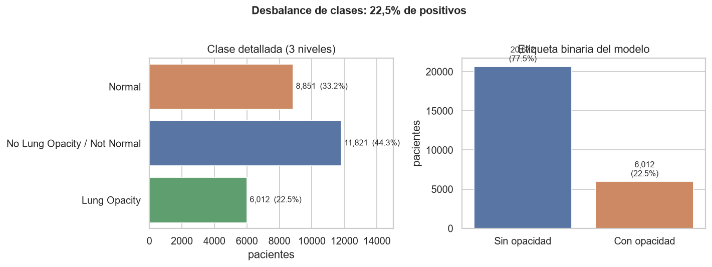
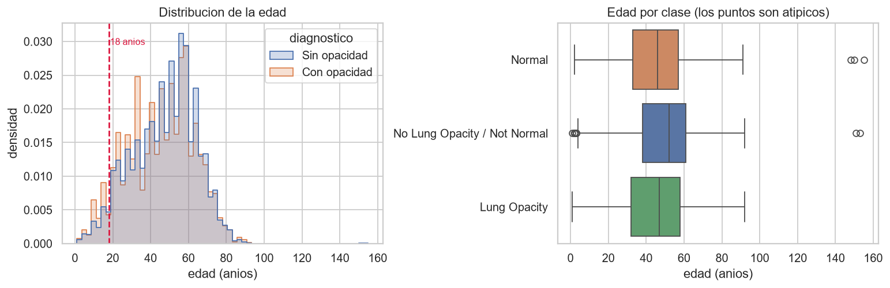
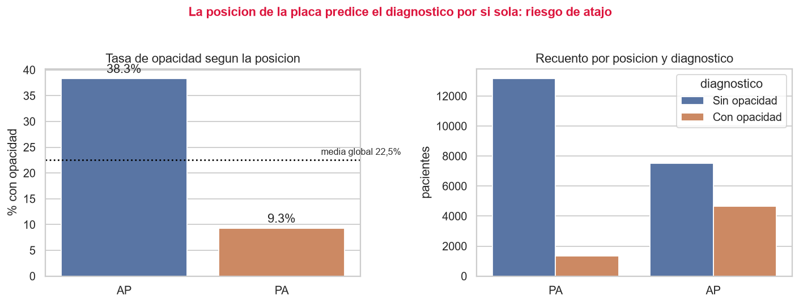
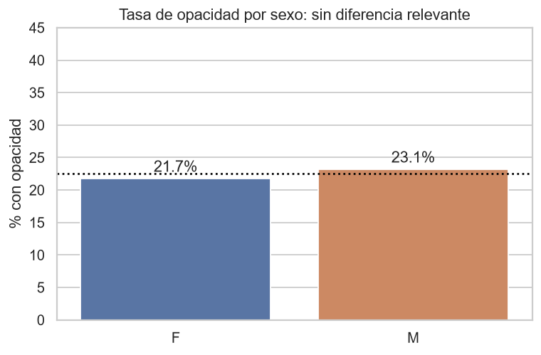
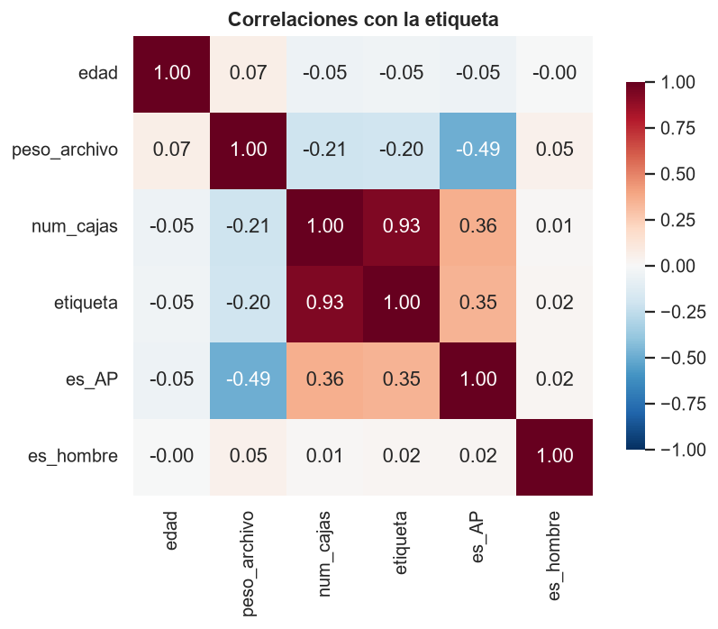
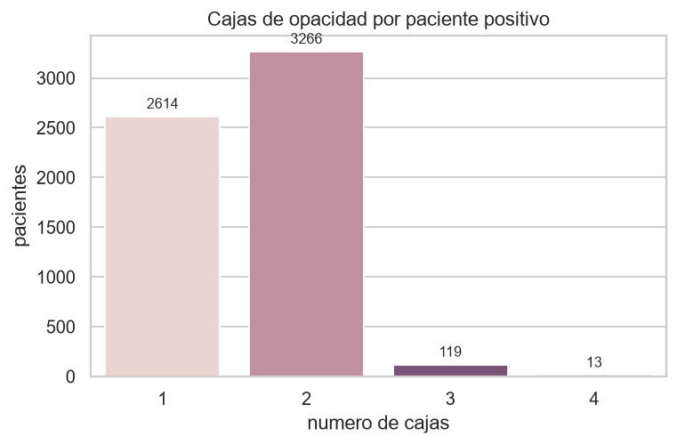

# Análisis exploratorio de datos

**Copiloto de triaje para neumonía en adultos** · Dataset: RSNA Pneumonia Detection Challenge (2018).

Este documento resume el análisis exploratorio (EDA) del dataset, las decisiones de
preparación que salieron de él y lo que el análisis no puede decir. Es el resultado del
trabajo de la Semana 2 y de su revisión posterior, con datos agregados: no contiene
imágenes ni filas por paciente.

- **Código y resultados:** `notebooks/01_exploracion.ipynb` (el cuaderno ejecutado, con
  todas las salidas) y las seis figuras de `docs/eda/`.
- **Cómo se generó la tabla analizada:** `scripts/extraer_metadatos.py` lee **solo las
  cabeceras** de los 26 684 archivos DICOM (sin decodificar los píxeles) y escribe una tabla
  de 17 columnas, una fila por placa. Recorrer el dataset completo tarda unos 26 segundos
  (cuaderno de exploración).
- **Preparación posterior:** `notebooks/02_preprocesamiento.ipynb`.
- **Datos:** el repositorio no redistribuye RSNA; ver `data/README.md` y `docs/ficha_datos.md`.

Las cifras salen de las salidas del cuaderno de exploración y, donde se indica «cálculo
sobre la tabla de metadatos», de agregados calculados sobre esa misma tabla para este
documento (sin cambiar el código del análisis). Donde coinciden, las cifras concuerdan con
las del workshop de la Semana 4.

## Contenido

1. [Qué se analiza](#1-qué-se-analiza)
2. [Descripción del dataset](#2-descripción-del-dataset)
3. [Estadísticas descriptivas](#3-estadísticas-descriptivas)
4. [Visualizaciones](#4-visualizaciones)
5. [Hallazgos: patrones, correlaciones y valores atípicos](#5-hallazgos-patrones-correlaciones-y-valores-atípicos)
6. [El confusor de la proyección AP/PA](#6-el-confusor-de-la-proyección-appa)
7. [Datos faltantes y desbalance](#7-datos-faltantes-y-desbalance)
8. [Decisiones de preprocesamiento](#8-decisiones-de-preprocesamiento)
9. [Cómo quedaron los conjuntos](#9-cómo-quedaron-los-conjuntos)
10. [Límites del análisis](#10-límites-del-análisis)
11. [Referencias](#11-referencias)

## 1. Qué se analiza

El dataset son imágenes, no una tabla. Lo que se explora aquí es la **tabla de metadatos**
que el propio pipeline extrae de cada radiografía: edad, sexo, proyección de la placa
(PA o AP), modalidad, dimensiones, profundidad de bits, peso del archivo y la etiqueta, con
el número de cajas de opacidad que la acompañan.

Por qué ese enfoque: las decisiones que tomó el proyecto dependen de variables de esa tabla
(a qué población se limita el modelo, cómo se parten los datos, en qué subgrupos se mide el
rendimiento) y no de una exploración de los píxeles. La sección 10 dice qué queda sin mirar.

## 2. Descripción del dataset

| Característica | Valor |
| :--- | :--- |
| Nombre | RSNA Pneumonia Detection Challenge (Kaggle, 2018) |
| Procedencia | Subconjunto del NIH ChestX-ray14 (NIH Clinical Center, EE. UU.), re-anotado por radiólogos de la RSNA para opacidades pulmonares que pueden corresponder a neumonía |
| Tamaño | 26 684 estudios DICOM de entrenamiento, **una radiografía por paciente** (26 684 identificadores distintos); 3,66 GB el paquete completo |
| Formato | DICOM, modalidad CR, parte del cuerpo «tórax», `MONOCHROME2`, 8 bits, **1 024 × 1 024 píxeles en todas las imágenes** |
| Etiquetas | Tres clases por paciente (`stage_2_detailed_class_info`) y cajas de opacidad (`stage_2_train_labels`) |
| Etiqueta binaria del modelo | Positivo (1) = la placa tiene al menos una caja de opacidad (`Lung Opacity`); negativo (0) = `Normal` o `No Lung Opacity / Not Normal` |
| Filas del CSV de etiquetas | 30 227, más que imágenes: cada caja de un paciente positivo ocupa una fila (9 555 cajas) |
| Conjunto de prueba oficial | 3 000 DICOM sin etiquetas públicas: **no se usan**; la prueba del proyecto es una partición propia |

Aclaración sobre la etiqueta: la clase positiva es una **opacidad pulmonar compatible con
neumonía**, no neumonía confirmada por laboratorio. Ese matiz está en todo el proyecto: el
informe del bot y la interfaz dicen «opacidad», no «neumonía».

Fuentes: cuaderno de exploración, spec de SP1 (§4, hechos verificados el 16-sep-2026), Shih
et al. (2019) y Wang et al. (2017).

### 2.1 Las tres clases

| Clase | Pacientes | Proporción |
| :--- | ---: | ---: |
| `Lung Opacity` (positivo) | 6 012 | 22,5 % |
| `No Lung Opacity / Not Normal` (negativo: anormal sin opacidad) | 11 821 | 44,3 % |
| `Normal` (negativo) | 8 851 | 33,2 % |

Los negativos incluyen las placas anormales sin opacidad (44,3 %): es el caso clínicamente
difícil y realista, distinguir una opacidad de otras anomalías y no solo de placas
perfectas (spec de SP1, §6).

## 3. Estadísticas descriptivas

Fuente: cuaderno de exploración, sección 1.

### 3.1 Variables numéricas (26 684 placas)

| Variable | Media | Desv. | Mín. | Q1 | Mediana | Q3 | Máx. |
| :--- | ---: | ---: | ---: | ---: | ---: | ---: | ---: |
| Edad (años) | 47,0 | 16,8 | 1 | 34 | 49 | 59 | 155 |
| Filas y columnas (píxeles) | 1 024 | 0 | 1 024 | 1 024 | 1 024 | 1 024 | 1 024 |
| Peso del archivo (bytes) | 133 237,6 | 23 234,3 | 46 234 | 114 358 | 135 532 | 153 119 | 370 560 |
| Cajas de opacidad por paciente | 0,4 | 0,7 | 0 | 0 | 0 | 0 | 4 |

### 3.2 Variables categóricas

| Variable | Valores |
| :--- | :--- |
| Sexo | Hombres 15 166 (56,8 %); mujeres 11 518 (43,2 %) |
| Proyección | PA 14 511 (54,4 %); AP 12 173 (45,6 %) |
| Modalidad | CR en las 26 684 |
| Interpretación fotométrica | `MONOCHROME2` en las 26 684 |

### 3.3 Valores faltantes

**Ninguno:** el dataset está completo en todas las columnas extraídas (cuaderno de
exploración, sección 1).

### 3.4 Adultos tras el filtro de edad

Cálculo sobre la tabla de metadatos, coincidente con las cifras del workshop de la Semana 4:

| | Valor |
| :--- | ---: |
| Placas de adultos (18 a 100 años) | 25 403 (95,2 %) |
| Positivos | 5 627 (22,15 %) |
| Edad: media, mediana y rango | 48,8; 50; 18 a 92 |
| Hombres | 56,6 % |
| 60 años o más | 25,8 % |
| Proyección PA / AP | 13 944 / 11 459 (54,9 % / 45,1 %) |
| Tasa de opacidad en PA / AP | 9,2 % / 37,9 % |

## 4. Visualizaciones

Las seis figuras las genera el cuaderno `notebooks/01_exploracion.ipynb` y están en
`docs/eda/`.

### 4.1 Distribución de las clases

*Figura 1.* A la izquierda, las tres clases; a la derecha, la etiqueta binaria que ve el
modelo. La proporción real de positivos es **22,5 %**, no el 50 % que se suele suponer al leer
la descripción del reto. El documento de presentación de la Semana 1 hablaba de «15 000
casos con opacidad y 15 000 negativos»: era un error y se corrigió (spec de SP1, §4).

### 4.2 Edad y valores atípicos

*Figura 2.* Histograma de la edad por diagnóstico, con la línea de los 18 años, y diagrama de
cajas por clase. Contradice el alcance declarado («adultos») en dos puntos: **1 276 pacientes
(4,78 %) son menores de 18 años**, con edades desde 1 año, y **5 pacientes tienen edades
imposibles**: 148, 150, 151, 153 y 155 años.

### 4.3 La proyección de la placa predice la etiqueta

*Figura 3.* **El resultado con más consecuencias.** Las placas AP presentan **38,3 %** de
opacidad (4 664 de 12 173) frente al **9,3 %** de las PA (1 348 de 14 511). Se desarrolla en
la sección 6.

### 4.4 Sexo

*Figura 4.* El contraste útil: **aquí no hay señal.** La tasa de opacidad es del 23,1 % en
hombres y del 21,7 % en mujeres (cálculo sobre la tabla de metadatos), y la correlación con
la etiqueta es 0,017.

### 4.5 Correlaciones con la etiqueta

*Figura 5.* Correlaciones de Pearson con la etiqueta:

| Variable | Correlación | Lectura |
| :--- | ---: | :--- |
| Número de cajas | 0,932 | Se deriva de la etiqueta: es la etiqueta contada de otra forma, no un predictor |
| Proyección AP | 0,346 | El atajo principal (sección 6) |
| Sexo masculino | 0,017 | Sin señal |
| Edad | −0,046 | Débil |
| Peso del archivo | −0,197 | Segundo atajo potencial, más débil que la proyección |

### 4.6 Cajas por paciente positivo

*Figura 6.* Los 6 012 positivos tienen entre 1 y 4 cajas: 2 614 con una, 3 266 con dos, 119
con tres y 13 con cuatro. Explica por qué el CSV de etiquetas tiene 30 227 filas y no 26 684.

## 5. Hallazgos: patrones, correlaciones y valores atípicos

| Hallazgo | Evidencia | Consecuencia para el proyecto |
| :--- | :--- | :--- |
| 22,5 % de positivos, no 50 % | Figura 1 | Partición estratificada, ponderación de clases y umbral elegido sobre la curva ROC |
| **La proyección AP/PA predice la etiqueta** | 38,3 % frente a 9,3 % (figura 3); correlación 0,346 | Riesgo de aprendizaje por atajo. Se documenta como sesgo y se mide el rendimiento por separado en cada proyección |
| El 4,78 % son menores de 18 años | 1 276 placas, desde 1 año (figura 2) | El alcance es «adultos»: se filtra a 18-100 años |
| Cinco edades imposibles (148 a 155) | Figura 2 | Errores de dato: los excluye el mismo filtro |
| Sin valores faltantes y todas las imágenes de 1 024 × 1 024 | Sección 3 | No hace falta imputar ni homogeneizar tamaños |
| El peso del archivo correlaciona −0,20 con la etiqueta | Figura 5 | Segundo atajo potencial; las placas sin hallazgos comprimen mejor |
| El número de cajas correlaciona 0,93 | Figura 5 | Es la etiqueta disfrazada: nunca debe usarse como variable de entrada |
| Sin señal por sexo | Figura 4 | La diferencia de rendimiento por sexo, si aparece, no viene de la prevalencia |

### 5.1 Patrones demográficos (cálculo sobre la tabla de metadatos, adultos)

| Grupo | Placas | % con opacidad |
| :--- | ---: | ---: |
| 18 a 39 años | 7 248 | 24,2 |
| 40 a 59 años | 11 612 | 21,7 |
| 60 años o más | 6 543 | 20,6 |

La opacidad es algo menos frecuente en los grupos de más edad. La proporción de placas AP
es parecida en los tres grupos (47,6 %, 44,6 % y 43,2 %), y el descenso aparece sobre todo
dentro de las AP (40,5 %, 37,9 % y 34,6 %), mientras que en las PA es plano (9,5 %, 8,7 % y
10,0 %).

### 5.2 El peso del archivo

Las placas con opacidad pesan menos (mediana de 120 991 bytes frente a 139 553 de las
negativas) y las AP pesan menos que las PA (115 738 frente a 147 436) (cálculo sobre la tabla
de metadatos). Es una lectura, no una prueba: es probable que parte de esa correlación de
−0,20 venga de la proyección, porque las dos variables van juntas. Por eso se consideró un
atajo potencial del mismo tipo, aunque más débil.

## 6. El confusor de la proyección AP/PA

**Por qué ocurre.** Una placa PA se toma de pie, con el paciente colaborando. Una AP se toma
con un equipo portátil, en la cama, a quien no puede levantarse: pacientes más graves. La
proyección no causa la neumonía, pero **delata la gravedad del paciente** (cuaderno de
exploración, sección 4). Es una explicación del análisis, no un resultado medido con datos
clínicos.

**Por qué importa.** La red podría aprender a reconocer las marcas de una placa portátil en
vez de mirar el pulmón: acertaría mucho en este dataset y fallaría en un hospital con otra
mezcla de proyecciones.

**Qué aporta el desglose por clase.** Entre los adultos (cálculo sobre la tabla de metadatos):

| Proyección | Con opacidad | Anormal sin opacidad | Normal |
| :--- | ---: | ---: | ---: |
| AP | 37,9 % | 49,0 % | 13,2 % |
| PA | 9,2 % | 41,4 % | 49,3 % |

Una placa AP rara vez es normal (13,2 % frente a 49,3 %): la mayoría de las AP sin opacidad
son placas con otros hallazgos (78,8 % de las AP negativas), mientras que entre las PA
negativas lo son el 45,7 %. Eso hace que las negativas AP sean las difíciles.

**Qué se vio después, al medir.** El análisis anunció el riesgo y dejó la medición
pendiente; se hizo en la Semana 4 sobre el conjunto de prueba (`app/assets/metricas.json`):

| Proyección | Placas | Positivas | Recall | Especificidad | AUC |
| :--- | ---: | ---: | ---: | ---: | ---: |
| PA | 2 087 | 202 (9,7 %) | 0,693 | 0,880 | 0,882 |
| AP | 1 724 | 642 (37,2 %) | 0,941 | 0,393 | 0,829 |

El modelo con un umbral único deja pasar el 31 % de las opacidades en las placas PA y
marca como sospechosas el 61 % de las AP sin opacidad. Dentro de cada proyección ordena
razonablemente (AUC 0,88 y 0,83): el desfase es de punto de operación, no de capacidad de
ordenar. Esto lleva a la mitigación del umbral por vista (`docs/optimizacion.md`).

## 7. Datos faltantes y desbalance

**Faltantes.** No hay ninguno en la tabla de metadatos. El único dato que puede faltar en
operación, la edad, se trata como rechazo: si la cabecera DICOM no trae una edad legible el
servidor no la da por adulta y se niega a evaluar (`edad_desconocida`; spec de SP2, §7).

**Desbalance.** 22,15 % de positivos tras el filtro de edad. Un modelo que predijera siempre
«negativo» tendría cerca de un 78 % de exactitud y recall cero (spec de SP1, §6): por eso la exactitud
no es la métrica principal. Tres medidas:

1. **Partición estratificada** por etiqueta, para conservar la proporción en los tres
   conjuntos.
2. **Ponderación de clases** en la función de pérdida: `BCEWithLogitsLoss` con
   `pos_weight = negativos / positivos`, que sobre la partición de entrenamiento vale
   aproximadamente 3,5 (3,44 en el modelo desplegado; spec de SP2, §4).
3. **Umbral elegido sobre la curva ROC de validación**, no fijo en 0,5. Como el peso de
   clase desplaza la salida del modelo, esa salida no es una probabilidad y se calibra
   aparte (`docs/optimizacion.md`).

## 8. Decisiones de preprocesamiento

Cada decisión con el hallazgo que la motivó y dónde está implementada.

| Decisión | Hallazgo que la motivó | Implementación |
| :--- | :--- | :--- |
| **Filtrar a 18-100 años** (se descartan 1 276 menores y 5 edades imposibles; quedan 25 403) | El alcance declara adultos; la neumonía infantil se ve distinta y la anatomía también. Los menores tenían más opacidad (30,2 %), así que la proporción global casi no se mueve (22,15 % frente a 22,53 %) | `filtrar_por_edad` (`src/copiloto_triaje/datos/preparacion.py`); el descarte queda escrito, con el motivo, en `descartados_por_edad.json`: una pérdida de datos nunca es silenciosa. El servidor aplica el mismo rango en inferencia |
| **Partición 70/15/15 por paciente**, estratificada por etiqueta, con semilla 42 | Una imagen por paciente, pero la lógica protege frente a cualquier dataset con varias imágenes por paciente (el pediátrico de Kermany se descartó por fuga de datos) | `particionar_por_paciente` y `verificar_sin_fuga` (`src/copiloto_triaje/datos/particion.py`), con pruebas automáticas sobre los manifiestos emitidos |
| **Estratificar solo por etiqueta, no por proyección** | La mezcla de proyecciones quedó casi igual en la prueba (54,8 % PA y 45,2 % AP, frente a 54,9 % y 45,1 % en todos los adultos) | Se mide el rendimiento por proyección; no se rebalancea por proyección |
| **DICOM a PNG de 8 bits sin ventaneo** | Todos los DICOM de RSNA son `MONOCHROME2` de 8 bits: la conversión es directa | `convertir_a_png` (`src/copiloto_triaje/datos/dicom.py`) |
| **Redimensionar a 320 × 320** y normalizar con las estadísticas de ImageNet (replicando el canal a tres) | Se empezó en 224 y se subió a 320 tras medir: las opacidades son sutiles y difusas y reducir una placa de 1 024 píxeles tira la señal (`docs/mejoras-2026-09-21.md`) | `construir_transformaciones` (`src/copiloto_triaje/datos/dataset.py`) |
| **Aumento de datos solo en entrenamiento**: rotación de ±7°, desplazamiento del 5 %, brillo y contraste de ±0,15 | Regularizar sin alterar el significado clínico | Ídem. **Sin volteo horizontal**: la lateralidad cardiaca es información clínica real y voltearla produce anatomía imposible |
| **No imputar** | Sin valores faltantes | — |
| **No usar metadatos como entrada** | Proyección, peso del archivo y número de cajas correlacionan con la etiqueta: son atajos o la etiqueta misma | El modelo ve solo la imagen; la edad solo sirve para rechazar lo que está fuera de alcance |
| **Rechazar lo que el modelo no vio** | Todas las imágenes de entrenamiento son de 8 bits, `MONOCHROME2`, un cuadro y de 1 024 píxeles | El servidor y la interfaz rechazan por la cabecera, antes de decodificar, las placas de otro formato (spec de SP5-B4; README) |
| **Medir por subgrupo** (sexo, edad, proyección y sus cruces) | La proyección es un confusor y la edad cambia la prevalencia | `app/assets/metricas.json`; `docs/consideraciones_eticas.md` |

## 9. Cómo quedaron los conjuntos

Partición de las 25 403 placas de adultos (`Hallazgos medidos`, Semana 3; verificada contra
las matrices de confusión):

| Conjunto | Placas |
| :--- | ---: |
| Entrenamiento | 17 782 |
| Validación | 3 810 |
| Prueba | 3 811 |

Composición del conjunto de prueba (`app/assets/metricas.json`), la base de todas las
métricas finales: 3 811 placas, 844 con opacidad (22,1 %).

| Subgrupo | Placas | Positivas |
| :--- | ---: | ---: |
| Mujeres / Hombres | 1 677 / 2 134 | 353 / 491 |
| 18 a 39 / 40 a 59 / 60 o más años | 1 081 / 1 766 / 964 | 263 / 388 / 193 |
| PA / AP | 2 087 / 1 724 | 202 / 642 |
| PA y 60 años o más | 561 | 55 |

Los subgrupos pequeños (por ejemplo PA y 60 años o más, con 55 positivas) tienen intervalos de
confianza anchos; las métricas con sus intervalos de Wilson están en `app/assets/metricas.json`
y se comentan en `docs/consideraciones_eticas.md`.

## 10. Límites del análisis

Lo que este análisis **no** puede decir y se declara:

- **Es un análisis de metadatos.** No se exploraron los píxeles: no hay un análisis de
  calidad de imagen, de histogramas de intensidad ni de marcas visibles de equipos o de
  anotaciones que el modelo pudiera aprender.
- **La etiqueta es un proxy.** Opacidad compatible con neumonía, anotada por radiólogos de
  la RSNA sobre imágenes cuyas etiquetas originales (ChestX-ray14) se extrajeron de informes
  con procesamiento de lenguaje natural; no hay confirmación de laboratorio ni medida de la
  variabilidad entre lectores.
- **Origen único.** Las placas son del NIH Clinical Center (EE. UU.): el rendimiento en otros
  equipos, poblaciones y prevalencias no está garantizado, y no se hizo validación externa.
- **Variables que faltan.** La tabla extraída solo tiene edad, sexo y proyección; no hay raza,
  etnia ni nivel socioeconómico, así que no se puede auditar el sesgo por ellas.
- **Mecanismo del confusor sin comprobar.** La explicación de que las AP son pacientes más
  graves es razonable, pero el dataset no trae datos clínicos con los que contrastarla.
- **Desbalance de sexo y edad.** Hay más hombres (56,8 %) y solo un cuarto de los adultos
  tiene 60 años o más.

## 11. Referencias

- G. Shih et al., «Augmenting the National Institutes of Health chest radiograph dataset with
  expert annotations of possible pneumonia», *Radiology: Artificial Intelligence*, vol. 1,
  n.º 1, e180041, 2019. doi: 10.1148/ryai.2019180041.
- X. Wang, Y. Peng, L. Lu, Z. Lu, M. Bagheri y R. M. Summers, «ChestX-ray8: hospital-scale
  chest X-ray database and benchmarks on weakly-supervised classification and localization of
  common thorax diseases», en *Proc. IEEE CVPR*, 2017, pp. 3462-3471.
  doi: 10.1109/CVPR.2017.369.
- Radiological Society of North America, «RSNA Pneumonia Detection Challenge (2018)».
- Documentos del repositorio: `docs/superpowers/specs/2026-09-16-sp1-nucleo-imagen-design.md`,
  `docs/mejoras-2026-09-21.md`, `app/assets/metricas.json`.
