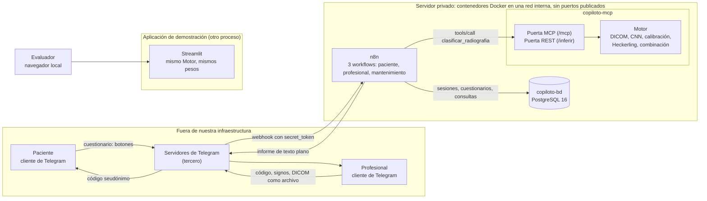
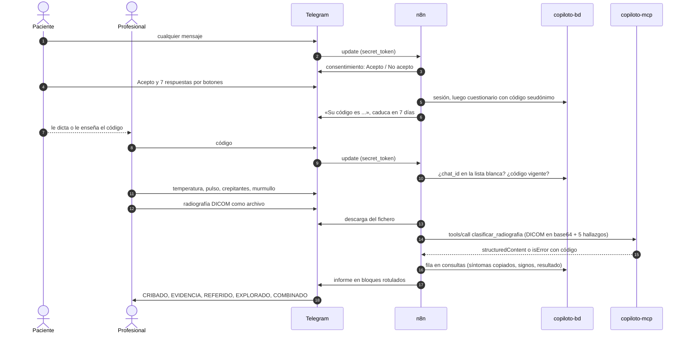
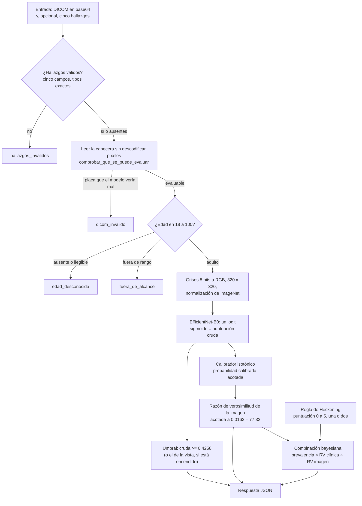

# Arquitectura del sistema y del modelo

**Proyecto:** Copiloto de triaje para neumonía en adultos · Proyecto Integrador, Maestría en Inteligencia Artificial (UEES), 2026.

Este documento describe **cómo está construido el sistema** (§2 a §7), **cómo está construido el modelo** (§8 a §13) y, al final, el contrato de la herramienta, las tecnologías con sus versiones, las decisiones, la seguridad y las limitaciones (§14 a §19), y por qué cada pieza es como es.

Cada cifra sale de una fuente que se cita al lado: los diseños de cada sub-proyecto, las guías de despliegue y operación (`docs/sp2-despliegue.md`, `docs/sp3-operacion.md`), el código (`src/copiloto_triaje/`, `servidor/`, `app/`, `n8n/`, `bd/`) y las métricas congeladas (`app/assets/metricas.json`). «SP1» a «SP5» son los sub-proyectos en que se hizo el proyecto —núcleo de imagen, servidor MCP, bots y n8n, combinación bayesiana, validación y cierre—; sus diseños están en `docs/superpowers/specs/`. Cuando una fuente posterior corrige a otra, gana la posterior y se dice.

> **Esto es un prototipo académico, no un producto sanitario.** El sistema no diagnostica: informa al profesional, y el profesional decide siempre. No ha atendido a ningún paciente real.

## Contenido

1. [Resumen](#1-resumen)
2. [Visión general y principios de diseño](#2-visión-general-y-principios-de-diseño)
3. [Diagrama de flujo del sistema completo](#3-diagrama-de-flujo-del-sistema-completo)
4. [Componentes](#4-componentes)
5. [Pipeline de datos: del cuestionario del paciente al informe del profesional](#5-pipeline-de-datos-del-cuestionario-del-paciente-al-informe-del-profesional)
6. [Qué se guarda y qué no](#6-qué-se-guarda-y-qué-no)
7. [Despliegue en Docker sobre un servidor privado](#7-despliegue-en-docker-sobre-un-servidor-privado)
8. [El modelo: tipo, justificación y arquitectura detallada](#8-el-modelo-tipo-justificación-y-arquitectura-detallada)
9. [Del DICOM a la salida del modelo: preprocesamiento y rechazos de cabecera](#9-del-dicom-a-la-salida-del-modelo-preprocesamiento-y-rechazos-de-cabecera)
10. [Entrenamiento](#10-entrenamiento)
11. [Calibración, razón de verosimilitud y umbral de cribado](#11-calibración-razón-de-verosimilitud-y-umbral-de-cribado)
12. [La regla clínica de Heckerling y la combinación bayesiana](#12-la-regla-clínica-de-heckerling-y-la-combinación-bayesiana)
13. [Explicabilidad (Grad-CAM) y umbral por vista](#13-explicabilidad-grad-cam-y-umbral-por-vista)
14. [El contrato de la herramienta y sus errores](#14-el-contrato-de-la-herramienta-y-sus-errores)
15. [Tecnologías y versiones](#15-tecnologías-y-versiones)
16. [Decisiones de arquitectura y alternativas descartadas](#16-decisiones-de-arquitectura-y-alternativas-descartadas)
17. [Seguridad y privacidad de la arquitectura](#17-seguridad-y-privacidad-de-la-arquitectura)
18. [Cómo se verifica](#18-cómo-se-verifica)
19. [Limitaciones y deuda declarada](#19-limitaciones-y-deuda-declarada)
Y las [referencias](#referencias).

---

## 1. Resumen

El sistema ayuda a un profesional de triaje a priorizar a un adulto con sospecha de neumonía. Combina dos fuentes de evidencia que por separado son modestas: la regla clínica de Heckerling [1] (cinco hallazgos de anamnesis y exploración) y una red convolucional que puntúa la opacidad pulmonar de una radiografía de tórax. La combinación es **aritmética auditable** (razones de verosimilitud multiplicadas sobre una probabilidad de partida) y se entrega como **horquilla**, no como un número con falsa precisión.

| Pieza | Qué es | Dónde vive |
| :--- | :--- | :--- |
| Bot del paciente | Telegram + n8n: consentimiento, 7 preguntas con botones y un código seudónimo | `n8n/copiloto-paciente.json` |
| Bot del profesional | Telegram + n8n: código, 4 signos de exploración, radiografía DICOM e informe | `n8n/copiloto-profesional.json` |
| Mantenimiento | n8n: limpieza diaria de datos caducados y vigilancia con avisos | `n8n/copiloto-mantenimiento.json` |
| Servidor de inferencia | Contenedor `copiloto-mcp`: una herramienta MCP y un `POST /inferir` REST sobre el mismo núcleo | `servidor/`, `src/copiloto_triaje/servicio/` |
| Base de datos | Contenedor `copiloto-bd`: PostgreSQL 16 propia | `bd/esquema.sql`, `servidor/docker-compose.yml` |
| Aplicación de demostración | Streamlit, con el mismo motor, en su propio proceso | `app/` |
| Modelo | EfficientNet-B0 a 320 px, calibrado, más la regla de Heckerling | `src/copiloto_triaje/modelo/`, `servicio/` |

Cifras de referencia del modelo desplegado (corrida 6, `efficientnet_b0_320px_lote24_4+20ep`): AUC de validación 0,8827; en el conjunto de prueba (3 811 placas, 844 con opacidad), AUC 0,885, recall 0,882 (IC 95 % 0,858–0,902) y especificidad 0,702 (0,686–0,719) con el umbral 0,4258 (`app/assets/metricas.json`). Las limitaciones de esas cifras están en la [ficha del modelo](ficha_modelo.md) y en [consideraciones éticas](consideraciones_eticas.md).

## 2. Visión general y principios de diseño

El diseño no salió de una plantilla: cada principio responde a un fallo que se midió o se previó.

| Principio | Cómo se concreta | Por qué |
| :--- | :--- | :--- |
| **El profesional decide siempre** | Todo informe cierra con «Esto no es un diagnóstico.»; el paciente nunca recibe el resultado; ninguna rama de error emite una probabilidad | Es una ayuda a la decisión, no una decisión (SP3 §1, §9) |
| **Dos bots, no uno** | El flujo del paciente no contiene ningún nodo que llame al servidor de inferencia | Que un paciente no pueda recibir el resultado deja de depender de que un `if` esté bien escrito (SP3, D1) |
| **Razón de verosimilitud, no probabilidad cruda** | La salida de la red se calibra y se entrega como razón de verosimilitud acotada | La red se entrenó con una pérdida ponderada: su salida cruda «0,74» no es un 74 % de probabilidad (SP2 §6.1) |
| **Acotar en vez de inventar** | La dependencia entre clínica e imagen se acota con dos supuestos límite calculables, sin un factor de corrección inventado | «Este proyecto no inventa constantes» (SP4 §7) |
| **Lo que falta no se rellena** | `asma: no sé` genera dos puntuaciones y un rango; una edad ausente rechaza la placa | Convertir `no_se` en un booleano sería fabricar el dato (SP4 §6; SP2 §7) |
| **Sin modelo de lenguaje** | Ninguna pieza llama a un LLM; el cuestionario es de botones | Un extractor probabilístico en la entrada de un cálculo clínico produce un previo equivocado que nadie ve (SP3 §4.5; SP4 §12) |
| **Fallar de forma segura** | Códigos de rechazo, razón de verosimilitud acotada, vigilancia diaria, vuelta atrás documentada | Los fallos peligrosos son los silenciosos (SP3 §9, §16) |
| **Nada del texto del paciente en el informe** | El informe se compone solo de números validados, enumeraciones cerradas y literales del sistema; el texto libre viaja en un mensaje aparte | Un filtro de caracteres va siempre un punto de código por detrás; la pregunta es «¿de dónde puede venir cada byte?» (SP3 §8) |

> **Un cambio respecto a los documentos iniciales.** La ficha de decisión técnica de la Semana 2 y la presentación de la Semana 1 incluían un LLM que normalizaba el lenguaje del paciente y redactaba el pre-informe. Se descartó en SP3 (decisión D4, §4.5) y en SP4 (§12): el código y este documento describen el sistema **sin** LLM, y es la versión vigente.

## 3. Diagrama de flujo del sistema completo

### 3.1. Vista de componentes y de datos



El tramo **cliente de Telegram → servidores de Telegram → n8n** sale de nuestra infraestructura; el tramo **n8n → `copiloto-mcp`** no. Esa frontera se explica y se declara en el [§6.3](#63-el-tramo-que-no-es-nuestro-telegram).

### 3.2. Una consulta, paso a paso



### 3.3. Dentro del servidor de inferencia



## 4. Componentes

### 4.1. Los tres workflows de n8n

Los tres son workflows nuevos, con el prefijo «🩺 Copiloto Triaje:», que viven en una instancia de n8n que ya corría en el servidor y de la que no se tocó ningún flujo ni credencial existente (SP3 §14). Los exportes versionados están en `n8n/`; los identificadores de credenciales y las direcciones van como **marcadores** que `scripts/marcadores_n8n.py` sustituye al importar (`docs/sp3-operacion.md`, §7).

| Workflow | Disparador | Qué hace |
| :--- | :--- | :--- |
| **Paciente** | Webhook de Telegram | Pide consentimiento; si acepta, hace 7 preguntas con botones; genera el código seudónimo en la base de datos; aplica un límite de 5 cuestionarios por cuenta y día |
| **Profesional** | Webhook de Telegram | Comprueba el `secret_token` y la lista blanca en **cada** mensaje; pide código, 4 signos y la placa; llama a `copiloto-mcp`; redacta el informe en un solo nodo (`Desenlace`); registra la consulta |
| **Mantenimiento** | Programado, diario | Borra lo caducado y avisa por Telegram al equipo si algo falla (§7.4) |

Los flujos usan un nodo **Webhook** con autenticación por cabecera y **no** el nodo *Telegram Trigger*: este no expone el `secret_token` ni las cabeceras de la petición, y su URL (un UUID) quedaría versionada dentro del JSON exportado. El coste es que el registro del webhook en Telegram se hace a mano una vez, y por eso hay una comprobación diaria de que sigue apuntando donde debe (SP3 §16).

### 4.2. El servidor de inferencia (`copiloto-mcp`)

Un solo contenedor con un solo proceso que carga el modelo al arrancar y lo expone por **dos puertas sobre el mismo núcleo** (`servicio/aplicacion.py`):

| Puerta | Ruta | Para qué |
| :--- | :--- | :--- |
| MCP | `POST /mcp` | La herramienta `clasificar_radiografia`: es la integración que consume n8n |
| REST | `POST /inferir` (multipart) | Contingencia prevista en el cronograma, con el mismo resultado |
| Salud | `GET /salud` | Comprobar que el modelo está cargado; el healthcheck del contenedor lo usa |

Las dos puertas llaman a la misma función, `Motor.clasificar` (`servicio/inferencia.py`), y una prueba exige que den **exactamente** el mismo resultado para la misma entrada (SP2 §9). El servidor atiende un `tools/call` suelto (`stateless_http`): no hace falta el saludo `initialize`, y n8n lo consume con un solo nodo HTTP Request, sin agente ni nodo cliente MCP (SP3 §10).

La estructura del paquete, que es lo que hace que lo probado en local sea lo desplegado:

| Módulo | Responsabilidad |
| :--- | :--- |
| `config.py` | Parámetros del pipeline y una única semilla |
| `datos/dicom.py` | Lectura de DICOM, metadatos y la regla de lo que el motor puede evaluar |
| `datos/particion.py`, `preparacion.py`, `dataset.py` | Partición por paciente sin fuga, manifiestos, `Dataset` de PyTorch |
| `modelo/arquitectura.py`, `entrenamiento.py`, `evaluacion.py`, `reporte.py` | Construcción de la red, bucle de entrenamiento, métricas y selección de umbral, reporte |
| `servicio/calibracion.py` | Salida cruda → probabilidad calibrada → razón de verosimilitud |
| `servicio/heckerling.py` | Puntuación de Heckerling y combinación bayesiana |
| `servicio/inferencia.py` | `Motor`: de bytes de DICOM a evidencia; umbral por vista; mapa de calor |
| `servicio/aplicacion.py` | Las dos puertas (MCP y REST) |
| `validacion/` | Simulación semisintética y análisis de la sesión con el médico |

### 4.3. La base de datos (`copiloto-bd`)

PostgreSQL 16 propia, en la misma red de Docker, sin puertos publicados, con el esquema de `bd/esquema.sql`. Los datos clínicos **se guardan** en infraestructura que controlamos; dónde **pasan** antes de guardarse es otra cuestión (§6.3).

| Tabla | Para qué |
| :--- | :--- |
| `sesiones_paciente`, `sesiones_profesional` | Estado de la conversación. Telegram limita a 64 bytes el `callback_data` y n8n no recuerda nada entre mensajes, así que el estado vive aquí; con `chat_id` como clave, dos profesionales a la vez no cruzan sus signos |
| `cuestionarios` | Respuestas del paciente con su código seudónimo y su caducidad |
| `profesionales` | Lista blanca de `chat_id`; es la única tabla con un dato personal directo (un nombre) |
| `consultas` | El registro permanente: copia de los síntomas, los signos, el `structuredContent` completo del servidor, el error y la latencia |
| `cuestionarios_iniciados`, `limite_paciente` | Agregado por día (iniciados frente a completados) y contador del límite de 5 diarios |

El código seudónimo son 6 caracteres de un alfabeto de 31 (`ABCDEFGHJKMNPQRSTUVWXYZ23456789`, sin `0`, `O`, `1`, `I` ni `L`, porque se dicta en voz alta), unos 887 millones de combinaciones. Lo genera PostgreSQL con `gen_random_bytes` en la misma transacción que comprueba la unicidad (`bd/esquema.sql`; SP3 §5.2).

### 4.4. La aplicación de demostración (`app/`)

Una página de Streamlit con tres pestañas («Probar el modelo», «Historial de la sesión» y «Acerca de») que carga **el mismo `Motor`** con los mismos pesos, la misma calibración y la misma combinación, y calcula en su propio proceso: no llama al servidor, a n8n ni a Telegram, y la placa no sale de ese proceso (SP5-C1, D2). Existe porque el bot no permite probar el sistema sin una cuenta de Telegram, sin estar en la lista blanca y sin pasar por el cuestionario. Añade lo que el bot no tiene: ejemplos precargados, el mapa de calor y la sección «Acerca de». Se describe para el usuario en el [manual](manual_usuario.md).

## 5. Pipeline de datos: del cuestionario del paciente al informe del profesional

Los números siguen la secuencia de §3.2.

| # | Paso | Qué viaja o se calcula | Dónde |
| :-: | :--- | :--- | :--- |
| 1 | El paciente escribe al bot | Cualquier mensaje abre el consentimiento (antes solo lo abría `/start`, y quien repetía consulta se quedaba sin respuesta) | Bot del paciente |
| 2 | Consentimiento | Qué se guarda, cuánto, quién lo ve, que pasa por Telegram, que lo analiza una IA y que no es un diagnóstico. «No acepto» no guarda **ninguna** fila | Bot del paciente |
| 3 | Siete preguntas con botones | Fiebre, tos, días de evolución, falta de aire, dolor torácico, asma y un texto libre opcional (500 caracteres como máximo) | Bot del paciente → `sesiones_paciente` |
| 4 | Código seudónimo | Se crea la fila de `cuestionarios`, se borra la sesión y se entrega el código, que caduca a los 7 días | `copiloto-bd` |
| 5 | El profesional presenta el código | `chat_id` en la lista blanca, comprobado en cada mensaje; código vigente | Bot del profesional |
| 6 | Cuatro signos | Temperatura (30,0–45,0 °C), pulso (20–250 lpm), crepitantes y murmullo disminuido (botones). Fuera de rango: el bot repregunta | Bot del profesional → `sesiones_profesional` |
| 7 | La radiografía, como **archivo** | Si llega como foto, el bot lo explica y espera el archivo: Telegram recomprime las fotos y destruye el DICOM y, con él, la edad de la cabecera | Bot del profesional |
| 8 | Descarga y llamada | n8n descarga el fichero (Telegram no deja pasar de 20 MB), lo codifica en base64 y llama a `clasificar_radiografia` con los cinco hallazgos: los cuatro signos y el asma que refirió el paciente. Tiempo máximo 30 s | n8n → `copiloto-mcp` |
| 9 | Inferencia | Los rechazos de cabecera y de edad, la red, la calibración, la regla y la combinación (§9 a §12) | `copiloto-mcp` |
| 10 | Redacción | Un solo nodo, `Desenlace`, compone el informe y la tabla de errores; ningún byte lo escribe el paciente | n8n |
| 11 | Registro | Una fila en `consultas`, escrita **una sola vez** con el desenlace final, también cuando hubo rechazo | `copiloto-bd` |
| 12 | Entrega | Informe en texto plano (sin `parse_mode`) y, aparte, el texto libre del paciente si lo hay | Telegram → profesional |

El informe tiene cinco bloques rotulados en mayúsculas, y la etiqueta del cribado y la razón de verosimilitud **nunca** van en el mismo renglón, porque miden cosas distintas y pueden contradecirse (SP3 §8):

```
CRIBADO — opacidad probable
(puntuación 0,9802 ≥ umbral 0,4258; punto orientado a detectar, sens. 0,88 / esp. 0,70)

EVIDENCIA DE LA IMAGEN — multiplica por 30,3 las probabilidades a favor de una opacidad compatible (probabilidad calibrada 0,90)

REFERIDO POR EL PACIENTE — fiebre sí, tos con flema, 3 a 7 días, sin falta de aire, dolor torácico al respirar, asma: no sabe
EXPLORADO — 38,2 °C, 104 lpm, crepitantes sí, murmullo normal

COMBINADO — entre 84 % y 97 % de probabilidad de opacidad compatible
(prevalencia 14,7 % × clínica 1,64–7,18 × imagen 30,3; Heckerling 3 o 4 de 5, según tenga asma o no)
⚠️ La auscultación y la imagen miran la misma consolidación, así que no son pruebas independientes: el 97 % supone que cada una aporta información nueva, y el 84 %, que la auscultación no añade nada sobre la imagen. Decide usted.

Esto no es un diagnóstico.
```

*(Mensaje literal del corpus de pruebas `pruebas/corpus/01-positiva_clara`: placa de RSNA y síntomas inventados, generado sin bots.)*

### 5.1. El pipeline de entrenamiento (de los datos al modelo)

| # | Paso | Detalle | Fuente |
| :-: | :--- | :--- | :--- |
| 1 | Descarga | RSNA Pneumonia Detection Challenge (Kaggle, 2018) [2], [3]: 26 684 estudios DICOM de entrenamiento, derivados de ChestX-ray14 del NIH, una imagen por paciente. Los datos **no** se redistribuyen: el repositorio solo los referencia | SP1 §4; `data/README.md` |
| 2 | Lectura | `pydicom` lee cada DICOM (8 bits, `MONOCHROME2`, 1024 × 1024); se extraen edad, sexo y proyección; un DICOM ilegible se registra y se salta | SP1 §7–§8; `datos/dicom.py` |
| 3 | Etiqueta | Positivo = al menos una caja de opacidad (`Target = 1`). Los negativos incluyen «Normal» y «anormal sin opacidad» | SP1 §6 |
| 4 | Filtro de edad | Se conservan 18–100 años: se descartan 1 276 menores y 5 edades imposibles (148–155). Quedan 25 403 con un 22,15 % de positivos | `docs/mejoras-2026-09-21.md` §4.1 |
| 5 | Partición | 70/15/15 por paciente, estratificada y con semilla 42: 17 782 de entrenamiento, 3 810 de validación y 3 811 de prueba. Una prueba falla si un paciente aparece en dos conjuntos | `datos/particion.py`; Semana 3, `hallazgos-medidos.md` |
| 6 | Manifiestos | `train.csv`, `val.csv` y `test.csv` con la semilla registrada: el `Dataset` lee solo de ellos | `datos/preparacion.py`, `datos/dataset.py` |
| 7 | Entrenamiento | En dos fases (§10) con aumento de datos solo en entrenamiento | `modelo/entrenamiento.py` |
| 8 | Calibración | Isotónica ajustada **solo** en validación | `scripts/ajustar_calibrador.py` |
| 9 | Prueba | El conjunto de prueba se evalúa una vez, con el umbral ya congelado | SP1 §6 |
| 10 | Exportación | `pesos_modelo_cpu.pt`: solo el `state_dict`, en CPU, que carga con `weights_only=True` | `modelo/entrenamiento.py` |

## 6. Qué se guarda y qué no

### 6.1. Lo que se guarda

| Dato | Dónde | Cuánto vive | Fuente |
| :--- | :--- | :--- | :--- |
| Estado de la conversación (con la cuenta de Telegram) | `sesiones_*` | Se borra al completar; las abandonadas, a las 24 h | SP3 §5.4; `bd/limpieza.sql` |
| Respuestas del cuestionario, con el código | `cuestionarios` | 7 días (borrado real) | SP3 §5.4 |
| Copia de síntomas, signos y resultado completo, con el código y **sin** la cuenta del paciente | `consultas` | Hasta el cierre del proyecto: el consentimiento dice «como muy tarde, el 31 de diciembre de 2026»; se vacía con `DELETE` y `VACUUM` tras la grabación de los videos y la fecha de entrega del video de preguntas | Consentimiento (`n8n/copiloto-paciente.json`); SP5 §6.5 |
| Contador del límite de 5 diarios | `limite_paciente` | 2 días | `bd/limpieza.sql` |
| Cuenta y nombre del profesional | `profesionales` | Mientras esté activo; al darlo de baja el nombre pasa a «(dado de baja)» | SP3 §5.4 |
| Iniciados por día | `cuestionarios_iniciados` | Sin datos personales | SP3 §5.1 |

La copia en `consultas` existe porque sin ella no hay nada que validar: `cuestionarios` se borra a los 7 días. Solo perduran los casos que un profesional realmente consultó (SP3, D12).

### 6.2. Lo que no se guarda

- **La radiografía.** Ni el DICOM, ni su base64, ni un PNG: el servidor responde y olvida. El `resultado` que se guarda es el JSON del §14, sin imagen.
- **Las ejecuciones de n8n.** Los dos bots llevan «guardar ejecuciones» en `none`, para éxitos y errores, porque sus ejecuciones arrastrarían el DICOM y las respuestas a la base de datos de n8n. El workflow de mantenimiento guarda sus errores —es el único rastro cuando falla el aviso— y por él no pasa ningún dato de paciente: sus consultas devuelven recuentos y códigos (SP3 §5.4, §16).
- **El nombre ni el teléfono del paciente**, que el bot no recibe: solo ve el `chat_id` de su cuenta, y lo borra de las tablas con el cuestionario (SP3 §4.2).
- **En la aplicación de demostración:** nada en disco. El historial vive en la sesión del navegador y su CSV no lleva imagen, nombre de fichero ni cabecera DICOM (`app/app.py`).

### 6.3. El tramo que no es nuestro: Telegram

Los dos tramos de una consulta no son iguales, y confundirlos fue un error propio que una evaluación externa señaló el 26-sep y se corrigió en todos los documentos (SP3 §5.5):

| Tramo | ¿Sale de nuestra infraestructura? | Quién lo ve, además de nosotros |
| :--- | :--- | :--- |
| Paciente o profesional → **Telegram** → n8n | **Sí** | Los servidores de Telegram: el DICOM entero con su cabecera, las respuestas y los signos, el código seudónimo y la cuenta de quien escribe |
| n8n → `copiloto-mcp` | **No** | Nadie: el contenedor no publica puertos y solo se alcanza por nombre de servicio dentro de la red de Docker |

El cifrado en tránsito protege del cable, no de Telegram, y los chats con un bot **no** tienen cifrado de extremo a extremo [4]. Se aceptó porque Telegram era la vía de entrega elegida —el profesional ya lo tiene instalado— y un canal propio habría exigido instalarlo y mantenerlo dentro de la red del centro; hoy lo acota que solo circulan placas de RSNA y síntomas inventados. **La afirmación «la radiografía no sale de la red del centro» no se escribe en ningún documento**, porque no es cierta del recorrido completo. Las vías para eliminar el riesgo (carga web propia sobre `POST /inferir`, una aplicación instalada, o un servidor de ficheros dentro de la red del centro) están en SP3 §5.5.

## 7. Despliegue en Docker sobre un servidor privado

### 7.1. Los contenedores

El servicio se despliega en un servidor privado (VPS) compartido con otros contenedores que no son nuestros y que **no se tocan**. Todo va en un solo `servidor/docker-compose.yml`, con nombre de proyecto explícito (`copiloto-mcp`) para que la vuelta atrás se identifique sola.

| Contenedor | Imagen | Límites | Notas |
| :--- | :--- | :--- | :--- |
| `copiloto-mcp` | Propia, sobre `python:3.12-slim` fijada por *digest*; los pesos (16 MB) y el calibrador van **dentro** | 2 CPU, 2 GB | `OMP_NUM_THREADS=2` (torch no mira el cgroup); healthcheck a `/salud`; sin `ports` |
| `copiloto-bd` | `postgres:16-alpine` fijada por *digest* | 1 CPU, 1 GB | Volumen con nombre; `pg_isready`; contraseña por variable de entorno, sin valor por defecto; sin `ports` |

Ambos usan la red externa de n8n (su nombre se declara en un `.env` local, no en el repositorio), rotación de logs de 10 MB × 3 ficheros y `restart: unless-stopped` (`servidor/docker-compose.yml`).

La imagen se construye con `torch` de las ruedas para **CPU**: un `pip install torch` a secas descarga la compilación con CUDA, 2,5 GB para un servidor sin GPU (`servidor/Dockerfile`).

### 7.2. Variables de entorno

| Variable | Valor desplegado | Qué es |
| :--- | :--- | :--- |
| `UMBRAL` | `0.4258` | Umbral de cribado |
| `AUC_VALIDACION` | `0.8827` (**obligatoria**, sin valor por defecto) | El AUC de **los pesos** que se sirven; se muestra al profesional |
| `PREVALENCIA_LOCAL` | `0.1466` (**obligatoria**, sin valor por defecto) | Probabilidad de partida de la combinación: 134/914, la cohorte de derivación de Heckerling |
| `UMBRAL_PA`, `UMBRAL_AP` | no definidas: **apagado** | Umbral por vista; las dos o ninguna (§13.2) |
| `OMP_NUM_THREADS` | `2` | Hilos de torch; debe igualar los CPU |

`AUC_VALIDACION` y `PREVALENCIA_LOCAL` no tienen valor por defecto a propósito: un valor silencioso sobreviviría a un reentrenamiento o a un cambio de entorno y seguiría citando una cifra vieja delante de un clínico. Sin ellas, `arrancar.py` se niega a arrancar y dice qué declarar (`servidor/arrancar.py`).

### 7.3. Rendimiento medido

| Dónde | Puerta | Mediana | Peor de 20 | Presupuesto |
| :--- | :--- | ---: | ---: | ---: |
| Contenedor de desarrollo, 2 CPU | REST | 38 ms | 50 ms | 4 000 ms |
| Contenedor de desarrollo, 2 CPU | MCP | 43 ms | 52 ms | 4 000 ms |
| Servidor de producción (24-sep-2026) | MCP | 143 ms | 225 ms | 4 000 ms |

*Fuente: `docs/sp2-despliegue.md` §7.* El servidor real es 3,3 veces más lento porque comparte CPU con contenedores ajenos; la cifra que describe el sistema desplegado es la de 143 ms. La imagen del modelo pesa unos 800 MB frente a los 2,5 GB de la de CUDA (SP2 §8). La aplicación de demostración usa menos de 500 MiB tras los cuatro ejemplos y el mapa de calor, y su imagen pesa 2,5 GB en disco (`README.md`, «Interfaz de usuario»). La latencia de extremo a extremo que ve el profesional (desde que sube la placa hasta que lee el informe) **no se mide aquí**: lo medido es el tramo del modelo.

### 7.4. Vigilancia y vuelta atrás

El workflow de mantenimiento, además de limpiar, avisa por Telegram al equipo cuando (SP3 §16):

- `copiloto-mcp` no responde a `/salud` o `copiloto-bd` no acepta conexiones;
- alguno de los tres workflows quedó desactivado;
- hay 3 o más rechazos `dicom_invalido` en 7 días **y** pasan del 20 % de las placas de esa ventana (las dos condiciones, para que el aviso no salte cada semana floja);
- hay cuestionarios caducados sin borrar;
- el webhook de un bot dejó de apuntar a donde debe (la mitad de la comprobación va en el workflow y la otra, la de Telegram, en una tarea programada diaria en la máquina del equipo).

La retirada del servicio es un procedimiento escrito antes de necesitarlo: `docker compose -p copiloto-mcp down`, borrar el volumen de la base, archivar los workflows, borrar sus credenciales y revocar los bots (SP3 §17; `docs/sp2-despliegue.md` §12). Se ejecuta tras la calificación (SP5 §6.5).

### 7.5. La aplicación de demostración

`docker build -t copiloto-app -f app/Dockerfile .` y `docker run --rm -p 127.0.0.1:8501:8501 --memory=2g --memory-swap=2g copiloto-app` (`README.md`). Reglas que la arquitectura impone: el puerto se publica **solo** en `127.0.0.1` (la página no pide contraseña), con un límite de memoria como red de seguridad, sin telemetría, sin privilegios y sin llamar a nadie al arrancar; una prueba (`tests/test_app_docker.py`) vigila las tres últimas.

## 8. El modelo: tipo, justificación y arquitectura detallada

### 8.1. Tipo de modelo y por qué

**Una red convolucional con transferencia de aprendizaje** que clasifica una radiografía frontal de tórax en «con opacidad / sin opacidad». Es clasificación binaria sobre datos no estructurados (una imagen), lo que descarta como modelo principal a las familias tabulares, que exigirían extraer a mano las características (Semana 2, *Análisis comparativo de algoritmos*); y la ficha de decisión técnica de la Semana 2 fija el recurso disponible: entrenar en GPU gratuita (Kaggle y Colab) y servir la inferencia en la CPU de un servidor propio.

**La arquitectura se fijó midiendo, no a priori.** La primera corrida (MobileNetV3-Large a 224 px, 7 épocas) dio AUC 0,845 y recall 0,766, por debajo de los mínimos; el AUC de validación seguía subiendo cuando paró. Se cambió la resolución a 320 px, el ajuste fino a la red completa, las épocas a 4 + 20, y se comparó en igualdad de condiciones (`docs/mejoras-2026-09-21.md`). Ocho corridas de tres arquitecturas quedaron entre AUC 0,874 y 0,889 en prueba (`docs/comparativa-corridas.md`), un margen del orden de lo que mueve una semilla distinta: las dos ejecuciones de la **misma** configuración de MobileNetV3 difieren en 0,010 (`docs/sp2-despliegue.md` §1). Elegir la que casualmente queda arriba habría sido seleccionar por ruido.

Entre corridas empatadas decide lo que sí se puede verificar, y por eso se despliega la **corrida 6**, `efficientnet_b0_320px_lote24_4+20ep`: es la que tiene el calibrador isotónico ajustado sobre sus propias 3 810 radiografías de validación y los pesos comprobados por SHA-256 (`bb985e1f792e1cfee150ec57bdc6d706f7484499fa999da3406a5798260e8d47`). Cambiar de corrida no es copiar un fichero: obliga a reajustar el calibrador, volver a medir la frontera recall/especificidad y reelegir el umbral.

| Corrida (tres arquitecturas) | Resolución | Recall | Especificidad | AUC en prueba |
| :--- | ---: | ---: | ---: | ---: |
| `kaggle_efficientnet_b0_320px_c2` (la mejor de la comparativa) | 320 px | 0,892 | 0,709 | 0,889 |
| `kaggle_densenet121_320px_c1` | 320 px | 0,891 | 0,702 | 0,874 |
| `kaggle_mobilenet_v3_large_320px_c1` | 320 px | 0,882 | 0,706 | 0,886 |
| **`efficientnet_b0_320px_lote24_4+20ep` (desplegada, corrida 6)** | 320 px | 0,882 | 0,702 | 0,885 |
| `corrida2_densenet121_320px` | 320 px | 0,880 | 0,699 | 0,888 |

*Cinco de las ocho corridas de `docs/comparativa-corridas.md`.* La arquitectura ligera tiene además una razón de sistema: inferir en CPU con latencia muy por debajo de los 4 s del presupuesto (medición: 0,022 s por imagen en SP1, 143 ms en el servidor real con todo incluido).

### 8.2. Arquitectura detallada

**EfficientNet-B0** [5] de `torchvision`, inicializada con pesos de ImageNet y con la cabeza sustituida por una sola salida. Entrada de 3 × 320 × 320 (la radiografía en gris se replica a tres canales porque la red es de ImageNet); salida de **un logit**, cuya sigmoide es la «puntuación cruda» de opacidad.

| Etapa | Operación | Bloques | Núcleo | Canales de salida | Parámetros |
| :-: | :--- | :-: | :-: | :-: | ---: |
| 0 | Convolución de entrada (paso 2) | 1 | 3 × 3 | 32 | 928 |
| 1 | MBConv | 1 | 3 × 3 | 16 | 1 448 |
| 2 | MBConv (paso 2) | 2 | 3 × 3 | 24 | 16 714 |
| 3 | MBConv (paso 2) | 2 | 5 × 5 | 40 | 46 640 |
| 4 | MBConv (paso 2) | 3 | 3 × 3 | 80 | 242 930 |
| 5 | MBConv | 3 | 5 × 5 | 112 | 543 148 |
| 6 | MBConv (paso 2) | 4 | 5 × 5 | 192 | 2 026 348 |
| 7 | MBConv | 1 | 3 × 3 | 320 | 717 232 |
| 8 | Convolución 1 × 1 | 1 | 1 × 1 | 1 280 | 412 160 |
| — | Promedio global (`AdaptiveAvgPool2d`) | — | — | 1 280 | 0 |
| — | Cabeza: `Dropout(0,2)` + `Linear(1280, 1)` | — | — | 1 | 1 281 |

**Total: 4 008 829 parámetros** (4 007 548 en el extractor y 1 281 en la cabeza), 16 bloques MBConv en siete etapas. Con la entrada de 320 px, el extractor produce un mapa de **1 280 × 10 × 10**. *(Recuento propio, ejecutado sobre `construir_modelo("efficientnet_b0", preentrenado=False)` en la imagen de pruebas con `torch` 2.14.0; la estructura es la de EfficientNet-B0 [5].)*

Las tres arquitecturas del catálogo (`densenet121`, `mobilenet_v3_large`, `efficientnet_b0`) comparten la misma forma —un `features` secuencial y un clasificador—, lo que permite congelar y descongelar por bloques con un solo código (`modelo/arquitectura.py`). El modelo es intercambiable; hoy se sirve EfficientNet-B0.

## 9. Del DICOM a la salida del modelo: preprocesamiento y rechazos de cabecera

### 9.1. Preprocesamiento: idéntico en entrenamiento y en servicio

1. Lectura del DICOM con `pydicom`: la matriz de píxeles y cuatro metadatos (identificador, edad, sexo, vista).
2. Conversión a RGB (`Image.fromarray(arreglo).convert("RGB")`), en **un solo método**, `Motor._tensor_desde_arreglo`: una prueba captura el tensor que `clasificar` entrega de verdad al modelo y lo compara con el del entrenamiento, para que no haya una segunda copia que se desincronice (SP2 §9).
3. `Resize((320, 320))`, sin recorte.
4. `ToTensor` y normalización con la media y la desviación de ImageNet.

**Aumento de datos, solo en entrenamiento:** rotación y desplazamiento aleatorios (`RandomAffine`, ±7° y hasta el 5 % de traslación) y ajuste aleatorio de brillo y contraste (±15 %). **Nunca volteo horizontal**: la lateralidad cardiaca es información clínica y voltearla produciría anatomía imposible (`datos/dataset.py`).

La edad, el sexo y la vista **no son variables de entrada** de la red: solo la imagen. Los metadatos gobiernan la partición y los rechazos, no la predicción (Semana 2, ficha de decisión técnica).

### 9.2. Lo que el motor se niega a evaluar

La regla vive en un único sitio, `comprobar_que_se_puede_evaluar` (`datos/dicom.py`), la aplican el servidor, el bot y la aplicación, y mira la cabecera **antes de descodificar un solo píxel**. Es fruto de una medición: una neumonía en 16 bits pasa de 0,91 a 0,48 porque la conversión satura casi a blanco todo lo que supera 255; una `MONOCHROME1` se vería al revés; y unos 600 bytes comprimidos que declaran 60 000 × 60 000 píxeles hacían reservar 3,4 GiB y el contenedor moría (`docs/sp2-despliegue.md` §9).

| Lo que trae el fichero | Motivo (`PlacaNoEvaluable.motivo`) | Por qué no se evalúa |
| :--- | :--- | :--- |
| Sin metainformación DICOM o con una sintaxis de transferencia desconocida | `sin_metainformacion` | No se sabe leerlo |
| Sintaxis Deflated (todo el conjunto comprimido con zlib) | `deflated` | Leer la cabecera lo infla entero; unos cientos de KiB pueden ser cientos de MiB |
| Cabecera sin alguno de los campos de la imagen, o vacío | `cabecera_incompleta` | `pydicom` no la sabría descodificar |
| Más de 5 000 píxeles de lado | `tamano` | Ninguna placa de tórax digital llega (rondan 4 300 × 4 300) |
| Más de un cuadro | `cuadros` | El modelo evalúa una placa sola |
| No es de 8 bits sin signo | `bits` | El modelo se entrenó con las de RSNA |
| `MONOCHROME1` (escala invertida) | `fotometria` | La vería al revés |
| En color (otra fotometría o más de una muestra por píxel) | `color` | Se entrenó con placas en grises |
| La cabecera sin la imagen (fichero recortado) | `sin_pixeles` | No hay placa que leer |
| Comprimida con una sintaxis sin descodificador (JPEG-LS, JPEG Lossless, HTJ2K…) | `compresion` | No se puede leer la imagen |

Todos salen con el código `dicom_invalido` y un detalle que es **texto nuestro**, de una plantilla con solo enteros: nunca texto de `pydicom` ni bytes del fichero. Las 26 684 placas de RSNA pasan la regla. Además, y por separado, se rechaza por **edad**: fuera de 18–100 años (`fuera_de_alcance`) o ausente o ilegible (`edad_desconocida`); **no se asume adulto** a quien no declara edad. Un campo `PatientAge` con sufijo `M` (meses) se convierte: «018M» es un año y medio, no 18 años (`datos/preparacion.py`).

## 10. Entrenamiento

Hiperparámetros del modelo desplegado. La búsqueda y el análisis de sensibilidad se documentan en [`optimizacion.md`](optimizacion.md).

| Aspecto | Valor | Por qué |
| :--- | :--- | :--- |
| Punto de partida | Pesos de ImageNet | Transferencia de aprendizaje |
| Fase 1 («cabeza») | 4 épocas, `lr` = 1e-3, extractor **congelado** | Entrenar solo la cabeza evita destruir los pesos preentrenados al principio |
| Fase 2 («ajuste») | Hasta 20 épocas, `lr` = 2e-4, **red completa** descongelada | Las características de ImageNet transfieren a rayos X, pero no del todo (un canal, otra estadística) |
| Optimizador y calendario | Adam [6]; recocido coseno por fase [7] | Baja la tasa de forma suave para afinar al final |
| Pérdida | `BCEWithLogitsLoss(pos_weight = negativos / positivos)`, que sobre el 22,15 % de positivos ronda 3,5 y se calcula en cada corrida con su partición | Un modelo que dijera siempre «negativo» tendría un 77,5 % de exactitud y recall cero |
| Lote | 24 | 320 px pesa más en memoria |
| Parada temprana | Paciencia 5 por fase; criterio: **recall en validación** medido en el umbral que `elegir_umbral` elegiría para esa época, con el AUC como desempate | En triaje el falso negativo es el error caro; medir el recall en 0,5 fijo no sirve (con `pos_weight` el modelo queda sentado justo en 0,5) |
| Semilla | 42; cuDNN determinista | «Misma semilla, mismos resultados» es un criterio de aceptación |
| Mejor época de la corrida 6 | La 5 | `docs/comparativa-corridas.md` |
| Coste | 19 026 s en CPU (corrida 6) | `docs/comparativa-corridas.md` |

*Fuentes: `src/copiloto_triaje/config.py`, `modelo/entrenamiento.py`, `docs/mejoras-2026-09-21.md`, Semana 3 (`hallazgos-medidos.md`).*

**Sobreajuste, medido.** Las tres arquitecturas reentrenadas en Kaggle el 26-sep sobreajustan: la pérdida de validación toca fondo entre la época 6 y la 7 y después sube (EfficientNet-B0: +68,3 % desde su mínimo), mientras el AUC de entrenamiento llega a 0,99 frente a 0,87 de validación. La parada temprana que ya estaba implementada evitó ese coste: en EfficientNet-B0 elegir la época 7 en vez de la última rinde +0,0132 de AUC de validación (Semana 3, `hallazgos-medidos.md`, §3 y §5). Una sola semilla: lo que sostienen las tres a la vez es la dirección, no las diferencias entre ellas.

## 11. Calibración, razón de verosimilitud y umbral de cribado

### 11.1. Por qué tres números y no uno

La red se entrenó con una pérdida ponderada, así que su salida está desplazada hacia arriba: **0,74 no significa un 74 % de probabilidad de neumonía**. La respuesta lleva tres números distintos (SP2 §6.1):

| Campo | Qué es | Para qué |
| :--- | :--- | :--- |
| `probabilidad_cruda` | La sigmoide del logit | Trazabilidad, y la comparación con el umbral del cribado |
| `probabilidad_calibrada` | La salida de la curva isotónica | Probabilidad de opacidad con la prevalencia del conjunto de ajuste (22,15 %) |
| `razon_de_verosimilitud` | Odds posteriores / odds previas del conjunto | **Lo que se combina con la clínica**: es una propiedad de la prueba, no de la población |

### 11.2. El calibrador

Una **regresión isotónica** [8] ajustada **solo** sobre las 3 810 radiografías de validación, nunca sobre prueba. Es isotónica y no una sigmoide de Platt porque no impone forma: solo exige que la probabilidad no baje cuando la puntuación sube. Se guarda como 200 puntos de la curva en `servidor/calibrador.json` (unos kilobytes, versionable, sin atarse a una versión de scikit-learn) junto con la corrida con la que se ajustó y la prevalencia, 0,2215.

La razón de verosimilitud se deriva de la probabilidad calibrada `p` y de esa prevalencia [9]:

`RV = [p / (1 − p)] / [0,2215 / (1 − 0,2215)]`

### 11.3. La cota: la imagen no puede anular la clínica ni volverse certeza

La isotónica devuelve 0,0 y 1,0 exactos en los extremos donde ya no queda ningún negativo (o ningún positivo): un punto de 200 a cada lado. No son una medición sino el artefacto de un tramo sin contraejemplos. Dejarlos pasar daba razones de 3,5·10⁻⁶ y 3,5·10⁶, y un paciente con previo 0,90 acababa con una posterior del 0,003 %: un salto de unas 4 630 veces decidido por una sola placa. Por eso la probabilidad calibrada se **acota a los extremos sostenidos de la propia curva** (no a una constante), y la razón queda entre:

| Cota | `probabilidad_calibrada` | `razon_de_verosimilitud` |
| :--- | ---: | ---: |
| Mínima | 0,004608 | **0,0163** |
| Máxima | 0,956522 | **77,32** |

*Fuente: `servidor/calibrador.json` y `docs/sp2-despliegue.md` §9.* Las cotas se recalculan al cargar el calibrador y **cambian si se reentrena**: no son constantes universales (SP3 §10.5). Una prueba falla si se reajusta el calibrador y no se actualiza esa tabla.

### 11.4. El umbral del cribado y la frontera recall/especificidad

La etiqueta `opacidad_probable` sale de `probabilidad_cruda ≥ 0,4258`. Se eligió **sobre la curva ROC de validación**, no la de prueba, y se congeló antes de tocar la prueba, que se evalúa una vez. La regla de elección ordena los puntos por cuánto del criterio de aceptación satisfacen y, ante empate, prefiere el de mayor especificidad (`modelo/evaluacion.py`).

**No existe un punto con recall ≥ 0,85 y especificidad ≥ 0,75 a la vez.** Medido en validación (3 810 placas, AUC 0,8827):

| Especificidad exigida | Especificidad real | Recall | Umbral |
| ---: | ---: | ---: | ---: |
| 0,70 | 0,7006 | **0,8815** | **0,4258 (el desplegado)** |
| 0,72 | 0,7256 | 0,8637 | 0,4649 |
| 0,75 | 0,7522 | 0,8400 | 0,5029 |
| 0,78 | 0,7815 | 0,8187 | 0,5407 |
| 0,80 | 0,8007 | 0,8033 | 0,5654 |
| 0,85 | 0,8506 | 0,7358 | 0,6575 |

*Fuente: `docs/frontera-recall-especificidad.md`.* El punto por defecto prioriza el **recall**: un falso negativo manda a casa una neumonía; un falso positivo cuesta una placa revisada de más. No se reentrenó para cruzar el listón, porque elegir la corrida que casualmente lo cruza es seleccionar por ruido.

**La banda contradictoria.** La etiqueta y la razón de verosimilitud salen de escalas distintas. Con la puntuación cruda entre 0,4258 y 0,5786 la etiqueta es positiva y la razón es **menor que 1**: el cribado marca la placa y la evidencia *resta* probabilidad. Ocurre en 379 de las 3 811 placas de prueba (9,9 %), que son el 23,3 % de todo lo que el cribado etiqueta como `opacidad_probable`; el 80,5 % de ellas no tenía opacidad. Por eso el informe separa los bloques y, en ese caso, añade un aviso explícito (SP3 §3, §8). Las cifras de la banda cambian si se recalibra.

## 12. La regla clínica de Heckerling y la combinación bayesiana

### 12.1. La regla

Cinco predictores publicados [1]; **un punto por cada uno** (`servicio/heckerling.py`):

| Predictor | Dato que recogen los bots | Quién lo aporta |
| :--- | :--- | :--- |
| Temperatura **mayor que** 37,8 °C | `temperatura_c` | Profesional |
| Pulso **mayor que** 100 lpm | `frecuencia_cardiaca` | Profesional |
| Crepitantes | `crepitantes` | Profesional |
| Murmullo vesicular disminuido | `murmullo_disminuido` | Profesional |
| **Ausencia** de asma | `asma` (`sí` / `no` / `no sé`) | Paciente |

Los cortes son **estrictos**: 37,8 °C exactos y 100 lpm exactos no puntúan; un corte mal puesto mueve la puntuación entera y ninguna prueba de redondeo lo cazaría. Las otras seis respuestas del paciente (tos, días de evolución, falta de aire, dolor torácico, texto libre, fiebre referida) **no entran en la fórmula**: son contexto para el profesional.

Las razones de verosimilitud por puntuación son las del **conjunto de derivación** (Illinois), tal como las reproduce una revisión sistemática con metaanálisis [10] (PMC7422644, tabla 2); no se pudo leer el artículo primario (PubMed pide un CAPTCHA y *Annals* es de pago), y se dice:

| Puntuación | Con neumonía | Sin neumonía | VPP publicado | **RV** |
| ---: | ---: | ---: | ---: | ---: |
| 0 | 1 | 48 | 2,0 % | **0,12** |
| 1 | 11 | 316 | 3,4 % | **0,20** |
| 2 | 28 | 232 | 10,8 % | **0,70** |
| 3 | 42 | 149 | 22,0 % | **1,64** |
| 4 | 37 | 30 | 55,2 % | **7,18** |
| 5 | 15 | 5 | 75,0 % | **17,5** |

Las RV se verificaron contra los recuentos antes de aceptarlas (p. ej. la de la puntuación 5: (15/134) ÷ (5/780) = 17,46). Tres cosas que se saben: son las de la **derivación**, no las de la validación (una regla rinde mejor donde se ajustó); los recuentos suman 914 y el metaanálisis dice que Illinois tenía 1 436 pacientes mientras el artículo original habla de 1 134 (no afecta a las RV, que salen de las celdas, y queda anotado); y la fuente es secundaria (SP4 §4).

Se usó razón de verosimilitud y no la tabla de probabilidades porque esa probabilidad arrastra la prevalencia de la población donde se midió: con cuatro predictores va del 27 % en atención primaria al 55,2 % en la derivación original y al 64,0 % en la validación agrupada (SP4 §3.1). La razón no tiene ese problema.

### 12.2. La combinación

```
odds de partida  =  prevalencia / (1 − prevalencia)
odds posteriores =  odds de partida  ×  RV(Heckerling)  ×  RV(imagen)
probabilidad     =  odds posteriores / (1 + odds posteriores)
```

- **Cada factor tiene su procedencia y es discutible por separado**, y los tres se imprimen en el informe: así el profesional puede rehacer la multiplicación y ver cuál cambiar.
- **La probabilidad de partida es un parámetro, no una constante**: `PREVALENCIA_LOCAL` = 0,1466 (134/914, la cohorte de derivación), sin valor por defecto en el código. No se reutiliza el 0,2215 del calibrador, porque RSNA son placas ya indicadas, no la población que llega a una consulta con tos (SP4 §5).
- **La prueba que sostiene todo lo demás:** con la prevalencia de la propia cohorte (134/914), la cadena reproduce la columna de VPP del artículo, salvo redondeo: 2,0 / 3,3 / 10,7 / 22,0 / 55,2 / 75,0 % frente a 2,0 / 3,4 / 10,8 / 22,0 / 55,2 / 75,0 % (SP4 §11.1). Si alguien toca una RV o la aritmética, deja de reproducirla.
- **`asma: no sé` no se convierte en un booleano.** Se calculan las dos puntuaciones posibles (con y sin asma, que difieren en uno) y se entregan como un rango: el ancho dice si esa pregunta importa en el caso concreto (SP4 §6).

### 12.3. El supuesto incómodo: independencia condicional

Multiplicar dos razones asume que son independientes dado el diagnóstico, y aquí es discutible: los crepitantes y el murmullo disminuido son el mismo fenómeno físico que la opacidad que ve la red. La multiplicación **exagera**. En lugar de amortiguarla con un factor inventado, se **acota** con los dos supuestos límite, que se calculan sin ningún parámetro nuevo (SP4 §7):

| Supuesto | Qué significa | RV combinada |
| :--- | :--- | :--- |
| Independencia | Cada prueba aporta información nueva | RV clínica × RV imagen |
| Dependencia total | La más informativa absorbe a la otra | La de mayor \|ln RV\| |

La horquilla se entrega **solo cuando las dos evidencias apuntan al mismo lado de 1**. Cuando se contradicen, «dependencia total» deja de tener sentido (no hay una prueba que absorba a la otra) y el rango sale inútil: se entrega un número —o la horquilla de las dos puntuaciones, si el asma no se sabe— y un aviso de que apuntan en sentidos opuestos.

*Ejemplo calculado* (SP4 §8): puntuación 3 y una imagen con razón 30,3, ambas a favor. Con la prevalencia 0,1466, las odds de partida son 0,1718. Independencia: 0,1718 × 1,64 × 30,3 = 8,54 → **90 %**. Dependencia total (manda la imagen): 0,1718 × 30,3 = 5,21 → **84 %**. El informe dice «entre 84 % y 90 %» y explica a qué supuesto corresponde cada extremo. Otro ejemplo, el de la captura de la aplicación (puntuación 4, razón de la imagen 6,84): 0,1718 × 7,18 × 6,84 → 89 %; absorbe la clínica: 0,1718 × 7,18 → 55 %.

**Reglas de redacción** que son parte del diseño: se dice «opacidad compatible» y no «neumonía» (las dos mitades de la cadena hablan de un hallazgo en la placa, no de un diagnóstico clínico); la posterior se imprime en porcentaje entero (más precisión sería falsa precisión) y nunca como 0 % ni 100 % (`< 1 %` y `> 99 %`); un rango que se cierra deja de ser un rango; sin los cinco hallazgos no hay combinación y el informe dice por qué (SP4 §8.1).

### 12.4. Lo que la simulación dice de esta combinación

La combinación se validó en una **simulación semisintética** (3 811 placas reales de prueba, clínica sorteada con la distribución publicada de la regla, dependencia entre clínica e imagen como supuesto declarado) y **no mide exactitud clínica** en pacientes (`docs/validacion-semisintetica-sp5.md`, generado sin teclear cifras):

- **Con independencia total (0A)**, el sistema reproduce caso a caso la posterior del generador: la pendiente de calibración es 1,03 (IC 95 % 0,95–1,10) y el AUC de la combinación 0,930 frente a 0,885 de la imagen sola. Es la comprobación de que **calcula lo que dice calcular**.
- **Con dependencia**, la independencia **exagera**: en las seis celdas destacadas la pendiente es menor que 1 (de 0,65 a 0,93), con el intervalo entero por debajo de 1 en cinco.
- **La horquilla no se sostiene como contención.** La hipótesis declarada de antemano —que el oráculo cae dentro de la horquilla en al menos el 90 % de los concordantes— **no se sostiene en ninguna** de las seis celdas con dependencia y con intervalo (contención de 17,4 % a 70,7 %). Dónde cae la verdad dentro del rango sigue sin saberse: es un resultado publicado tal cual, y la cota se entrega como lo que es, un límite calculable y no un intervalo de confianza.

## 13. Explicabilidad (Grad-CAM) y umbral por vista

### 13.1. Mapa de calor

`Motor.mapa_de_calor` calcula **Grad-CAM** [11] sobre el último bloque convolucional (el mapa de 1 280 × 10 × 10), respecto del logit de opacidad: las activaciones ponderadas por la media espacial de su gradiente, con ReLU, interpoladas a 320 × 320 y divididas por su máximo. Devuelve una matriz en [0, 1] (sin `nan`: con gradiente nulo, una matriz de ceros). Se calcula **sin ganchos** (`register_forward_hook`) porque el `Motor` es uno solo y la aplicación lo comparte entre sesiones en hilos distintos: un gancho registrado en una sesión se dispararía dentro de la clasificación de otra. El gradiente se pide con `autograd.grad` y no deja `.grad` en ningún parámetro; calcular un mapa no cambia la respuesta de `clasificar`.

Se usa **solo en la aplicación**, no en el bot, y siempre con su advertencia: señala **dónde mira el modelo, no por qué acierta**, y no marca lesiones. Es el único mecanismo de explicabilidad de la imagen; la parte clínica se explica por sí sola con sus razones de verosimilitud.

### 13.2. Umbral por vista (apagado por defecto)

El umbral único oculta un sesgo: en prueba, el recall de las placas PA (de pie) es 0,693 y el de las AP (portátiles), 0,941, y la especificidad es 0,880 frente a 0,393 (`app/assets/metricas.json`). El umbral por vista es una mitigación de equidad: `UMBRAL_PA` = 0,1798 y `UMBRAL_AP` = 0,5815, elegidos en validación para igualar el recall de las dos vistas, tomando la `ViewPosition` de la cabecera; cualquier otra vista, o ninguna, usa el global.

- **Solo cambia la etiqueta del cribado.** La razón de verosimilitud y la combinación no dependen de la vista.
- **Está apagado por defecto**, en el servidor y en la aplicación: sin las variables, la respuesta es la de siempre, clave por clave. Encenderlo lo decide la institución, con su precio a la vista.
- **Su precio** (conjunto de prueba, `app/assets/metricas.json`):

| Placas | Recall, un umbral | Recall, dos umbrales | Especificidad, un umbral | Especificidad, dos umbrales |
| :--- | ---: | ---: | ---: | ---: |
| PA (2 087; 202 con opacidad) | 0,693 | 0,891 | 0,880 | 0,646 |
| AP (1 724; 642 con opacidad) | 0,941 | 0,888 | 0,393 | 0,561 |
| Todas (3 811; 844 con opacidad) | 0,882 | 0,889 | 0,702 | 0,615 |

La diferencia de recall entre vistas pasa de 0,25 a 0,003; en total hay menos opacidades sin marcar (de 100 a 94), pero la especificidad global baja de 0,70 a 0,615, por debajo del mínimo de 0,70 del proyecto. **No mejora a todos: redistribuye el error.**

## 14. El contrato de la herramienta y sus errores

### 14.1. Una inferencia correcta

`clasificar_radiografia` recibe el DICOM en base64 y, opcionalmente, `hallazgos` (los cinco campos, validados con tipos estrictos: ni uno menos, ni uno de más). Devuelve, por ejemplo (el DICOM de referencia de `docs/sp2-despliegue.md` §9, con los decimales recortados):

```json
{
  "probabilidad_cruda": 0.9858,
  "probabilidad_calibrada": 0.9263,
  "razon_de_verosimilitud": 44.18,
  "umbral": 0.4258,
  "clasificacion": "opacidad_probable",
  "edad_paciente": 40,
  "modelo": "efficientnet_b0_320px",
  "auc_validacion": 0.8827,
  "milisegundos": 59.8,
  "combinacion": { "...": "solo si se pidió con hallazgos" }
}
```

El bloque `combinacion` lleva: `prevalencia`, `puntuacion` (una o dos), `rv_clinica`, `rv_imagen`, `concordantes`, `absorbe` (`imagen`, `clinica` o `mixta`), `independencia`, `dependencia` (o `null` sin concordancia) y la horquilla, `minima` y `maxima`. **Sin `hallazgos`, la respuesta es idéntica a la de las versiones anteriores**, y eso es un criterio de aceptación (SP4 §9.2). Con el umbral por vista encendido, el `umbral` es el aplicado y aparece una clave más, `umbral_por_vista`.

### 14.2. Errores

Todo rechazo lleva un **código legible por máquina**. Por REST va aislado en el campo `codigo`; por MCP va dentro del texto, como **segundo** campo, porque el SDK antepone `Error executing tool clasificar_radiografia: ` (partir por el primer `:` devuelve siempre lo mismo y no sirve).

| Código | Cuándo | REST | MCP |
| :--- | :--- | :-: | :-: |
| `fuera_de_alcance` | Edad fuera de 18–100 | 422 | `isError` |
| `edad_desconocida` | La cabecera no declara una edad interpretable | 422 | `isError` |
| `dicom_invalido` | No es un DICOM legible, o la placa no se puede evaluar (§9.2) | 422 | `isError` |
| `hallazgos_invalidos` | Los cinco hallazgos no son válidos | 422 | `isError` |
| `payload_excesivo` | Más de 5 MB (5 242 880 bytes) ya descodificados | 413 | `isError` |
| `base64_invalido` | El base64 no es válido | — | `isError` |

Hay dos límites de tamaño distintos: el del **producto** (5 MB, comprobado sobre los bytes descodificados, igual en las dos puertas) y el del **transporte** (algo por encima de 5,3 MB: responde HTTP 413 sin SSE ni JSON-RPC). El flujo trata las tres ramas (SP3 §10.4). Los DICOM de RSNA tienen una mediana de 131 KB (máximo 185 KB), así que en la práctica nada de esto se activa.

**Qué dice el bot de cada fallo** está en el [manual de usuario](manual_usuario.md#5-qué-dicen-los-bots-y-la-aplicación-cuando-algo-falla). Dos reglas de diseño merecen constar aquí: ninguna rama de error emite una cifra de probabilidad (el rechazo por edad es una decisión clínica del sistema y llega como tal), y el bot clasifica cada código del servidor según **quién compuso su texto**: se relata lo que compuso nuestro código sobre datos validados, nunca lo que armó una librería de terceros sobre bytes ajenos (SP3 §9, §10.4 bis).

## 15. Tecnologías y versiones

| Capa | Tecnología | Versión | Fuente |
| :--- | :--- | :--- | :--- |
| Lenguaje (servidor) | Python | 3.12 (imagen `python:3.12-slim`, por *digest*) | `servidor/Dockerfile` |
| Aprendizaje profundo | PyTorch / torchvision (ruedas CPU) | 2.14.0 / 0.29.0 | `pyproject.toml` |
| DICOM | pydicom | 3.0.2 | `pyproject.toml` |
| Imagen y datos | Pillow / NumPy / pandas | mínimos `≥ 11` / `≥ 2` / `≥ 2.2` en el paquete; 12.3.0 / 2.5.2 / 3.0.5 fijadas en la aplicación | `pyproject.toml`, `app/requirements.txt` |
| Calibración y métricas | scikit-learn / SciPy | mínimos `≥ 1.6` / `≥ 1.13` en el paquete; 1.9.1 / 1.18.1 fijadas en la aplicación | `pyproject.toml`, `app/requirements.txt` |
| Protocolo de herramientas | `mcp` (SDK de Model Context Protocol) | 2.2.0 | `servidor/Dockerfile` |
| API REST | FastAPI / uvicorn / python-multipart | 0.141.1 / 0.53.0 / 0.0.32 | `servidor/Dockerfile` |
| Aplicación de demostración | Streamlit / Altair / Matplotlib | 1.65.0 / 6.3.0 / 3.11.2 | `app/requirements.txt` |
| Orquestación | n8n | 2.35.4 | SP3 §3 |
| Base de datos | PostgreSQL (con `pgcrypto`) | 16 (`postgres:16-alpine`, por *digest*) | `servidor/docker-compose.yml` |
| Contenedores | Docker / Compose | 29.6.1 / v5.2.0 (medido el 23-sep) | `docs/sp2-despliegue.md` |
| Canal | API de bots de Telegram | — | SP3 |
| Pruebas | pytest; Node.js (pruebas de los nodos de n8n) | `pytest>=8` | `pyproject.toml`, `README.md` |

Las simulaciones de validación se calcularon con Python 3.13.14, NumPy 2.5.2, SciPy 1.18.1, pandas 3.0.5 y scikit-learn 1.9.1 (`docs/validacion-semisintetica-sp5.md`). `python-multipart` se fija con versión exacta en la imagen porque es quien interpreta el `multipart/form-data` de `/inferir`.

## 16. Decisiones de arquitectura y alternativas descartadas

| Decisión | Alternativa descartada | Razón | Fuente |
| :--- | :--- | :--- | :--- |
| Dos bots de Telegram separados | Un bot con dos roles | La separación de roles no depende de que un `if` esté bien escrito | SP3 D1 |
| PostgreSQL propia | Las bases de datos del servidor | Las demás son de un tercero y no se tocan; los datos clínicos se guardan en infraestructura controlada | SP3 D2 |
| Cuestionario por botones | Texto libre con extracción por LLM | Un extractor probabilístico en la entrada de un cálculo clínico produce un previo equivocado que nadie ve | SP3 D4, §4.5 |
| DICOM como documento de Telegram | Foto | Telegram recomprime las fotos: se pierde el DICOM y la edad de su cabecera | SP3 D5 |
| Lista blanca de `chat_id` en cada mensaje | Comprobar solo en `/start` | Un bot es descubrible; comprobar solo al inicio deja entrar a quien lo salte | SP3 D6 |
| Webhook + autenticación por cabecera | *Telegram Trigger* | No expone el `secret_token` y versiona su URL | SP3 §16 |
| Toda la lógica en n8n, salvo el cálculo | Todo en código | Decisión del responsable; se compensa con pruebas que ejecutan el `jsCode` real de los nodos | SP3 D7, §13 |
| Combinación en Python | Combinación en el nodo `Desenlace` | Es *la* afirmación clínica: tiene que vivir donde se pueda mutar una constante y ver la prueba ponerse roja | SP4 §9.1 |
| Se llama a `/mcp` | `/inferir` | Las dos son el mismo servidor; MCP es la integración prometida | SP3 D8 |
| Una sola llamada con los hallazgos | Llamar dos veces | Los cinco datos ya existen cuando se envía la placa | SP4 §9.2 |
| Imagen y pesos en el mismo contenedor | Pesos montados | 16 MB: el contenedor es autocontenido y reproducible | SP2 §8 |
| Streamlit con el mismo `Motor` | Reimplementar o llamar al servidor | Los resultados coinciden por construcción; el mapa de calor necesita el modelo en el proceso | SP5-C1 D2 |
| EfficientNet-B0 a 320 px | DenseNet121, MobileNetV3 | Empate estadístico: decide lo verificable (calibrador y pesos de la corrida 6) | `docs/sp2-despliegue.md` §1 |

## 17. Seguridad y privacidad de la arquitectura

El análisis ético completo está en [`consideraciones_eticas.md`](consideraciones_eticas.md); aquí, lo que la arquitectura hace por construcción.

| Amenaza | Defensa | Fuente |
| :--- | :--- | :--- |
| Un `update` forjado que se hace pasar por Telegram | `secret_token` obligatorio, comprobado antes de mirar nada más; sin él, el flujo descarta sin tocar nada | SP3 §4.2 |
| Alguien ajeno usa el bot del profesional | Lista blanca de `chat_id` en cada mensaje; el rechazo no da pistas («No autorizado.») y se registra | SP3 D6, §9 |
| Abuso del bot del paciente | Límite de 5 cuestionarios por cuenta y día, con un contador en tabla aparte para no atar un cuestionario a una cuenta | SP3 §4.2 |
| El paciente se hace pasar por el sistema con su texto libre | El informe no contiene un solo carácter escrito por el paciente; su texto viaja en un mensaje aparte | SP3 §8 |
| El paciente recibe el resultado | El flujo del paciente no tiene ningún nodo que llame al servidor | SP3 §4.3 |
| Un DICOM malicioso agota memoria | Rechazo por cabecera antes de descodificar; límite de 5 MB; límite de 2 GB del contenedor como red de seguridad | `datos/dicom.py`; SP2 |
| Una cifra «certera» que los datos no sostienen | RV acotada, posterior nunca 0 % ni 100 %, rechazo de lo que no se puede evaluar | §11, §12 |
| Secretos en el repositorio | Los workflows llevan marcadores; las credenciales y contraseñas viven en n8n o en un `.env` fuera del control de versiones | SP3 §12; `docs/sp3-operacion.md` §7 |
| Fuga hacia terceros desde la aplicación | Sin telemetría; no llama a nadie al arrancar; puerto solo en `127.0.0.1` | `README.md` |

Lo que la arquitectura **no** resuelve: el DICOM puede traer en su cabecera nombre, número de historia y fecha si se exporta de un sistema hospitalario real, y el bot no la mira: la reenvía tal cual. Eso depende del origen de la placa, no de nosotros (SP3 §5.5).

## 18. Cómo se verifica

| Qué | Cómo |
| :--- | :--- |
| Sin fuga de datos entre particiones | `tests/test_particion.py` y `tests/test_manifiestos_emitidos.py` (sobre los tres CSV que quedan en disco) |
| Mismo preprocesamiento en entrenamiento y servicio | Prueba que captura el tensor que `clasificar` entrega realmente al modelo |
| Las dos puertas dicen lo mismo | Prueba de equivalencia MCP/REST (`tests/test_contrato_mcp.py`) |
| La combinación | La cadena reproduce la columna de VPP del artículo con la prevalencia de su cohorte (`tests/test_heckerling.py`); 0A, caso a caso (`tests/test_validacion_0a.py`) |
| Las cotas de la RV | Una prueba falla si se reajusta el calibrador y no se actualiza la tabla |
| Los nodos de n8n | `node tests/profesional.mjs`, `decidir.mjs`, `mantenimiento.mjs` ejecutan el `jsCode` real; las consultas SQL, contra una PostgreSQL desechable |
| Lo visual del bot | Guion manual, porque ninguna aserción lo cubre |
| La aplicación | `streamlit.testing.v1.AppTest` y una prueba de la imagen Docker (`tests/test_app*.py`) |
| Anonimato del repositorio | `scripts/verificar_anonimato.py` |

Lo que no se puede ejecutar siempre (el dataset, n8n, el contenedor, la imagen Docker) **se salta** con el motivo escrito en vez de fallar: un `skip` se ve verde, así que se lista con `pytest -rs` antes de decir que la suite está en verde (`README.md`).

## 19. Limitaciones y deuda declarada

| Limitación | Estado |
| :--- | :--- |
| **Opacidad no es neumonía.** El modelo aprendió la etiqueta de opacidad de RSNA: hay opacidades que no son neumonía y neumonías sin opacidad visible | Inherente; el informe dice «opacidad compatible» |
| **Datos de Estados Unidos.** El rendimiento con otros equipos, poblaciones o protocolos no está medido | Sin validación externa (PadChest no se gestionó) |
| **Sesgo por vista y por edad** (§13.2; ficha del modelo) | Medido; umbral por vista disponible y apagado |
| **La combinación solo se validó en simulación semisintética**; ningún conjunto público trae la auscultación junto a la placa | Abierto; vía futura con MIMIC |
| **Telegram** ve la placa y las respuestas (§6.3) | Aceptado y declarado; canal propio como alternativa |
| **Trazabilidad:** cada fila de `consultas` guarda el modelo, el umbral y el AUC, pero no la huella de los pesos ni el *commit* | Pendiente |
| **Prevalencia de partida sin dato local** (0,1466, de una cohorte de 1990) | Parámetro, cambiable sin tocar código |
| **Latencia de extremo a extremo** no medida aquí | Solo se mide el tramo del modelo |
| El **mapa de calor** no está en el bot, solo en la aplicación | Decisión de alcance |
| La RV de Heckerling es la de **derivación**, más optimista que la de validación | Declarado (SP4 §4.1); cambiaría de banda a 225 de 3 460 casos en la simulación |
| Una sola semilla por configuración entrenada | Declarado; las diferencias pequeñas no se atribuyen |

---

## Referencias

[1] P. S. Heckerling *et al.*, «Clinical prediction rule for pulmonary infiltrates», *Ann. Intern. Med.*, vol. 113, n.º 9, pp. 664–670, nov. 1990, doi: 10.7326/0003-4819-113-9-664.

[2] G. Shih *et al.*, «Augmenting the National Institutes of Health chest radiograph dataset with expert annotations of possible pneumonia», *Radiol. Artif. Intell.*, vol. 1, n.º 1, art. e180041, ene. 2019, doi: 10.1148/ryai.2019180041.

[3] X. Wang, Y. Peng, L. Lu, Z. Lu, M. Bagheri y R. M. Summers, «ChestX-ray8: hospital-scale chest X-ray database and benchmarks on weakly-supervised classification and localization of common thorax diseases», en *Proc. IEEE Conf. Comput. Vis. Pattern Recognit. (CVPR)*, 2017, pp. 3462–3471, doi: 10.1109/CVPR.2017.369.

[4] Telegram, «Telegram Privacy Policy». Consultado: 5 oct. 2026. [En línea]. Disponible: https://telegram.org/privacy

[5] M. Tan y Q. V. Le, «EfficientNet: rethinking model scaling for convolutional neural networks», en *Proc. 36th Int. Conf. Mach. Learn. (ICML)*, 2019, arXiv:1905.11946.

[6] D. P. Kingma y J. Ba, «Adam: a method for stochastic optimization», en *Proc. 3rd Int. Conf. Learn. Represent. (ICLR)*, 2015, arXiv:1412.6980.

[7] I. Loshchilov y F. Hutter, «SGDR: stochastic gradient descent with warm restarts», en *Proc. 5th Int. Conf. Learn. Represent. (ICLR)*, 2017, arXiv:1608.03983.

[8] B. Zadrozny y C. Elkan, «Transforming classifier scores into accurate multiclass probability estimates», en *Proc. 8th ACM SIGKDD Int. Conf. Knowl. Discov. Data Min.*, 2002, pp. 694–699, doi: 10.1145/775047.775151.

[9] S. McGee, «Simplifying likelihood ratios», *J. Gen. Intern. Med.*, vol. 17, n.º 8, pp. 646–649, ago. 2002, doi: 10.1046/j.1525-1497.2002.10750.x.

[10] C. S. Marchello, M. H. Ebell, A. P. Dale, E. T. Harvill, Y. Shen y C. C. Whalen, «Signs and symptoms that rule out community-acquired pneumonia in outpatient adults: a systematic review and meta-analysis», *J. Am. Board Fam. Med.*, vol. 32, n.º 2, pp. 234–247, mar. 2019, doi: 10.3122/jabfm.2019.02.180219.

[11] R. R. Selvaraju, M. Cogswell, A. Das, R. Vedantam, D. Parikh y D. Batra, «Grad-CAM: visual explanations from deep networks via gradient-based localization», en *Proc. IEEE Int. Conf. Comput. Vis. (ICCV)*, 2017, pp. 618–626, doi: 10.1109/ICCV.2017.74.
