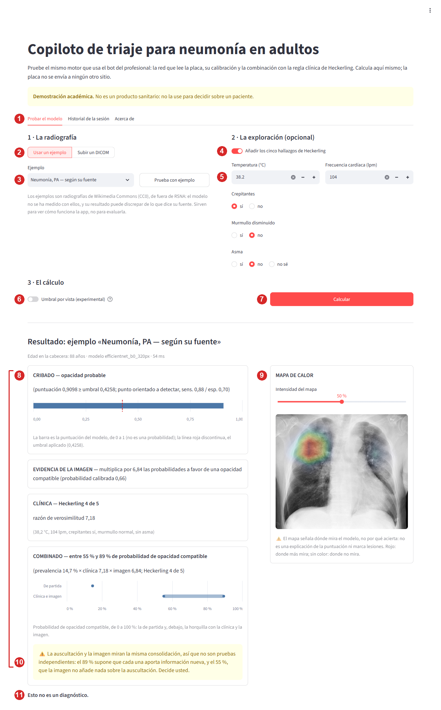

# Manual de usuario

**Proyecto:** Copiloto de triaje para neumonía en adultos · Proyecto Integrador, Maestría en Inteligencia Artificial (UEES), 2026.

> ## Esto no es un diagnóstico
>
> El copiloto es una **ayuda** para un profesional de la salud: calcula una probabilidad de que una radiografía de tórax muestre una **opacidad compatible** con neumonía y la combina con unos datos de la exploración. **No diagnostica, no sustituye el criterio clínico y no sirve para decidir sobre un paciente.** Es un prototipo académico: no es un producto sanitario, no tiene registro sanitario y nunca se ha usado con pacientes reales.
> **Si usted o alguien a su cargo tiene dificultad para respirar, dolor fuerte de pecho o se siente muy mal, acuda a urgencias ahora.**

Este manual explica, paso a paso y en lenguaje llano, cómo usar las dos formas de probar el sistema:

- la **aplicación de demostración** (una página web que se abre en su navegador), pensada para **evaluadores y para quien quiera probar el modelo** sin más requisitos; y
- los **dos bots de Telegram** —el del paciente y el del profesional—, que son el producto en sí.

## Contenido

1. [Antes de empezar](#1-antes-de-empezar)
2. [Parte A: la aplicación de demostración](#2-parte-a-la-aplicación-de-demostración)
3. [Parte B: los bots de Telegram](#3-parte-b-los-bots-de-telegram)
4. [Cómo leer un resultado: glosario](#4-cómo-leer-un-resultado-glosario)
5. [Qué dicen los bots y la aplicación cuando algo falla](#5-qué-dicen-los-bots-y-la-aplicación-cuando-algo-falla)
6. [Problemas comunes y soluciones](#6-problemas-comunes-y-soluciones)
7. [Preguntas frecuentes](#7-preguntas-frecuentes)
8. [Qué no hace el sistema](#8-qué-no-hace-el-sistema)
9. [Soporte y contacto](#9-soporte-y-contacto)

## 1. Antes de empezar

### 1.1. ¿Cuál es mi caso?

| Usted es… | Use… | Lea |
| :--- | :--- | :--- |
| **Evaluador** del proyecto, o quiere **probar** el modelo | La aplicación de demostración | [Parte A](#2-parte-a-la-aplicación-de-demostración) |
| **Profesional** de salud dado de alta por el equipo del proyecto | El bot del profesional | [Parte B, B.3](#b3-el-bot-del-profesional) |
| **Paciente** al que un profesional le pide responder un cuestionario | El bot del paciente | [Parte B, B.2](#b2-el-bot-del-paciente) |

Probar los bots exige una cuenta de Telegram y, para el del profesional, estar en una lista de personas autorizadas. **La aplicación de demostración no exige nada de eso**: es la forma de ver el mismo motor funcionando. Los bots se retiran del servidor después de la calificación del proyecto; la aplicación se puede ejecutar siempre desde el repositorio.

### 1.2. Cuatro cosas que conviene saber

1. **El sistema mide «opacidad», no «neumonía».** Una opacidad en la placa puede no ser una neumonía, y una neumonía puede no tener opacidad visible. Por eso todos los textos hablan de «opacidad compatible».
2. **Un resultado negativo no descarta nada.** En las pruebas el sistema dejó sin marcar una de cada ocho opacidades, y **una de cada tres en las placas hechas de pie (PA)**.
3. **Decide siempre el profesional.** El paciente nunca recibe el resultado.
4. **Solo para adultos de 18 a 100 años.** Con otra edad, o sin edad en la cabecera de la placa, el sistema se niega a opinar.

## 2. Parte A: la aplicación de demostración

### 2.1. Qué necesita

- **Docker** instalado (es la forma reproducible; hay una alternativa sin Docker en [§2.2](#22-cómo-ponerla-en-marcha)).
- El repositorio descargado y los **pesos del modelo** (16 MB), que **no viajan en el repositorio** y se descargan del *release*; se copian a `servidor/pesos_modelo_cpu.pt`. Su huella SHA-256 (para comprobar que son los correctos) está en [`ficha_modelo.md`](ficha_modelo.md) y en `models/README.md`.
- Unos 2,5 GB de disco para la imagen y 2 GB de memoria para el contenedor. La **primera construcción tarda unos minutos** (descarga PyTorch para CPU); después ya no necesita red.
- Un navegador. La página se diseñó con pantalla ancha de escritorio; **no se probó en móviles**.

### 2.2. Cómo ponerla en marcha

Desde la raíz del repositorio:

```bash
docker build -t copiloto-app -f app/Dockerfile .
docker run --rm -p 127.0.0.1:8501:8501 --memory=2g --memory-swap=2g copiloto-app
```

y abra **http://127.0.0.1:8501** en el navegador. Para detenerla, pulse `Ctrl+C` en la terminal donde la lanzó.

| Detalle | Por qué importa |
| :--- | :--- |
| **`127.0.0.1:` delante del puerto, siempre** | Sin él, Docker publica la página en todas las interfaces de su máquina, y la página no pide contraseña |
| **El límite de memoria** (`--memory=2g --memory-swap=2g`) | Es la red de seguridad: si algo se le escapara a las comprobaciones, lo que muere es el contenedor y no su máquina |
| **Lanzar la construcción desde la raíz** | Es su contexto de construcción |
| **La primera página que abra carga el modelo** | Unos segundos, con un indicador; después, cada cálculo tarda décimas de segundo |

**Sin Docker** (requiere Python y las dependencias): desde la raíz, `pip install -r app/requirements.txt` y `pip install --no-deps .`; después, **desde la carpeta `app/`** y declarando dos variables que no tienen valor por defecto:

```bash
cd app
AUC_VALIDACION=0.8827 PREVALENCIA_LOCAL=0.1466 streamlit run app.py
```

En PowerShell: `$env:AUC_VALIDACION = "0.8827"; $env:PREVALENCIA_LOCAL = "0.1466"; streamlit run app.py`. Hay que lanzarla **desde `app/`**: de otro modo se pierden en silencio los ajustes de la página (límite de subida de 5 MB, sin telemetría). Con Docker, la calibración usa una librería (scikit-learn) que en algunas máquinas Windows no carga; por eso Docker es lo recomendado.

> La aplicación **no guarda nada en disco**, no envía la radiografía a ningún sitio, no tiene telemetría y no llama a nadie al arrancar. Calcula en el mismo proceso en que se ejecuta.

### 2.3. Un recorrido de dos minutos

1. Abra la página. Verá un aviso amarillo, «**Demostración académica**. No es un producto sanitario: no la use para decidir sobre un paciente», y tres pestañas: «Probar el modelo», «Historial de la sesión» y «Acerca de».
2. En «Probar el modelo», deje elegida **«Usar un ejemplo»** y, en la lista, el ejemplo **«Neumonía, PA — según su fuente»**.
3. Pulse **«Prueba con ejemplo»** (o «Calcular»). Aparece un indicador «Calculando…» y, debajo, el resultado en bloques y el mapa de calor sobre la placa.
4. Pruebe ahora con los cinco hallazgos (§2.5, paso 2) y compare.
5. Mire la pestaña «Acerca de»: dice qué hace el sistema, cómo está hecho, con qué datos, qué métricas tiene por grupos y qué limitaciones.

### 2.4. La pantalla «Probar el modelo», por zonas

La captura es de un cálculo con el ejemplo «Neumonía, PA» y los cinco hallazgos rellenos. Los números de la leyenda están dibujados sobre la imagen.



| N.º | Zona | Para qué sirve |
| :-: | :--- | :--- |
| **1** | Las tres pestañas | «Probar el modelo» (esta pantalla), «Historial de la sesión» y «Acerca de» |
| **2** | **1 · La radiografía**: el selector «Usar un ejemplo» / «Subir un DICOM» | Elegir de dónde sale la placa |
| **3** | La lista de ejemplos y el botón **«Prueba con ejemplo»** | Elegir uno de los cuatro ejemplos y calcularlo. El aviso de debajo recuerda que son de otra fuente |
| **4** | **2 · La exploración (opcional)**: el interruptor «Añadir los cinco hallazgos de Heckerling» | Sin él, el resultado es solo la evidencia de la imagen |
| **5** | Los cinco campos: temperatura, frecuencia cardíaca, crepitantes, murmullo disminuido y asma | Los datos de la regla clínica |
| **6** | **3 · El cálculo**: el interruptor «Umbral por vista (experimental)» | Apagado por defecto (§2.5, paso 4) |
| **7** | El botón **«Calcular»** | Ejecuta el cálculo con lo que haya elegido |
| **8** | Los bloques de resultado: **CRIBADO**, **EVIDENCIA DE LA IMAGEN**, **CLÍNICA** y **COMBINADO** | Qué dice la imagen, qué dice la clínica y las dos juntas (§2.6) |
| **9** | El **mapa de calor** y su deslizador «Intensidad del mapa» | Dónde mira el modelo en la placa (§2.7) |
| **10** | El **aviso amarillo** dentro de «COMBINADO» | Por qué la cifra combinada es orientativa |
| **11** | **«Esto no es un diagnóstico.»** | Siempre, al final de todo resultado |

### 2.5. Paso a paso

**Paso 1. Elegir la radiografía.**

- *Con un ejemplo:* deje «Usar un ejemplo», elija uno de la lista y pulse «Prueba con ejemplo» o «Calcular». Los cuatro ejemplos están descritos en [§2.8](#28-los-cuatro-ejemplos).
- *Con su propio DICOM:* elija **«Subir un DICOM»** y suba un fichero de **hasta 5 MB**. Tiene que ser un **DICOM de una radiografía de tórax de un adulto**; una foto o un JPEG no sirven (no llevan la edad ni los datos que el modelo necesita). La página dice «Se lee aquí mismo y no se envía a ningún otro sitio; la app no la guarda en disco».

**Paso 2. Añadir la exploración (opcional).** Active **«Añadir los cinco hallazgos de Heckerling»** y rellene **todos** los campos; no se calcula con unos pocos:

| Campo | Qué poner | Límites de la página |
| :--- | :--- | :--- |
| Temperatura (°C) | La medida, con un decimal | De 30,0 a 45,0 |
| Frecuencia cardíaca (lpm) | Latidos por minuto | De 20 a 250 |
| Crepitantes | Sí o no | — |
| Murmullo disminuido | Sí o no | — |
| Asma | Sí, no o **no sé** | — |

Los límites solo impiden un error de tecleo (un 380 °C); no son rangos clínicos. La regla da **un punto** por cada uno de estos hallazgos: temperatura **mayor que** 37,8 °C, pulso **mayor que** 100 lpm, crepitantes, murmullo disminuido y **no** tener asma. Los cortes son estrictos: 37,8 °C exactos y 100 lpm exactos **no** puntúan. La página usa el valor tal como se ve en el campo, con un decimal. Si no sabe si tiene asma, elija «no sé»: el sistema calcula las dos puntuaciones posibles y da un rango. Si deja el interruptor apagado, el resultado es solo la evidencia de la imagen y la página lo dice («SIN COMBINAR — faltan signos de la exploración…»).

**Paso 3. Pulsar «Calcular»** (o «Prueba con ejemplo»). Mientras trabaja verá «Calculando…». Si falta algún dato, la página se lo dice sin calcular: «Faltan hallazgos: la temperatura, …. Complete los cinco, o quite los hallazgos para calcular solo con la imagen».

**Paso 4. Probar el «Umbral por vista (experimental)».** Está **apagado**. Encendido, una placa **PA** (de pie) se clasifica con el umbral 0,1798 y una **AP** (portátil) con el 0,5815, en lugar del único 0,4258. Solo cambia la **etiqueta del cribado**: la razón de verosimilitud y la combinación no dependen de la vista. Mejora el recall de las placas PA (de 0,69 a 0,89) a cambio de menos especificidad (de 0,70 a 0,62 en total); la tabla completa está en «Acerca de». Si la etiqueta cambia, el bloque CRIBADO dice «Con el umbral global (0,4258) sería …». **No lo encienda para tomar decisiones**: es experimental.

**Paso 5. Leer el resultado.** Véase [§2.6](#26-cómo-leer-el-resultado).

**Paso 6. Cambiar la entrada.** Si cambia la placa, un hallazgo o el interruptor, la página avisa: «La entrada ha cambiado: pulse «Calcular» para ver su resultado.» Un resultado solo se muestra junto a la entrada que lo produjo.

### 2.6. Cómo leer el resultado

El resultado tiene los mismos bloques que el informe del bot. Se explican con el ejemplo de la captura (ejemplo «Neumonía, PA» con 38,2 °C, 104 lpm, crepitantes sí, murmullo no, sin asma):

| Bloque | Qué dice (en la captura) | Cómo se lee |
| :--- | :--- | :--- |
| *Encabezado* | «Edad en la cabecera: 88 años · modelo efficientnet_b0_320px · 54 ms» | La edad que el modelo leyó en el DICOM, el modelo y lo que tardó |
| **CRIBADO** | «opacidad probable (puntuación 0,9098 ≥ umbral 0,4258; punto orientado a detectar, sens. 0,88 / esp. 0,70)» | La **puntuación** del modelo (de 0 a 1; **no es una probabilidad**) frente al **umbral**. La barra azul es la puntuación; la línea roja discontinua, el umbral. «Orientado a detectar» significa que el punto prioriza no dejar pasar opacidades, a costa de falsas alarmas |
| **EVIDENCIA DE LA IMAGEN** | «multiplica por 6,84 las probabilidades a favor de una opacidad compatible (probabilidad calibrada 0,66)» | La **razón de verosimilitud (RV)**: cuánto mueve la imagen las probabilidades a favor. Una RV mayor que 1 *suma*; menor que 1 *resta*. Entre 0,5 y 2, la página avisa de que la imagen **apenas mueve** la probabilidad |
| **CLÍNICA** | «Heckerling 4 de 5; razón de verosimilitud 7,18; (38,2 °C, 104 lpm, crepitantes sí, murmullo normal, sin asma)» | La puntuación de la regla (0 a 5) y su RV |
| **COMBINADO** | «entre 55 % y 89 % de probabilidad de opacidad compatible (prevalencia 14,7 % × clínica 7,18 × imagen 6,84; Heckerling 4 de 5)» | La **horquilla**: el extremo alto supone que clínica e imagen aportan información independiente; el bajo, que la más informativa absorbe a la otra. La probabilidad de partida (14,7 %) está dibujada como un punto, y la horquilla, como una barra |
| *Aviso amarillo* | «La auscultación y la imagen miran la misma consolidación, así que no son pruebas independientes: el 89 % supone que cada una aporta información nueva, y el 55 %, que la imagen no añade nada sobre la auscultación. Decide usted.» | Dice a qué supuesto corresponde cada extremo. **La cifra es orientativa** |

**Cuatro reglas para no leer de más:**

- **Si dos evidencias se contradicen** (la imagen a favor y la clínica en contra, o al revés), el sistema da **un número** en lugar de una horquilla y lo dice: «La clínica y la imagen apuntan en sentidos opuestos…».
- **Nunca se muestra 0 % ni 100 %**: se escribe «menos de 1 %» y «más de 99 %».
- **Si el cribado marca la placa pero la RV es menor que 1**, la página avisa: «El cribado marca esta placa por estar orientado a detectar, pero la imagen en sí no apoya el diagnóstico. Decide la clínica.» Es el comportamiento habitual de una de cada diez placas de prueba, no un fallo.
- **En todo resultado negativo** (sin opacidad probable) aparece: «El modelo mide opacidad en la placa, no neumonía. Un resultado negativo no la descarta. Decide usted.»

### 2.7. El mapa de calor

A la derecha del resultado, la placa aparece con colores superpuestos (de azul a rojo). **Rojo: donde más mira el modelo; sin color: donde no mira.** El deslizador **«Intensidad del mapa»** (de 0 a 100 %) mezcla el color con la placa. Junto al mapa hay un aviso que hay que leer: «El mapa señala dónde mira el modelo, **no por qué acierta**: no es una explicación de la puntuación ni marca lesiones.» Un mapa que cae fuera de los pulmones no significa que el resultado sea falso, ni uno que cae sobre ellos que sea cierto. Si el mapa vale cero en toda la placa, la página lo dice. Si no se pudo calcular, el resultado no depende de él. El mapa **solo está en la aplicación**, no en el bot.

### 2.8. Los cuatro ejemplos

| Ejemplo | Qué es | Qué esperar |
| :--- | :--- | :--- |
| **Normal, PA — según su fuente** | Radiografía de una mujer de 21 años, en proyección PA | Para ver la página con una placa que su fuente declara normal. **Con estos pesos, el cribado la marca**, y la página avisa de que la imagen no apoya ese resultado |
| **Neumonía, PA — según su fuente** | Varón de 88 años, PA, con consolidación en parches | Es el de la captura |
| **Neumonía, AP — según su fuente** | Mujer de 76 años, placa AP (portátil), con infiltrados neumónicos según su fuente | Para ver una placa de la otra vista, y probar el umbral por vista |
| **Rechazado: menor de edad (edad inventada)** | La placa normal con una edad de 15 años, **inventada** | Para ver cómo el sistema **se niega** a evaluar lo que no puede ([§5](#5-qué-dicen-los-bots-y-la-aplicación-cuando-algo-falla)) |

**Los ejemplos no son de RSNA ni del NIH**: son tres radiografías de Wikimedia Commons con licencia CC0 (sus fuentes, autor y licencia están en `app/assets/LICENCIAS.md` y en un desplegable de «Acerca de»). El modelo **no se ha medido con ellas**: su resultado puede discrepar de lo que dice su fuente y **no dice nada del rendimiento del modelo**. Sirven para ver cómo funciona la página, no para evaluarla.

### 2.9. El historial de la sesión

La pestaña **«Historial de la sesión»** lista los cálculos que ha hecho desde que abrió la página: número, origen («ejemplo: …» o «fichero subido»), si el umbral por vista estaba encendido, la puntuación, el umbral, la probabilidad calibrada, la RV de la imagen, los hallazgos que tecleó, la puntuación de Heckerling, su RV, la prevalencia de partida y los extremos de la horquilla.

El botón **«Descargar el historial (CSV)»** guarda el fichero `historial_de_la_sesion.csv`, que sirve para **comparar varias predicciones**. Lleva **solo lo de esta sesión del navegador, sin la imagen**: ni el nombre del fichero que subió, ni nada de su cabecera DICOM (que en una placa real puede traer nombre o fechas), ni la edad. Si recarga la página, el historial se pierde.

### 2.10. La pestaña «Acerca de»

Es la documentación dentro de la aplicación. Tiene, en este orden:

| Sección | Qué encontrará |
| :--- | :--- |
| **Qué hace y qué no** | Qué lee y qué entrega; que no diagnostica, no localiza lesiones y no sustituye el juicio clínico |
| **El modelo** | La red (EfficientNet-B0, 320 × 320 px), el cribado y su umbral, la calibración y las cotas de la RV, el AUC de validación, la regla de Heckerling con su tabla de RV, la combinación, el mapa de calor y los valores del despliegue (`UMBRAL`, `AUC_VALIDACION`, `PREVALENCIA_LOCAL`) |
| **Los datos** | El conjunto RSNA, con sus referencias; el repositorio **no lleva ninguna de esas imágenes** |
| **Las métricas** | AUC, sensibilidad y especificidad globales y **por 13 subgrupos** (sexo, edad, vista y sus cruces), con intervalos al 95 %. Un aviso verde confirma que son de **estos mismos pesos** (su huella coincide) |
| **Las limitaciones** | Opacidad no es neumonía; datos de Estados Unidos; sesgo por vista y por edad; validación semisintética; ejemplos no medidos |
| **El umbral por vista y su precio** | Lo que gana y pierde cada vista |
| **Los ejemplos** | Aviso y licencias |
| **Aviso** | «No es un producto sanitario…» |

## 3. Parte B: los bots de Telegram

### B.1. Quién puede usarlos

| Bot | Quién | Cómo se accede |
| :--- | :--- | :--- |
| **Paciente** | Cualquier persona a la que un profesional se lo pida | Se abre el bot en Telegram y se escribe cualquier mensaje |
| **Profesional** | Solo personas **dadas de alta** por el equipo del proyecto | Se comprueba en **cada** mensaje; quien no esté en la lista recibe «No autorizado.» y nada más |

Son dos bots distintos **a propósito**: el del paciente no tiene ningún camino que devuelva un resultado. Para pedir el alta como profesional, vea [§9](#9-soporte-y-contacto).

### B.2. El bot del paciente

**Para quién:** un adulto al que su profesional de salud le ha pedido contestar unas preguntas antes de la consulta. Son siete preguntas, y no necesita dar su nombre ni su teléfono.

1. **Escriba cualquier mensaje** al bot. Le responde con una explicación y dos botones, **Acepto** y **No acepto**.
2. **Lea el consentimiento.** Dice, en pocas palabras, que sus respuestas **pasan por Telegram** (una empresa extranjera que las guarda en sus servidores); que el bot **no guarda su nombre ni su teléfono**; que se **borran a los 7 días**, salvo que su médico use el código, en cuyo caso **una copia sin su cuenta se guarda hasta que termine el proyecto académico** (como muy tarde, el 31 de diciembre de 2026); quién las ve (su médico y el equipo del proyecto); que **un programa de inteligencia artificial** analiza la radiografía y calcula una probabilidad, que es una **ayuda para su médico y no un diagnóstico**, y que usted puede pedirle que le explique el resultado; y que si quiere que se borren antes, se lo diga a su médico. **Si le cuesta respirar, le duele mucho el pecho o se siente muy mal, acuda a urgencias ahora.**
3. **Pulse «No acepto»** y el bot se despide diciendo «No he guardado nada». No queda **ninguna** fila de datos. O pulse **«Acepto»** para seguir.
4. **Conteste las 7 preguntas**, una por mensaje y con botones:

| # | Pregunta | Botones |
| :-: | :--- | :--- |
| 1 | ¿Ha sentido fiebre estos días? | Sí · No · No lo sé |
| 2 | ¿Tiene tos? | Sí, con flema · Sí, seca · No tengo tos |
| 3 | ¿Desde hace cuánto se siente así? | Menos de 3 días · Entre 3 y 7 días · Más de 7 días |
| 4 | ¿Le falta el aire? | Sí · No |
| 5 | ¿Le duele el pecho al respirar? | Sí · No |
| 6 | ¿Tiene asma diagnosticada por un médico? | Sí · No · No lo sé |
| 7 | ¿Algo más que quiera contarle a su médico? | **Omitir**, o escribir un mensaje (hasta 500 caracteres) |

5. **Reciba su código.** Al terminar, el bot le da un **código de 6 letras y números** y la fecha en que caduca (a los 7 días): «Enséñeselo a su médico junto con su radiografía». Es **seudónimo**: no lleva su nombre. Se dicta en voz alta, por eso no usa `0`, `O`, `1`, `I` ni `L`.

**Qué más debe saber:**

- Un mensaje que no sea uno de los botones esperados (salvo en la pregunta 7) hace que el bot **repita la pregunta**. `/reiniciar` borra lo contestado y vuelve a empezar.
- Puede completar **hasta 5 cuestionarios al día**. Si lo supera, el bot lo dice: «Ya ha completado 5 cuestionarios hoy, que es el máximo».
- Si el bot dice «No he podido generar su código. Ha sido un fallo mío, no suyo», sus siete respuestas siguen guardadas: escríbale cualquier cosa y lo intenta otra vez.
- **El bot no le da ningún resultado ni consejo médico.** Solo recoge sus respuestas y le da el código.
- El texto de la pregunta 7 llega a su médico **tal como lo escribió**, en un mensaje aparte.

### B.3. El bot del profesional

**Para quién:** profesionales de salud dados de alta. **Qué necesita:** el código del paciente, la temperatura y el pulso, la auscultación (crepitantes y murmullo) y la **radiografía en DICOM** como archivo.

| Paso | Qué le pide el bot | Cómo contestar |
| :-: | :--- | :--- |
| 1 | «Envíeme el código de 6 caracteres que le dio el paciente.» | Escriba el código. Si no existe o caducó: «Ese código no existe o caducó. Pida al paciente que repita el cuestionario.» |
| — | *Le muestra lo que el paciente refirió* | Léalo: fiebre, tos, días, falta de aire, dolor y asma (con «asma: no sabe» si no lo supo) |
| 2 | «Temperatura en grados centígrados, entre 30,0 y 45,0. Por ejemplo 38,2.» | Un número; vale coma o punto |
| 3 | «Frecuencia cardiaca en latidos por minuto: un entero entre 20 y 250.» | Un número entero |
| 4 | «¿Se auscultan crepitantes?» | Botones Sí / No |
| 5 | «¿Hay murmullo vesicular disminuido?» | Botones Sí / No |
| 6 | «Envíeme la radiografía COMO ARCHIVO (el clip, opción Archivo), no como foto.» | Adjunte el **DICOM** con el clip, opción **Archivo** |

**La radiografía, como archivo.** Telegram **recomprime las fotos**: destruye el DICOM y, con él, la edad de la cabecera, que el modelo necesita. Si envía una foto, el bot lo explica y **sigue esperando el archivo**. Tampoco puede pasar de 5 MB (una placa de RSNA ronda los 131 KB); Telegram no deja a un bot descargar más de 20 MB.

**Si se equivoca de dato**, el bot lo dice y **vuelve a preguntar** (por ejemplo, una temperatura fuera de 30,0–45,0). `/reiniciar` borra la conversación y vuelve al código; `/start` a mitad de conversación **no** borra lo ya recogido.

**Después de la placa**, el bot tarda unos segundos y responde con **el informe** (B.4). Si el paciente escribió un comentario libre, llega en un **mensaje aparte** que lo avisa, para que nunca se confunda con lo que dice el sistema.

### B.4. El informe del bot, bloque a bloque

Es el mismo que el de la aplicación, en texto plano. Ejemplo literal (placa de un conjunto público y síntomas inventados):

```
CRIBADO — opacidad probable
(puntuación 0,9802 ≥ umbral 0,4258; punto orientado a detectar, sens. 0,88 / esp. 0,70)

EVIDENCIA DE LA IMAGEN — multiplica por 30,3 las probabilidades a favor de una opacidad compatible (probabilidad calibrada 0,90)

REFERIDO POR EL PACIENTE — fiebre sí, tos con flema, 3 a 7 días, sin falta de aire, dolor torácico al respirar, asma: no sabe
EXPLORADO — 38,2 °C, 104 lpm, crepitantes sí, murmullo normal

COMBINADO — entre 84 % y 97 % de probabilidad de opacidad compatible
(prevalencia 14,7 % × clínica 1,64–7,18 × imagen 30,3; Heckerling 3 o 4 de 5, según tenga asma o no)
⚠️ La auscultación y la imagen miran la misma consolidación, así que no son pruebas independientes: el 97 % supone que cada una aporta información nueva, y el 84 %, que la auscultación no añade nada sobre la imagen. Decide usted.

Esto no es un diagnóstico.
```

| Bloque | Qué es | Cómo leerlo |
| :--- | :--- | :--- |
| **CRIBADO** | La etiqueta: «opacidad probable» o «sin opacidad probable» | Un punto de corte **orientado a detectar**: marca de más para no dejar pasar. La puntuación entre paréntesis **no es una probabilidad** |
| **EVIDENCIA DE LA IMAGEN** | Cuánto multiplica o reduce la imagen las probabilidades a favor | «Multiplica por 30,3» es una evidencia fuerte a favor; «reduce a 0,02×», fuerte en contra; cerca de 1, la imagen no aporta |
| **REFERIDO POR EL PACIENTE** | Las respuestas del cuestionario | Siempre los seis datos, en el mismo orden; un síntoma que falta **no** significa que no lo tenga |
| **EXPLORADO** | Lo que usted tecleó | Compruebe que es lo que quería decir |
| **COMBINADO** | La probabilidad de opacidad compatible, con sus tres factores a la vista | Una **horquilla** si clínica e imagen apuntan al mismo lado; un **número** con un aviso si se contradicen; «SIN COMBINAR» si faltan signos. «Heckerling 3 o 4 de 5, según tenga asma o no» significa que el asma no se sabe y se dan las dos puntuaciones |
| **El descargo** | «Esto no es un diagnóstico.» | Siempre |

Las probabilidades se dan en porcentaje entero: más decimales serían una precisión que el sistema no tiene. Los tres factores (prevalencia, clínica, imagen) se imprimen para que usted pueda **rehacer la multiplicación** y, si no está de acuerdo con la prevalencia, ver cuál cambiar.

### B.5. Guía de bolsillo para el profesional

Lo que hay que tener presente cada vez que lee un informe:

1. **Mide opacidad, no neumonía.** Y un negativo **no descarta**.
2. **Mire la vista de la placa.** Con el umbral único, el sistema deja sin marcar el **31 %** de las opacidades en placas **PA** (recall 0,69) y el **36 %** en las PA de **60 años o más** (recall 0,64); en las **AP** (portátiles) casi no se le escapa ninguna (recall 0,94), pero marca de más (especificidad 0,39). Fuente: pestaña «Acerca de» y [`ficha_modelo.md`](ficha_modelo.md).
3. **Si el aviso dice que el cribado y la imagen discrepan**, no es raro: ocurre en una de cada diez placas. Decide la clínica.
4. **La cifra combinada es orientativa.** Clínica e imagen miran la misma consolidación; en las pruebas, la independencia exagera.
5. **No se fíe de un resultado solo porque suene rotundo.** En la sesión de validación con un médico, ver el mensaje cambió su categoría en 12 de 20 casos: **el sistema influye**, y eso solo es bueno si acierta.
6. **Anote el código de cada consulta en la historia clínica.** Es la forma de que la institución localice las consultas de un periodo si hubiera que revisarlas.
7. **Una placa fuera de alcance no da resultado**: menores de 18, sin edad, de 16 bits, invertidas, en color… El bot lo dice y no da ninguna cifra.
8. **La placa que usted envía pasa por los servidores de Telegram**, con su cabecera DICOM. Si sale de un sistema hospitalario real, puede traer nombre y número de historia: **expórtela sin identificadores**.

## 4. Cómo leer un resultado: glosario

| Término | Qué significa |
| :--- | :--- |
| **Opacidad compatible** | Una zona más blanca de lo normal en la placa que puede ser una neumonía, pero también otra cosa. Es lo que mide el modelo |
| **Puntuación (cruda)** | La salida de la red, de 0 a 1. **No es una probabilidad**: la red se entrenó dando más peso a los positivos, y la puntuación está desplazada hacia arriba |
| **Umbral** | El punto de corte (0,4258) por encima del cual el cribado dice «opacidad probable». Prioriza detectar |
| **Probabilidad calibrada** | La puntuación corregida para que se parezca a una probabilidad, con la prevalencia del conjunto de datos del modelo (22,15 %), que no es la de su consulta |
| **Razón de verosimilitud (RV)** | Cuánto cambia una prueba las probabilidades a favor de la opacidad. RV 1: no cambia nada; RV 10: las multiplica por diez; RV 0,1: las reduce a la décima parte. Acotada entre 0,0163 y 77,32 para que una placa no anule la clínica ni dé certeza |
| **Regla de Heckerling** | Cinco hallazgos que suman 0 a 5 puntos: temperatura > 37,8 °C, pulso > 100 lpm, crepitantes, murmullo disminuido y **no** tener asma. Cada puntuación tiene su RV |
| **Prevalencia de partida** | La probabilidad con la que se empieza antes de mirar nada: 14,66 % (la de la cohorte de la regla). Es un parámetro del despliegue, no un dato de su consulta |
| **Horquilla** | El rango entre dos supuestos: que clínica e imagen aportan información independiente (extremo alto) y que la más informativa absorbe a la otra (extremo bajo) |
| **Vista PA / AP** | PA: la placa se hace con el paciente **de pie**. AP: portátil, a menudo a quien no puede levantarse. Las AP son más a menudo de pacientes más graves, y el modelo rinde distinto en cada una |
| **Sensibilidad (recall)** | De las placas con opacidad, cuántas marca el modelo |
| **Especificidad** | De las placas sin opacidad, cuántas deja sin marcar |
| **Mapa de calor (Grad-CAM)** | Dónde mira el modelo. No explica por qué |

## 5. Qué dicen los bots y la aplicación cuando algo falla

El sistema **nunca da una cifra de probabilidad cuando algo falla**, y le dice qué hacer. Los textos son los literales de la aplicación y de los bots.

### 5.1. Placas y datos que el sistema no evalúa

| Situación | Qué dice | Qué hacer |
| :--- | :--- | :--- |
| Paciente **fuera de 18–100 años** | «NO PROCEDE — fuera del alcance del modelo. El paciente tiene 15 años y el modelo solo es válido entre 18 y 100. No hay resultado que dar: el modelo se validó entre 18 y 100 años, y aplicarlo fuera de ahí no significaría nada. Decida clínicamente.» | Nada con el sistema: es una decisión clínica del sistema, no un fallo. En el bot, la consulta termina |
| **Sin edad** en la cabecera | «NO PROCEDE — no se puede saber la edad.» y el mismo cierre | Compruebe la edad en la cabecera del estudio; no se asume adulto |
| **No es un DICOM legible** | «No pude leer esa radiografía.» (en la app, con: «Compruebe que es el DICOM de la placa y que está completo (una foto o un JPEG no sirven), o pruebe con un ejemplo.») | Reenvíe el DICOM completo. En el bot: «Sigo esperando el archivo.» |
| **Comprimido entero («Deflated»)** | «Este fichero viene comprimido entero (…), y la app no lo descomprime… Así que no se calcula nada.» | Expórtelo sin comprimir |
| **No es de 8 bits** (p. ej. 16) | «Esta placa es de 16 bits: los visores la enseñan bien, pero el modelo se entrenó con placas de 8 bits… la vería saturada, casi blanca. Así que no se calcula nada.» | Expórtela en 8 bits |
| **Escala de grises invertida** (`MONOCHROME1`) | «Esta placa guarda la escala de grises invertida… la vería al revés…» | Expórtela con la escala de grises normal (`MONOCHROME2`) |
| **En color** | «Esta placa no está en escala de grises…» | Expórtela en escala de grises |
| **Más de 5 000 píxeles de lado** | «Esta placa declara … píxeles, y la app no lee placas de más de 5 000 de lado…» | Expórtela más pequeña |
| **Varias imágenes en el fichero** | «Este fichero trae … imágenes, y la app evalúa una placa sola.» | Exporte solo la placa de tórax |
| **Más de 5 MB** | «El archivo supera los 5 MB.» | Pruebe con un DICOM más pequeño |
| **Hallazgos inválidos** | «Los hallazgos de la exploración no son válidos. Revíselos, o quite los hallazgos para calcular solo con la imagen.» | Corrija los cinco campos |
| **Fallo inesperado** | «No pude leer esa radiografía. No pude interpretar el contenido del fichero. Si lo recortó al enviarlo, vuelva a exportarlo completo, o pruebe con un ejemplo.» | Pruebe con un ejemplo; si el ejemplo falla, es del servicio, no de su fichero |

### 5.2. Mensajes propios del bot del profesional

| Situación | Qué dice el bot | Qué hacer |
| :--- | :--- | :--- |
| No está en la lista | «No autorizado.» | Pida el alta (§9) |
| La placa llega como **foto** | «Telegram recomprime las fotos y destruye el DICOM. Envíela como archivo.» | Reenvíela con el clip, opción **Archivo** |
| Código inexistente o caducado | «Ese código no existe o caducó. Pida al paciente que repita el cuestionario.» | El código caduca a los 7 días |
| Archivo > 20 MB | «Telegram no me deja descargar archivos de más de 20 MB.» | Una placa de tórax no debería pesar eso |
| Fallo al descargar | «No pude descargar el archivo de Telegram. Puede ser el archivo o el servicio. Si vuelve a pasar con otra placa, avise al responsable.» | Reintente; si persiste con otra placa, avise |
| El servicio no responde | «El servicio de imagen no está disponible. Inténtelo en unos minutos.» | Espere y reenvíe la placa |
| Error no reconocido | «El servicio devolvió un error que no sé interpretar. Se ha registrado.» | La consulta termina; avise al responsable |

**Cuando el bot sigue esperando**, lo dice al final del mensaje («Sigo esperando el archivo.» o «Sigo esperando el código del paciente.»): no hay que empezar de cero.

## 6. Problemas comunes y soluciones

### 6.1. La aplicación de demostración

| Síntoma | Causa probable | Solución |
| :--- | :--- | :--- |
| La construcción de Docker se detiene en un `COPY` | Faltan los pesos en `servidor/pesos_modelo_cpu.pt` | Descárguelos del *release* del repositorio y compruebe su huella (`ficha_modelo.md`) |
| «No se pudo cargar el modelo: No estan los pesos en… Revise RUTA_PESOS y RUTA_CALIBRADOR; los pesos no se versionan.» | La aplicación (sin Docker) no encuentra los pesos | Copie los pesos a `servidor/pesos_modelo_cpu.pt` o apunte `RUTA_PESOS` |
| «Falta la variable de entorno AUC_VALIDACION…» o «…PREVALENCIA_LOCAL…» | Se lanzó sin Docker sin declarar las dos variables | Declárelas con los valores de `servidor/docker-compose.yml` (0.8827 y 0.1466), como en §2.2 |
| La página no abre en el navegador | El puerto 8501 está ocupado, o se lanzó sin `-p` | Use otro puerto del lado izquierdo, `-p 127.0.0.1:8502:8501`, y abra `http://127.0.0.1:8502` |
| La página tarda al abrirse la primera vez | Carga el modelo (unos segundos) | Espere el indicador «Cargando el modelo…» |
| El contenedor se cierra solo | Se quedó sin memoria | Verifique que lo lanzó con 2 GB y que Docker tiene memoria suficiente |
| «Suba un fichero DICOM, o elija «Usar un ejemplo».» | Pulsó «Calcular» sin placa | Elija un ejemplo o suba un DICOM |
| «La entrada ha cambiado: pulse «Calcular»…» | Cambió algo después del último cálculo | Pulse «Calcular» |
| Un aviso rojo con «NO PROCEDE» o «No pude leer esa radiografía» | La placa no se puede evaluar | Vea §5.1 |
| Un aviso amarillo en «Acerca de»: «Las métricas… se calcularon con otros pesos» | Los pesos cargados no son los medidos | Use los pesos del *release* |
| «El mapa vale cero en toda la placa» | No hay nada que señalar | No es un error |
| La página «falló por un error que no sé interpretar» | Un error inesperado, ya registrado | Recargue la página |

### 6.2. Los bots

| Síntoma | Causa probable | Solución |
| :--- | :--- | :--- |
| El bot del profesional dice «No autorizado.» | No está en la lista | Pida el alta (§9) |
| El bot no responde | Servicio retirado o desactivado | Pruebe con la aplicación; avise al responsable |
| El bot repite la pregunta | La respuesta no es una de las esperadas | Use los botones; en la 7, escriba o pulse «Omitir» |
| «Ya ha completado 5 cuestionarios hoy» | Límite diario | Vuelva mañana |
| El bot se queda «esperando el archivo» | La placa llegó como foto, ilegible o demasiado grande | Envíela como archivo, completa, de hasta 5 MB |
| El código no sirve | Caducó (7 días) o se escribió mal (no usa `0`, `O`, `1`, `I`, `L`) | Que el paciente repita el cuestionario |
| El informe sale sin bloque COMBINADO | Faltan signos, o el sistema no pudo combinar | Lea el motivo en «SIN COMBINAR» |

## 7. Preguntas frecuentes

**1. ¿El sistema diagnostica neumonía?** No. Estima si hay una opacidad compatible en la placa y la combina con unos datos clínicos. «Esto no es un diagnóstico.»

**2. ¿Puedo usarlo con un paciente real?** No. Es un prototipo sin validación local, sin registro sanitario y sin evaluación de impacto de protección de datos. Los pasos que faltan están en [`consideraciones_eticas.md`](consideraciones_eticas.md#17-lo-que-falta-antes-de-cualquier-uso-clínico).

**3. ¿Por qué un ejemplo «normal» sale marcado?** Porque el modelo se entrenó y se evaluó con RSNA y **no se ha medido con los ejemplos**, que son de otra fuente. Sirven para ver la página, no para valorar el modelo. La propia página avisa cuando la imagen no apoya la etiqueta.

**4. ¿Por qué no dice «neumonía» sino «opacidad compatible»?** Porque lo que se entrenó es la detección de opacidades anotadas por radiólogos; hay opacidades que no son neumonía y neumonías sin opacidad visible.

**5. ¿Qué diferencia hay entre el CRIBADO y la EVIDENCIA?** El cribado compara la puntuación con un umbral **orientado a detectar**; la evidencia es la razón de verosimilitud, que sale de otra escala. Pueden contradecirse (ocurre en una de cada diez placas), y por eso nunca van en el mismo renglón.

**6. ¿Por qué da un rango («entre 55 % y 89 %») y no un número?** Porque combinar clínica e imagen supone que son independientes, y no lo son del todo: miran la misma consolidación. El rango dice entre qué supuestos está la respuesta. Si las evidencias se contradicen, da un número y lo dice.

**7. ¿Y si no sé si el paciente tiene asma?** Elija «no sé»: el sistema calcula las dos puntuaciones posibles y da un rango; su ancho dice si esa pregunta importa en ese caso.

**8. ¿Debo encender el «Umbral por vista»?** Es experimental y está apagado por defecto. Sube el recall de las placas PA (de 0,69 a 0,89) pero baja la especificidad global (de 0,70 a 0,62). Es una decisión de la institución, con la tabla de «Acerca de» delante.

**9. ¿Se guardan mis datos en la aplicación?** No se guarda nada en disco. El historial vive en su navegador, sin imagen, y se pierde al recargar.

**10. ¿Y en los bots?** Se guardan las respuestas del cuestionario con un código seudónimo, no la radiografía. Los detalles —qué se guarda, cuánto y quién lo ve— están en el consentimiento y en [`arquitectura.md`](arquitectura.md#6-qué-se-guarda-y-qué-no). Los datos **pasan por Telegram**.

**11. ¿Cuánto tarda?** El modelo, décimas de segundo (una mediana de 143 ms en el servidor, con todo incluido). El tiempo total que usted espera en el bot depende además de Telegram, que no se midió. La primera vez que se abre la aplicación, además, carga el modelo.

**12. ¿Puede el paciente ver el resultado?** No: el bot del paciente no tiene ningún camino que lo devuelva.

**13. ¿Puedo cambiar la probabilidad de partida?** Es un parámetro del despliegue (`PREVALENCIA_LOCAL`, 0,1466 por defecto, la de la cohorte de la regla). En la aplicación con Docker se cambia al lanzarla (`-e PREVALENCIA_LOCAL=…`); en un uso real debería ser la de su servicio.

**14. ¿Qué hago si el resultado contradice mi criterio clínico?** Decida usted: el sistema lo dice en cada informe, y los avisos existen para eso.

**15. ¿Funciona en el móvil?** La página está diseñada para pantalla ancha y no se probó en móviles. El bot funciona en cualquier cliente de Telegram.

**16. ¿Por qué el bot pide el archivo y no una foto?** Porque Telegram recomprime las fotos y destruye el DICOM, con la edad de su cabecera.

## 8. Qué no hace el sistema

- **No diagnostica**, no localiza lesiones y no sustituye la lectura de la placa por un radiólogo.
- **No evalúa** menores de 18 años, radiografías laterales, ni placas que no sean de 8 bits en grises normal.
- **No da resultado al paciente** ni le aconseja.
- **No sabe nada de su centro**: no está validado con equipos ni poblaciones distintos de los de su entrenamiento (conjunto público de Estados Unidos).
- **No sustituye el consentimiento ni la evaluación de impacto** que exigiría un uso real.
- **No es un producto sanitario.**

El análisis completo de sus riesgos está en [`consideraciones_eticas.md`](consideraciones_eticas.md) y el del modelo, en [`ficha_modelo.md`](ficha_modelo.md).

## 9. Soporte y contacto

- **Dudas o fallos de la aplicación o del repositorio:** abra una incidencia (*issue*) en el repositorio del proyecto, o consulte el README.
- **Alta como profesional en el bot, o dudas del proyecto:** los datos de contacto del equipo y de su responsable de producto están en la sección «Autores y contribuciones» del [README](../README.md).
- **Para el curso:** la tutora del Proyecto Integrador.
- **Si el problema es clínico:** no es asunto del sistema; recurra a su profesional de salud. **En una emergencia, acuda a urgencias.**

Los demás documentos: [arquitectura](arquitectura.md), [ficha del modelo](ficha_modelo.md), [consideraciones éticas](consideraciones_eticas.md).
