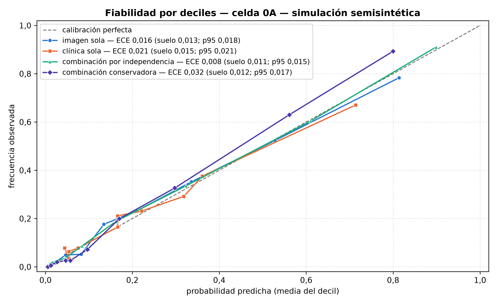
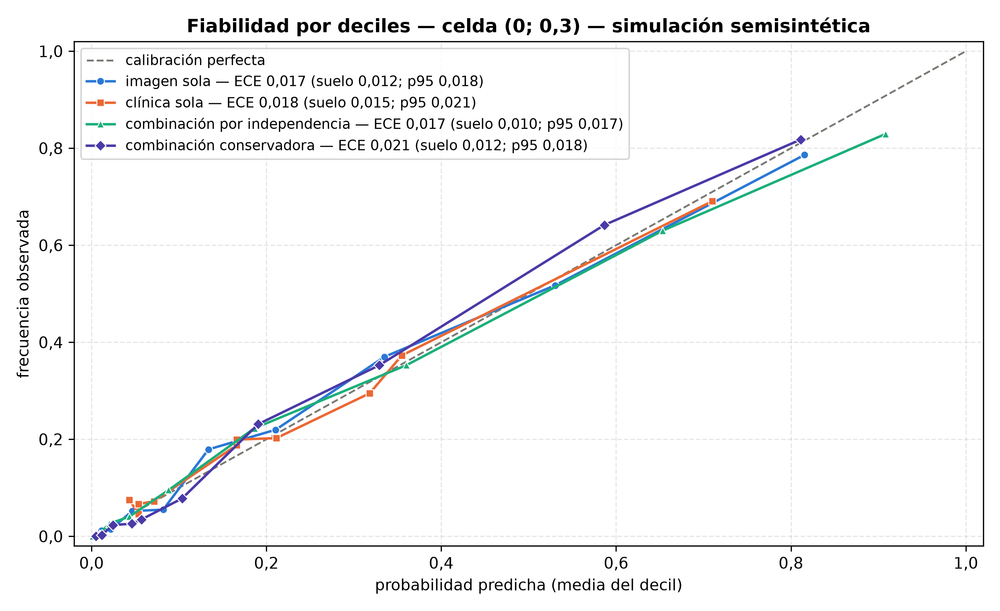
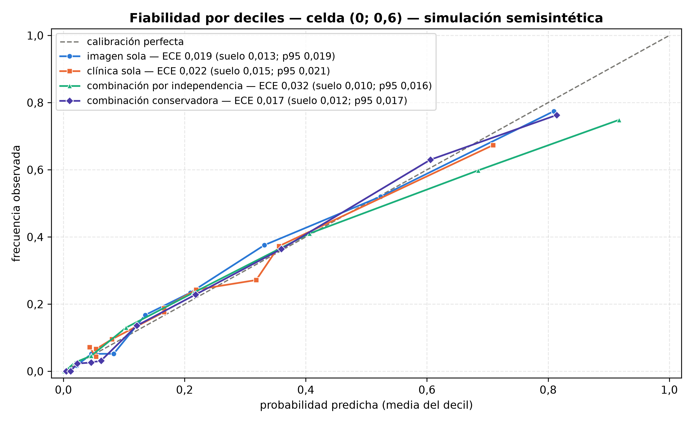
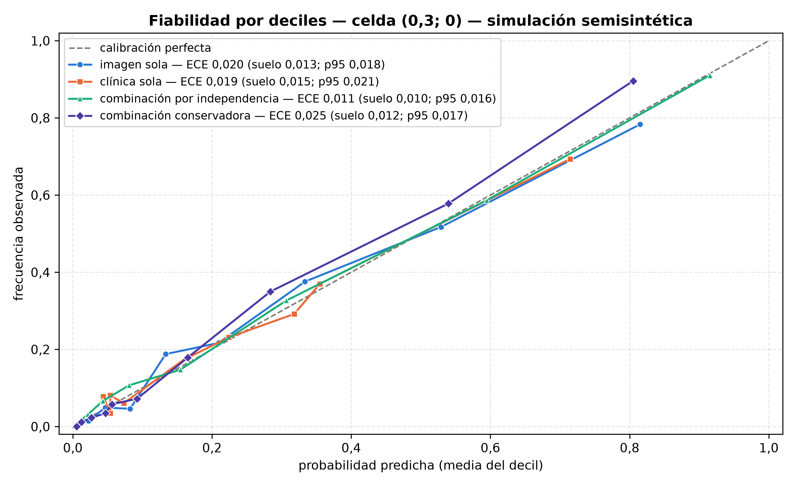
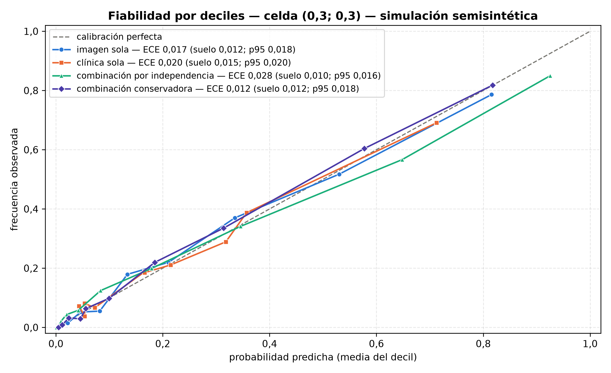
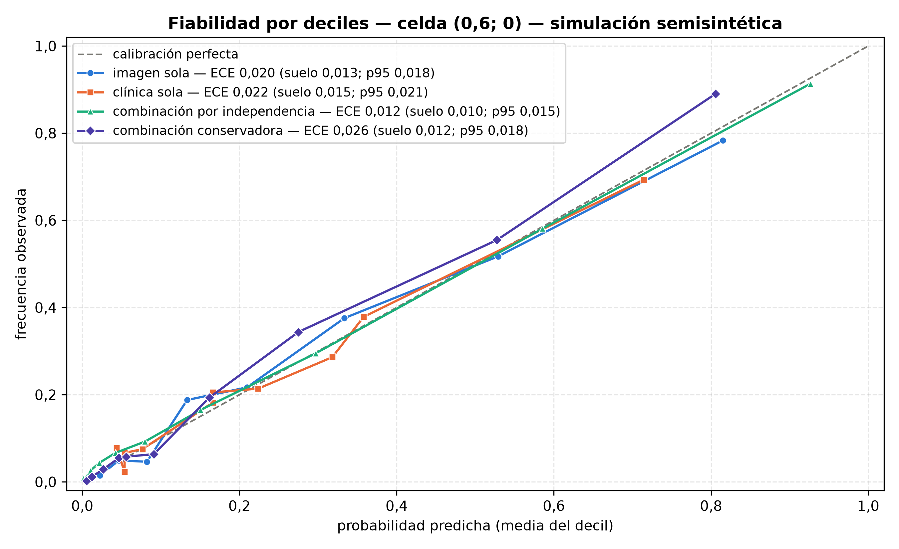
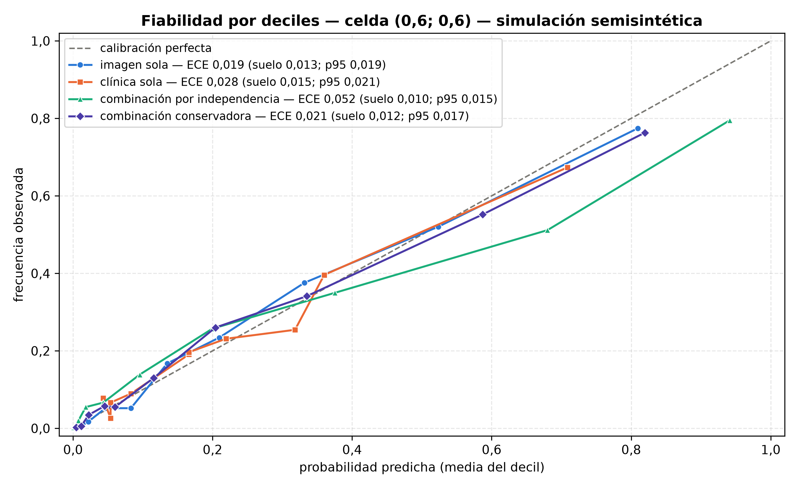
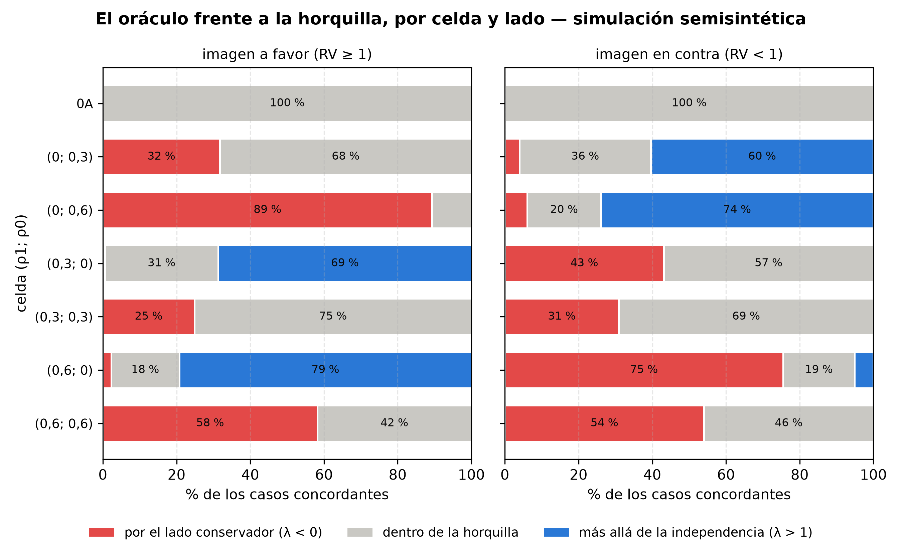
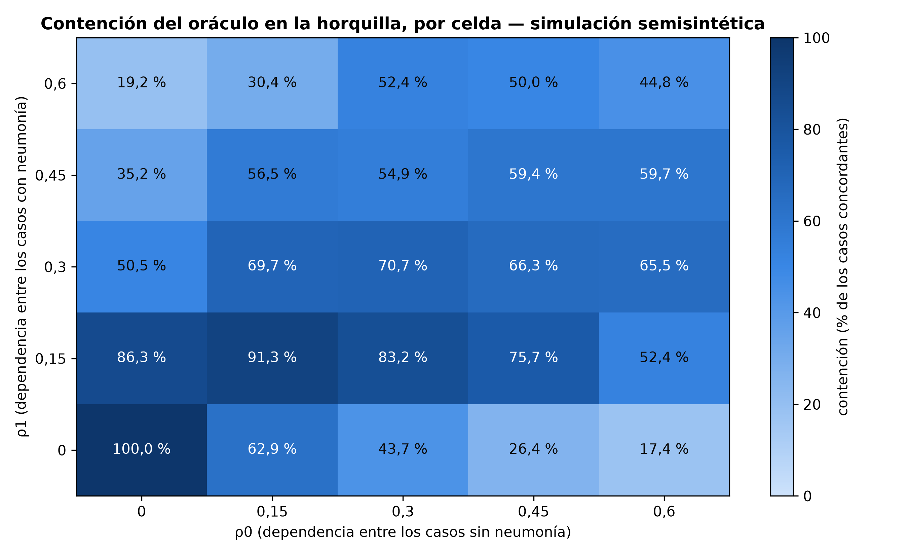
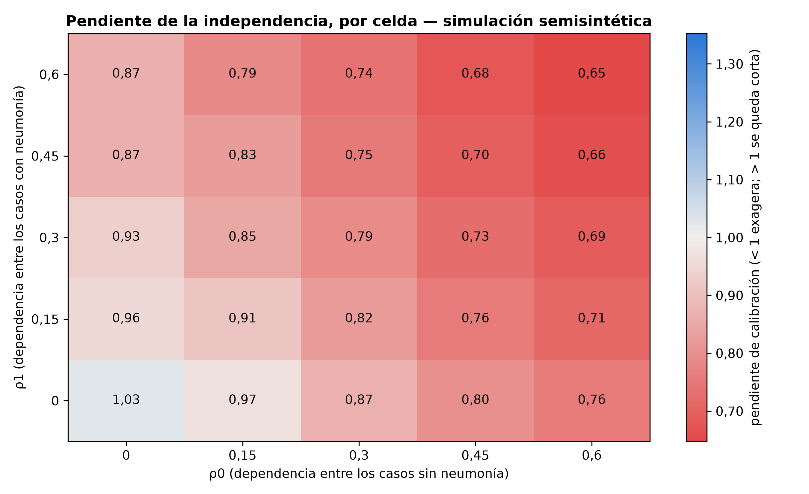

# Validación de la combinación de clínica e imagen: simulación semisintética (SP5)

**Las placas y sus etiquetas son reales (conjunto de prueba de RSNA); la clínica se sortea con la distribución publicada de la puntuación de Heckerling y la dependencia entre clínica e imagen es un supuesto declarado. Nada de esto mide exactitud clínica en pacientes.**

> Este documento es GENERADO por `scripts/validar_combinacion.py` a partir de `resultados_simulacion.json`: ninguna cifra se teclea y no se edita a mano. Para cambiar una frase se cambia `src/copiloto_triaje/validacion/informe.py` y se vuelve a generar; para cambiar una cifra, se vuelve a correr la simulación.

## Insumos y parámetros

Qué es real y qué se supone:

- **Placas y verdad:** las 3 811 placas del conjunto de prueba de RSNA (una por paciente; 844 positivas, prevalencia 0,2215), nunca usadas para entrenar ni calibrar, con su etiqueta real de opacidad. Es un desenlace análogo al de Heckerling (infiltrado radiográfico) en una población distinta: RSNA no es una cohorte con sospecha de neumonía.
- **Clínica:** a cada placa se le sortea la puntuación de Heckerling dada su etiqueta, con las frecuencias publicadas de la cohorte de derivación. No se inventa la exactitud de la regla: se usa la publicada, tal como la usa el sistema. Cada placa con su clínica sorteada es una viñeta.
- **Dependencia:** la estructura de dependencia entre clínica e imagen es un supuesto: nula en 0A y barrida en el resto de la rejilla.
- **Transporte:** el generador supone que la distribución de la puntuación por clase, medida en la cohorte de derivación, se transporta al espectro de RSNA. Eso no se comprueba ni se puede comprobar aquí.

Con qué se calculó:

- Puntuaciones crudas del modelo desplegado: `docs/validacion-semisintetica/crudas_prueba.csv` (sha256 `414dd3a5cfc5…`), generadas con los pesos de sha256 `bb985e1f792e…`.
- Calibrador: `servidor/calibrador.json` (sha256 `993a47842f06…`).
- Previo del análisis principal: 0,2215, el del calibrador, que es la prevalencia del conjunto. El previo desplegado, 0,1466, solo entra en la sensibilidad al previo.
- Rejilla: ρ1 y ρ0 toman los valores 0 / 0,15 / 0,3 / 0,45 / 0,6: 25 celdas. El origen es 0A y se cuenta aparte; celdas destacadas: (0; 0,3), (0; 0,6), (0,3; 0), (0,3; 0,3), (0,6; 0) y (0,6; 0,6).
- Bootstrap: 1 000 réplicas en 0A y en las celdas destacadas; cada réplica remuestrea las placas con reemplazo (una placa por paciente, así que es un bootstrap por paciente) y vuelve a sortear la clínica. El generador queda fijo en todas. Intervalos del 95 % por percentiles; las diferencias entre modelos se calculan dentro de cada réplica (pareadas).
- Semillas: clínica de la estimación puntual, 1; clínica de la réplica b, 10000 + b; placas de la réplica b, 20000 + b.
- Tolerancia de las colas de la horquilla: ε = 0,015 log-odds, que cubre el redondeo de las RV publicadas (la misma tolerancia de la comprobación 0A).
- ECE: 10 tramos de igual masa, con los empates rotos por el orden del identificador de la placa. Su suelo de ruido: 200 juegos de etiquetas simuladas con las probabilidades del propio modelo (semilla 20261009); se publican la media y el percentil 95.
- Hipótesis de la horquilla: contención ≥ 90 % de los concordantes.

## La imagen sola

La probabilidad calibrada de la imagen sobre las 3 811 placas. El oráculo toma esa probabilidad como la verdad de la imagen: así la diferencia entre el sistema y el oráculo aísla la parte clínica, y la calibración de la imagen se publica aparte, aquí, como el suelo de calibración de todo lo demás.

| AUC | Brier | pendiente | intercepto | ECE | suelo de la ECE (media) | suelo de la ECE (p95) |
| ---: | ---: | ---: | ---: | ---: | ---: | ---: |
| 0,884 | 0,108 | 0,98 | 0,012 | 0,016 | 0,012 | 0,017 |

La ECE (0,016) no supera el percentil 95 de su suelo: no se distingue del ruido de muestreo. La ECE solo se lee al lado de su suelo, nunca contra un umbral absoluto. Una pendiente menor que 1 quiere decir que el modelo exagera; mayor que 1, que se queda corto.

## Escenario 0A: la aritmética

Con dependencia nula (ρ1 = ρ0 = 0) el oráculo de cada caso es la suma, en log-odds, de la evidencia de la imagen y del logaritmo de la RV de recuentos de su puntuación. Las tres comprobaciones de 0A son deterministas y caso a caso, y no viven en este documento sino en `tests/test_validacion_0a.py`: la puntuación que calcula el sistema es la que sorteó el generador; el bloque que entrega es el redondeo de su propia aritmética; y la posterior del sistema coincide con la del oráculo dentro de ε = 0,015 log-odds en todos los casos. Son pruebas, no estadísticas: una RV o un corte mutados las hacen fallar.

Lo que 0A puede demostrar es que el sistema calcula lo que dice calcular; no que la posterior sea exacta en pacientes.

Los cuatro modelos puntuales en 0A, sobre los 3 460 casos con el asma conocida:

| modelo | AUC | Brier | pendiente | intercepto | ECE | suelo de la ECE (media) | suelo de la ECE (p95) |
| :--- | ---: | ---: | ---: | ---: | ---: | ---: | ---: |
| imagen sola | 0,885 (IC 95 %: 0,871 a 0,898) | 0,107 (IC 95 %: 0,101 a 0,115) | 0,98 (IC 95 %: 0,91 a 1,06) | 0,012 (IC 95 %: −0,095 a 0,113) | 0,016 (IC 95 %: 0,011 a 0,030) | 0,013 | 0,018 |
| clínica sola | 0,790 (IC 95 %: 0,776 a 0,824) | 0,134 (IC 95 %: 0,120 a 0,138) | 0,95 (IC 95 %: 0,90 a 1,11) | 0,020 (IC 95 %: −0,097 a 0,106) | 0,021 (IC 95 %: 0,015 a 0,038) | 0,015 | 0,021 |
| combinación, independencia | 0,930 (IC 95 %: 0,920 a 0,941) | 0,082 (IC 95 %: 0,075 a 0,089) | 1,03 (IC 95 %: 0,91 a 1,09) | 0,046 (IC 95 %: −0,119 a 0,143) | 0,008 (IC 95 %: 0,007 a 0,024) | 0,011 | 0,015 |
| combinación, extremo conservador | 0,929 (IC 95 %: 0,917 a 0,939) | 0,085 (IC 95 %: 0,078 a 0,092) | 1,27 (IC 95 %: 1,15 a 1,36) | 0,128 (IC 95 %: 0,005 a 0,217) | 0,032 (IC 95 %: 0,020 a 0,041) | 0,012 | 0,017 |

La ECE de la combinación por independencia (0,008) no supera el percentil 95 de su suelo: no se distingue del ruido de muestreo.

**La fila 0A de la horquilla es la comprobación de la métrica.** Con ρ = 0 el único desvío entre el sistema y el oráculo es el redondeo de las RV, así que las dos colas tienen que ser exactamente 0 y la contención, 100 %:

| celda | concordantes | por el lado conservador | más allá de la independencia | contención |
| :--- | ---: | ---: | ---: | ---: |
| 0A | 2 217 | 0,0 % (IC 95 %: 0,0 a 0,0) | 0,0 % (IC 95 %: 0,0 a 0,0) | 100,0 % (IC 95 %: 100,0 a 100,0) |

Se cumple: la métrica de la horquilla pasa su comprobación en el caso nulo.

## Dependencia entre clínica e imagen

Crepitantes, murmullo y opacidad son el mismo fenómeno físico visto de dos maneras: la clínica y la imagen no son independientes. El sistema solo ve la puntuación, y los recuentos publicados no la descomponen por hallazgo; por eso la dependencia se induce sobre la puntuación entera. **ρ1** es la correlación latente, entre los casos con neumonía, entre lo que la puntuación mide y lo que la imagen mide; **ρ0**, la misma entre los casos sin neumonía. Temperatura, pulso y asma diluyen esa correlación. Un ρ de 0,6 sobre la puntuación es un caso extremo, no plausible: se incluye para acotar, no porque se espere.

Son dos parámetros y no uno porque con un solo ρ, simétrico, la dirección del sesgo quedaría decidida de antemano por el diseño. Con dos, la dirección es un resultado de cada celda y de cada lado de la imagen, no una premisa. En todas las celdas la distribución de la puntuación dentro de cada clase es la publicada: lo que cambia es la RV de la puntuación una vez vista la imagen.

La correlación de Pearson, dentro de cada clase, entre la puntuación y la imagen que implica cada celda:

| celda | ρ1 | ρ0 | correlación con neumonía | correlación sin neumonía |
| :--- | ---: | ---: | ---: | ---: |
| 0A | 0 | 0 | 0,000 | 0,000 |
| (0; 0,3) | 0 | 0,3 | 0,000 | 0,275 |
| (0; 0,6) | 0 | 0,6 | 0,000 | 0,558 |
| (0,3; 0) | 0,3 | 0 | 0,286 | 0,000 |
| (0,3; 0,3) | 0,3 | 0,3 | 0,286 | 0,275 |
| (0,6; 0) | 0,6 | 0 | 0,574 | 0,000 |
| (0,6; 0,6) | 0,6 | 0,6 | 0,574 | 0,558 |

Los cuatro modelos puntuales por celda (casos con el asma conocida). La pendiente lleva su intervalo; la ECE va al lado de su suelo:

| celda | modelo | AUC | Brier | pendiente | intercepto | ECE | suelo de la ECE (media) | suelo de la ECE (p95) |
| :--- | :--- | ---: | ---: | ---: | ---: | ---: | ---: | ---: |
| 0A | imagen sola | 0,885 | 0,107 | 0,98 (IC 95 %: 0,91 a 1,06) | 0,012 | 0,016 | 0,013 | 0,018 |
| 0A | clínica sola | 0,790 | 0,134 | 0,95 (IC 95 %: 0,90 a 1,11) | 0,020 | 0,021 | 0,015 | 0,021 |
| 0A | combinación, independencia | 0,930 | 0,082 | 1,03 (IC 95 %: 0,91 a 1,09) | 0,046 | 0,008 | 0,011 | 0,015 |
| 0A | combinación, extremo conservador | 0,929 | 0,085 | 1,27 (IC 95 %: 1,15 a 1,36) | 0,128 | 0,032 | 0,012 | 0,017 |
| (0; 0,3) | imagen sola | 0,886 | 0,107 | 0,99 (IC 95 %: 0,91 a 1,06) | 0,015 | 0,017 | 0,012 | 0,018 |
| (0; 0,3) | clínica sola | 0,789 | 0,133 | 0,97 (IC 95 %: 0,89 a 1,11) | 0,046 | 0,018 | 0,015 | 0,021 |
| (0; 0,3) | combinación, independencia | 0,917 | 0,093 | 0,87 (IC 95 %: 0,78 a 0,93) | −0,079 | 0,017 | 0,010 | 0,017 |
| (0; 0,3) | combinación, extremo conservador | 0,915 | 0,093 | 1,12 (IC 95 %: 1,02 a 1,21) | 0,043 | 0,021 | 0,012 | 0,018 |
| (0; 0,6) | imagen sola | 0,887 | 0,107 | 1,00 (IC 95 %: 0,91 a 1,07) | 0,024 | 0,019 | 0,013 | 0,019 |
| (0; 0,6) | clínica sola | 0,788 | 0,133 | 0,97 (IC 95 %: 0,89 a 1,11) | 0,029 | 0,022 | 0,015 | 0,021 |
| (0; 0,6) | combinación, independencia | 0,903 | 0,104 | 0,76 (IC 95 %: 0,68 a 0,81) | −0,240 | 0,032 | 0,010 | 0,016 |
| (0; 0,6) | combinación, extremo conservador | 0,903 | 0,101 | 1,03 (IC 95 %: 0,95 a 1,13) | −0,063 | 0,017 | 0,012 | 0,017 |
| (0,3; 0) | imagen sola | 0,888 | 0,107 | 0,99 (IC 95 %: 0,91 a 1,06) | 0,014 | 0,020 | 0,013 | 0,018 |
| (0,3; 0) | clínica sola | 0,793 | 0,132 | 0,97 (IC 95 %: 0,89 a 1,11) | 0,026 | 0,019 | 0,015 | 0,021 |
| (0,3; 0) | combinación, independencia | 0,919 | 0,085 | 0,93 (IC 95 %: 0,82 a 0,98) | 0,085 | 0,011 | 0,010 | 0,016 |
| (0,3; 0) | combinación, extremo conservador | 0,917 | 0,089 | 1,18 (IC 95 %: 1,06 a 1,25) | 0,173 | 0,025 | 0,012 | 0,017 |
| (0,3; 0,3) | imagen sola | 0,886 | 0,107 | 0,99 (IC 95 %: 0,91 a 1,06) | 0,015 | 0,017 | 0,012 | 0,018 |
| (0,3; 0,3) | clínica sola | 0,794 | 0,132 | 0,98 (IC 95 %: 0,89 a 1,11) | 0,039 | 0,020 | 0,015 | 0,020 |
| (0,3; 0,3) | combinación, independencia | 0,905 | 0,097 | 0,79 (IC 95 %: 0,71 a 0,85) | −0,062 | 0,028 | 0,010 | 0,016 |
| (0,3; 0,3) | combinación, extremo conservador | 0,903 | 0,098 | 1,03 (IC 95 %: 0,95 a 1,12) | 0,073 | 0,012 | 0,012 | 0,018 |
| (0,6; 0) | imagen sola | 0,888 | 0,107 | 0,99 (IC 95 %: 0,91 a 1,06) | 0,014 | 0,020 | 0,013 | 0,018 |
| (0,6; 0) | clínica sola | 0,797 | 0,131 | 0,99 (IC 95 %: 0,90 a 1,10) | 0,021 | 0,022 | 0,015 | 0,021 |
| (0,6; 0) | combinación, independencia | 0,909 | 0,088 | 0,87 (IC 95 %: 0,76 a 0,89) | 0,105 | 0,012 | 0,010 | 0,015 |
| (0,6; 0) | combinación, extremo conservador | 0,908 | 0,092 | 1,13 (IC 95 %: 1,00 a 1,17) | 0,200 | 0,026 | 0,012 | 0,018 |
| (0,6; 0,6) | imagen sola | 0,887 | 0,107 | 1,00 (IC 95 %: 0,91 a 1,07) | 0,024 | 0,019 | 0,013 | 0,019 |
| (0,6; 0,6) | clínica sola | 0,793 | 0,132 | 0,99 (IC 95 %: 0,89 a 1,11) | 0,023 | 0,028 | 0,015 | 0,021 |
| (0,6; 0,6) | combinación, independencia | 0,884 | 0,113 | 0,65 (IC 95 %: 0,59 a 0,69) | −0,205 | 0,052 | 0,010 | 0,015 |
| (0,6; 0,6) | combinación, extremo conservador | 0,881 | 0,109 | 0,90 (IC 95 %: 0,84 a 0,98) | −0,003 | 0,021 | 0,012 | 0,017 |

Diferencias pareadas de cada combinación frente a la imagen sola (combinación menos imagen, sobre los mismos casos):

| celda | modelo | ΔAUC | ΔBrier | Δpendiente |
| :--- | :--- | ---: | ---: | ---: |
| 0A | combinación, independencia | +0,046 (IC 95 %: +0,035 a +0,058) | −0,026 (IC 95 %: −0,032 a −0,020) | +0,04 (IC 95 %: −0,07 a +0,09) |
| 0A | combinación, extremo conservador | +0,044 (IC 95 %: +0,033 a +0,056) | −0,022 (IC 95 %: −0,028 a −0,018) | +0,29 (IC 95 %: +0,18 a +0,35) |
| (0; 0,3) | combinación, independencia | +0,031 (IC 95 %: +0,023 a +0,045) | −0,014 (IC 95 %: −0,021 a −0,009) | −0,12 (IC 95 %: −0,20 a −0,06) |
| (0; 0,3) | combinación, extremo conservador | +0,030 (IC 95 %: +0,021 a +0,043) | −0,014 (IC 95 %: −0,021 a −0,010) | +0,13 (IC 95 %: +0,06 a +0,21) |
| (0; 0,6) | combinación, independencia | +0,017 (IC 95 %: +0,011 a +0,032) | −0,003 (IC 95 %: −0,010 a +0,002) | −0,24 (IC 95 %: −0,30 a −0,18) |
| (0; 0,6) | combinación, extremo conservador | +0,017 (IC 95 %: +0,011 a +0,032) | −0,007 (IC 95 %: −0,014 a −0,004) | +0,03 (IC 95 %: −0,01 a +0,12) |
| (0,3; 0) | combinación, independencia | +0,031 (IC 95 %: +0,024 a +0,044) | −0,022 (IC 95 %: −0,027 a −0,016) | −0,06 (IC 95 %: −0,16 a −0,02) |
| (0,3; 0) | combinación, extremo conservador | +0,030 (IC 95 %: +0,021 a +0,042) | −0,018 (IC 95 %: −0,024 a −0,013) | +0,19 (IC 95 %: +0,09 a +0,24) |
| (0,3; 0,3) | combinación, independencia | +0,019 (IC 95 %: +0,012 a +0,032) | −0,010 (IC 95 %: −0,016 a −0,005) | −0,20 (IC 95 %: −0,27 a −0,15) |
| (0,3; 0,3) | combinación, extremo conservador | +0,017 (IC 95 %: +0,009 a +0,030) | −0,009 (IC 95 %: −0,016 a −0,006) | +0,04 (IC 95 %: −0,02 a +0,11) |
| (0,6; 0) | combinación, independencia | +0,022 (IC 95 %: +0,012 a +0,030) | −0,019 (IC 95 %: −0,023 a −0,012) | −0,13 (IC 95 %: −0,22 a −0,11) |
| (0,6; 0) | combinación, extremo conservador | +0,021 (IC 95 %: +0,011 a +0,029) | −0,015 (IC 95 %: −0,019 a −0,010) | +0,14 (IC 95 %: +0,04 a +0,17) |
| (0,6; 0,6) | combinación, independencia | −0,003 (IC 95 %: −0,009 a +0,007) | +0,005 (IC 95 %: −0,001 a +0,010) | −0,35 (IC 95 %: −0,40 a −0,30) |
| (0,6; 0,6) | combinación, extremo conservador | −0,005 (IC 95 %: −0,010 a +0,007) | +0,002 (IC 95 %: −0,005 a +0,004) | −0,10 (IC 95 %: −0,13 a −0,03) |

Un ΔBrier negativo es una mejora. Estas diferencias dicen cuánto aporta la clínica sorteada en la simulación, no cuánto aporta la clínica en pacientes.

## La horquilla frente al oráculo

La horquilla solo existe en los casos concordantes (clínica e imagen del mismo lado) con el asma conocida. Sus extremos son el conservador (dependencia total: solo cuenta la evidencia más informativa) y la independencia. La posición del oráculo se mide con λ, en log-odds: λ = 0 es el extremo conservador y λ = 1, la independencia.

- **Por el lado conservador:** el oráculo queda más allá del extremo conservador en más de ε = 0,015 log-odds. Ni la dependencia total recoge tanta redundancia.
- **Más allá de la independencia:** el oráculo queda más allá de la independencia en más de ε. La independencia se queda corta.
- **Contención:** el complemento de las dos colas. Se llama contención y no cobertura: no es un intervalo de confianza.

**Hipótesis declarada de antemano, a refutar celda a celda:** «el oráculo queda dentro de la horquilla en ≥ 90 % de los concordantes». La expectativa, medida sobre el conjunto durante el diseño y no declarada a ciegas, era que solo se sostuviera en 0A y en las celdas más suaves. Una contención baja es un resultado igual de publicable, y obliga a repensar la cota, no a ocultarla.

| celda | lado de la imagen | n | λ: mediana (q1 a q3) | por el lado conservador | más allá de la independencia | contención |
| :--- | :--- | ---: | ---: | ---: | ---: | ---: |
| 0A | todos los concordantes | 2 217 | 0,99 (0,99 a 1,00) | 0,0 % (IC 95 %: 0,0 a 0,0) | 0,0 % (IC 95 %: 0,0 a 0,0) | 100,0 % (IC 95 %: 100,0 a 100,0) |
| 0A | imagen a favor (RV ≥ 1) | 523 | 1,00 (1,00 a 1,00) | 0,0 % (IC 95 %: 0,0 a 0,0) | 0,0 % (IC 95 %: 0,0 a 0,0) | 100,0 % (IC 95 %: 100,0 a 100,0) |
| 0A | imagen en contra (RV < 1) | 1 694 | 0,99 (0,99 a 0,99) | 0,0 % (IC 95 %: 0,0 a 0,0) | 0,0 % (IC 95 %: 0,0 a 0,0) | 100,0 % (IC 95 %: 100,0 a 100,0) |
| (0; 0,3) | todos los concordantes | 2 368 | 0,98 (0,34 a 1,11) | 10,9 % (IC 95 %: 9,4 a 12,5) | 45,4 % (IC 95 %: 42,9 a 48,5) | 43,7 % (IC 95 %: 40,6 a 46,2) |
| (0; 0,3) | imagen a favor (RV ≥ 1) | 589 | 0,17 (−0,10 a 0,34) | 31,7 % (IC 95 %: 25,4 a 35,0) | 0,0 % (IC 95 %: 0,0 a 0,0) | 68,3 % (IC 95 %: 65,0 a 74,6) |
| (0; 0,3) | imagen en contra (RV < 1) | 1 779 | 1,04 (0,93 a 1,13) | 4,0 % (IC 95 %: 3,0 a 5,4) | 60,4 % (IC 95 %: 58,4 a 64,9) | 35,6 % (IC 95 %: 31,1 a 37,3) |
| (0; 0,6) | todos los concordantes | 2 567 | 1,11 (−0,06 a 1,25) | 28,6 % (IC 95 %: 26,4 a 30,7) | 54,0 % (IC 95 %: 51,0 a 55,9) | 17,4 % (IC 95 %: 16,0 a 19,9) |
| (0; 0,6) | imagen a favor (RV ≥ 1) | 694 | −0,51 (−0,73 a −0,06) | 89,3 % (IC 95 %: 83,8 a 90,4) | 0,0 % (IC 95 %: 0,0 a 0,0) | 10,7 % (IC 95 %: 9,6 a 16,2) |
| (0; 0,6) | imagen en contra (RV < 1) | 1 873 | 1,21 (0,97 a 1,43) | 6,1 % (IC 95 %: 4,7 a 7,6) | 74,0 % (IC 95 %: 71,3 a 76,6) | 19,9 % (IC 95 %: 17,5 a 22,3) |
| (0,3; 0) | todos los concordantes | 2 286 | 0,25 (−0,10 a 0,47) | 32,7 % (IC 95 %: 30,5 a 35,6) | 16,8 % (IC 95 %: 15,2 a 18,9) | 50,5 % (IC 95 %: 47,4 a 52,7) |
| (0,3; 0) | imagen a favor (RV ≥ 1) | 559 | 1,08 (0,98 a 1,10) | 0,5 % (IC 95 %: 0,0 a 1,6) | 68,7 % (IC 95 %: 63,0 a 73,5) | 30,8 % (IC 95 %: 26,0 a 36,5) |
| (0,3; 0) | imagen en contra (RV < 1) | 1 727 | 0,07 (−0,17 a 0,35) | 43,1 % (IC 95 %: 40,5 a 46,8) | 0,0 % (IC 95 %: 0,0 a 0,0) | 56,9 % (IC 95 %: 53,2 a 59,5) |
| (0,3; 0,3) | todos los concordantes | 2 430 | 0,31 (−0,15 a 0,44) | 29,3 % (IC 95 %: 26,0 a 31,1) | 0,0 % (IC 95 %: 0,0 a 0,0) | 70,7 % (IC 95 %: 68,9 a 74,0) |
| (0,3; 0,3) | imagen a favor (RV ≥ 1) | 624 | 0,27 (−0,02 a 0,44) | 24,8 % (IC 95 %: 20,1 a 29,1) | 0,0 % (IC 95 %: 0,0 a 0,0) | 75,2 % (IC 95 %: 70,9 a 79,9) |
| (0,3; 0,3) | imagen en contra (RV < 1) | 1 806 | 0,31 (−0,15 a 0,41) | 30,9 % (IC 95 %: 27,3 a 33,0) | 0,0 % (IC 95 %: 0,0 a 0,0) | 69,1 % (IC 95 %: 67,0 a 72,7) |
| (0,6; 0) | todos los concordantes | 2 327 | −0,08 (−0,60 a 0,95) | 57,2 % (IC 95 %: 53,7 a 59,0) | 23,5 % (IC 95 %: 21,7 a 26,3) | 19,2 % (IC 95 %: 17,4 a 22,0) |
| (0,6; 0) | imagen a favor (RV ≥ 1) | 579 | 1,23 (1,10 a 1,41) | 2,2 % (IC 95 %: 1,8 a 5,9) | 79,3 % (IC 95 %: 73,0 a 82,7) | 18,5 % (IC 95 %: 14,2 a 22,8) |
| (0,6; 0) | imagen en contra (RV < 1) | 1 748 | −0,16 (−0,70 a −0,04) | 75,5 % (IC 95 %: 71,5 a 77,1) | 5,1 % (IC 95 %: 4,1 a 7,0) | 19,5 % (IC 95 %: 17,7 a 22,7) |
| (0,6; 0,6) | todos los concordantes | 2 670 | −0,09 (−0,35 a 0,13) | 55,2 % (IC 95 %: 51,4 a 56,5) | 0,0 % (IC 95 %: 0,0 a 0,0) | 44,8 % (IC 95 %: 43,5 a 48,6) |
| (0,6; 0,6) | imagen a favor (RV ≥ 1) | 746 | −0,10 (−0,56 a 0,07) | 58,2 % (IC 95 %: 50,2 a 59,6) | 0,0 % (IC 95 %: 0,0 a 0,0) | 41,8 % (IC 95 %: 40,4 a 49,8) |
| (0,6; 0,6) | imagen en contra (RV < 1) | 1 924 | −0,06 (−0,27 a 0,13) | 54,0 % (IC 95 %: 50,7 a 56,5) | 0,0 % (IC 95 %: 0,0 a 0,0) | 46,0 % (IC 95 %: 43,5 a 49,3) |

Casos concordantes sin horquilla (RV de imagen exactamente 1) en estas celdas: 0.

El veredicto, celda a celda, sobre todos los concordantes. Donde hay intervalo decide el intervalo entero: si la estimación y su intervalo no quedan enteros a un lado del umbral, no se puede decir. Donde no lo hay solo está la estimación puntual, y el veredicto lo dice. Se decide con la contención tal como se imprime (un «90,0 %» alcanza un umbral del 90 %); el campo `se_sostiene` del fichero de resultados se calcula sin redondear:

| celda | contención | umbral | veredicto |
| :--- | ---: | ---: | :--- |
| 0A | 100,0 % (IC 95 %: 100,0 a 100,0) | ≥ 90 % | se sostiene |
| (0; 0,15) | 62,9 % | ≥ 90 % | no se sostiene (estimación puntual, sin intervalo) |
| (0; 0,3) | 43,7 % (IC 95 %: 40,6 a 46,2) | ≥ 90 % | no se sostiene |
| (0; 0,45) | 26,4 % | ≥ 90 % | no se sostiene (estimación puntual, sin intervalo) |
| (0; 0,6) | 17,4 % (IC 95 %: 16,0 a 19,9) | ≥ 90 % | no se sostiene |
| (0,15; 0) | 86,3 % | ≥ 90 % | no se sostiene (estimación puntual, sin intervalo) |
| (0,15; 0,15) | 91,3 % | ≥ 90 % | se sostiene (estimación puntual, sin intervalo) |
| (0,15; 0,3) | 83,2 % | ≥ 90 % | no se sostiene (estimación puntual, sin intervalo) |
| (0,15; 0,45) | 75,7 % | ≥ 90 % | no se sostiene (estimación puntual, sin intervalo) |
| (0,15; 0,6) | 52,4 % | ≥ 90 % | no se sostiene (estimación puntual, sin intervalo) |
| (0,3; 0) | 50,5 % (IC 95 %: 47,4 a 52,7) | ≥ 90 % | no se sostiene |
| (0,3; 0,15) | 69,7 % | ≥ 90 % | no se sostiene (estimación puntual, sin intervalo) |
| (0,3; 0,3) | 70,7 % (IC 95 %: 68,9 a 74,0) | ≥ 90 % | no se sostiene |
| (0,3; 0,45) | 66,3 % | ≥ 90 % | no se sostiene (estimación puntual, sin intervalo) |
| (0,3; 0,6) | 65,5 % | ≥ 90 % | no se sostiene (estimación puntual, sin intervalo) |
| (0,45; 0) | 35,2 % | ≥ 90 % | no se sostiene (estimación puntual, sin intervalo) |
| (0,45; 0,15) | 56,5 % | ≥ 90 % | no se sostiene (estimación puntual, sin intervalo) |
| (0,45; 0,3) | 54,9 % | ≥ 90 % | no se sostiene (estimación puntual, sin intervalo) |
| (0,45; 0,45) | 59,4 % | ≥ 90 % | no se sostiene (estimación puntual, sin intervalo) |
| (0,45; 0,6) | 59,7 % | ≥ 90 % | no se sostiene (estimación puntual, sin intervalo) |
| (0,6; 0) | 19,2 % (IC 95 %: 17,4 a 22,0) | ≥ 90 % | no se sostiene |
| (0,6; 0,15) | 30,4 % | ≥ 90 % | no se sostiene (estimación puntual, sin intervalo) |
| (0,6; 0,3) | 52,4 % | ≥ 90 % | no se sostiene (estimación puntual, sin intervalo) |
| (0,6; 0,45) | 50,0 % | ≥ 90 % | no se sostiene (estimación puntual, sin intervalo) |
| (0,6; 0,6) | 44,8 % (IC 95 %: 43,5 a 48,6) | ≥ 90 % | no se sostiene |

**Casos discordantes** (clínica e imagen en lados opuestos): el sistema da un solo número, el de la independencia. Error frente al oráculo, en log-odds; el sesgo es sistema menos oráculo:

| celda | n | error absoluto mediano | sesgo mediano |
| :--- | ---: | ---: | ---: |
| 0A | 1 243 | 0,002 (IC 95 %: 0,000 a 0,004) | 0,000 (IC 95 %: −0,004 a 0,000) |
| (0; 0,3) | 1 092 | 0,135 (IC 95 %: 0,135 a 0,180) | +0,020 (IC 95 %: −0,039 a +0,027) |
| (0; 0,6) | 894 | 0,339 (IC 95 %: 0,269 a 0,375) | −0,005 (IC 95 %: −0,122 a −0,005) |
| (0,3; 0) | 1 175 | 0,163 (IC 95 %: 0,140 a 0,163) | +0,050 (IC 95 %: +0,031 a +0,082) |
| (0,3; 0,3) | 1 030 | 0,152 (IC 95 %: 0,121 a 0,169) | +0,012 (IC 95 %: −0,032 a +0,024) |
| (0,6; 0) | 1 134 | 0,441 (IC 95 %: 0,396 a 0,517) | +0,396 (IC 95 %: +0,303 a +0,448) |
| (0,6; 0,6) | 791 | 0,361 (IC 95 %: 0,340 a 0,361) | +0,302 (IC 95 %: +0,143 a +0,335) |

**Casos con el asma desconocida:** el sistema entrega un rango (dos puntuaciones posibles) y el oráculo marginaliza el asma con la misma información. La tabla dice si el oráculo cae dentro de ese rango, con la misma ε, y el error del punto medio del rango en log-odds:

| celda | n | por debajo del rango | por encima del rango | dentro | punto medio: error absoluto mediano | punto medio: sesgo mediano |
| :--- | ---: | ---: | ---: | ---: | ---: | ---: |
| 0A | 351 | 0,0 % (IC 95 %: 0,0 a 0,0) | 0,0 % (IC 95 %: 0,0 a 0,0) | 100,0 % (IC 95 %: 100,0 a 100,0) | 0,338 (IC 95 %: 0,338 a 0,338) | −0,338 (IC 95 %: −0,338 a −0,338) |
| (0; 0,3) | 351 | 0,0 % (IC 95 %: 0,0 a 0,0) | 13,4 % (IC 95 %: 8,5 a 17,6) | 86,6 % (IC 95 %: 82,4 a 91,5) | 0,366 (IC 95 %: 0,283 a 0,476) | −0,283 (IC 95 %: −0,432 a −0,211) |
| (0; 0,6) | 350 | 10,0 % (IC 95 %: 6,8 a 15,9) | 17,1 % (IC 95 %: 9,9 a 19,8) | 72,9 % (IC 95 %: 67,8 a 79,8) | 0,398 (IC 95 %: 0,362 a 0,419) | −0,200 (IC 95 %: −0,333 a −0,047) |
| (0,3; 0) | 350 | 1,4 % (IC 95 %: 0,0 a 3,2) | 17,7 % (IC 95 %: 13,0 a 23,7) | 80,9 % (IC 95 %: 74,7 a 85,8) | 0,598 (IC 95 %: 0,557 a 0,780) | −0,595 (IC 95 %: −0,776 a −0,507) |
| (0,3; 0,3) | 351 | 1,4 % (IC 95 %: 0,0 a 2,6) | 23,9 % (IC 95 %: 16,8 a 28,7) | 74,6 % (IC 95 %: 70,1 a 82,1) | 0,729 (IC 95 %: 0,697 a 0,877) | −0,702 (IC 95 %: −0,834 a −0,625) |
| (0,6; 0) | 350 | 11,1 % (IC 95 %: 7,0 a 15,7) | 63,7 % (IC 95 %: 54,3 a 67,9) | 25,1 % (IC 95 %: 21,8 a 34,4) | 0,948 (IC 95 %: 0,805 a 1,068) | −0,805 (IC 95 %: −0,992 a −0,639) |
| (0,6; 0,6) | 350 | 4,0 % (IC 95 %: 0,7 a 5,2) | 30,9 % (IC 95 %: 25,2 a 38,2) | 65,1 % (IC 95 %: 59,1 a 72,5) | 1,004 (IC 95 %: 0,956 a 1,055) | −0,885 (IC 95 %: −1,036 a −0,828) |

Cuántos casos hay de cada tipo:

| celda | casos | asma conocida | concordantes | concordantes, imagen a favor | concordantes, imagen en contra | discordantes | asma desconocida |
| :--- | ---: | ---: | ---: | ---: | ---: | ---: | ---: |
| 0A | 3 811 | 3 460 | 2 217 | 523 | 1 694 | 1 243 | 351 |
| (0; 0,3) | 3 811 | 3 460 | 2 368 | 589 | 1 779 | 1 092 | 351 |
| (0; 0,6) | 3 811 | 3 461 | 2 567 | 694 | 1 873 | 894 | 350 |
| (0,3; 0) | 3 811 | 3 461 | 2 286 | 559 | 1 727 | 1 175 | 350 |
| (0,3; 0,3) | 3 811 | 3 460 | 2 430 | 624 | 1 806 | 1 030 | 351 |
| (0,6; 0) | 3 811 | 3 461 | 2 327 | 579 | 1 748 | 1 134 | 350 |
| (0,6; 0,6) | 3 811 | 3 461 | 2 670 | 746 | 1 924 | 791 | 350 |

## Cuánto de su evidencia conserva la puntuación

Por puntuación y por lado de la imagen: la RV de la puntuación una vez vista la imagen, en log-odds, y la **fracción** de su log-RV de recuentos que conserva. Una fracción de 1 es la independencia (la puntuación conserva toda su evidencia); menor que 1, que la imagen ya contaba parte; mayor que 1, que la independencia se queda corta; negativa, que el signo se invierte. Las puntuaciones k = 2 y k = 3 se rotulan «poco informativa» (|ln RV de recuentos| < 0,5): dividir por un número tan pequeño amplifica cualquier variación. La dirección se lee por lado, no global.

En 0A la fracción mediana de las puntuaciones extremas (k ≤ 1 y k ≥ 4) es 1,00 con la imagen a favor y 1,00 con la imagen en contra: sin dependencia la puntuación conserva toda su evidencia.

### Celda (0; 0,3)

Fracción mediana de las puntuaciones extremas (k ≤ 1 y k ≥ 4): 0,65 con la imagen a favor y 1,05 con la imagen en contra.

Imagen a favor (RV ≥ 1), 1 248 placas:

| k | ln RV de recuentos | casos esperados | log-RV: mediana (q1 a q3) | fracción: mediana (q1 a q3) | signo invertido | rótulo |
| :--- | ---: | ---: | ---: | ---: | ---: | :--- |
| 0 | −2,11 | 17,2 | −1,09 (−1,28 a −0,75) | 0,52 (0,36 a 0,61) | 4,1 % |  |
| 1 | −1,60 | 216,6 | −1,22 (−1,34 a −1,11) | 0,76 (0,70 a 0,84) | 0,0 % |  |
| 2 | −0,35 | 325,4 | −0,44 (−0,44 a −0,41) | 1,24 (1,15 a 1,25) | 0,0 % | poco informativa |
| 3 | +0,50 | 374,9 | 0,04 (−0,05 a 0,14) | 0,09 (−0,10 a 0,29) | 38,4 % | poco informativa |
| 4 | +1,97 | 229,6 | 1,13 (0,87 a 1,36) | 0,57 (0,44 a 0,69) | 0,0 % |  |
| 5 | +2,86 | 84,4 | 1,67 (1,22 a 1,98) | 0,58 (0,43 a 0,69) | 0,0 % |  |

Imagen en contra (RV < 1), 2 563 placas:

| k | ln RV de recuentos | casos esperados | log-RV: mediana (q1 a q3) | fracción: mediana (q1 a q3) | signo invertido | rótulo |
| :--- | ---: | ---: | ---: | ---: | ---: | :--- |
| 0 | −2,11 | 171,7 | −2,39 (−2,88 a −2,01) | 1,13 (0,95 a 1,37) | 0,0 % |  |
| 1 | −1,60 | 1 054,7 | −1,67 (−1,78 a −1,58) | 1,05 (0,99 a 1,12) | 0,0 % |  |
| 2 | −0,35 | 733,5 | −0,38 (−0,42 a −0,30) | 1,07 (0,86 a 1,18) | 0,0 % | poco informativa |
| 3 | +0,50 | 456,4 | 0,47 (0,36 a 0,78) | 0,94 (0,73 a 1,57) | 0,0 % | poco informativa |
| 4 | +1,97 | 117,6 | 1,91 (1,75 a 2,30) | 0,97 (0,89 a 1,17) | 0,0 % |  |
| 5 | +2,86 | 29,1 | 2,80 (2,64 a 3,08) | 0,98 (0,92 a 1,08) | 0,0 % |  |

### Celda (0; 0,6)

Fracción mediana de las puntuaciones extremas (k ≤ 1 y k ≥ 4): 0,24 con la imagen a favor y 1,22 con la imagen en contra.

Imagen a favor (RV ≥ 1), 1 248 placas:

| k | ln RV de recuentos | casos esperados | log-RV: mediana (q1 a q3) | fracción: mediana (q1 a q3) | signo invertido | rótulo |
| :--- | ---: | ---: | ---: | ---: | ---: | :--- |
| 0 | −2,11 | 6,4 | 2,08 (1,00 a 3,72) | −0,98 (−1,76 a −0,48) | 100,0 % |  |
| 1 | −1,60 | 132,0 | −0,37 (−0,82 a 0,16) | 0,23 (−0,10 a 0,52) | 32,1 % |  |
| 2 | −0,35 | 317,3 | −0,40 (−0,54 a −0,14) | 1,12 (0,39 a 1,53) | 21,3 % | poco informativa |
| 3 | +0,50 | 441,1 | −0,30 (−0,36 a −0,18) | −0,60 (−0,73 a −0,36) | 97,2 % | poco informativa |
| 4 | +1,97 | 260,3 | 0,48 (0,07 a 0,78) | 0,24 (0,04 a 0,39) | 23,8 % |  |
| 5 | +2,86 | 91,0 | 0,92 (0,09 a 1,67) | 0,32 (0,03 a 0,58) | 13,0 % |  |

Imagen en contra (RV < 1), 2 563 placas:

| k | ln RV de recuentos | casos esperados | log-RV: mediana (q1 a q3) | fracción: mediana (q1 a q3) | signo invertido | rótulo |
| :--- | ---: | ---: | ---: | ---: | ---: | :--- |
| 0 | −2,11 | 182,5 | −2,97 (−3,48 a −2,41) | 1,41 (1,14 a 1,65) | 1,0 % |  |
| 1 | −1,60 | 1 139,3 | −1,94 (−2,01 a −1,58) | 1,22 (0,99 a 1,26) | 0,0 % |  |
| 2 | −0,35 | 741,6 | −0,52 (−0,59 a −0,24) | 1,47 (0,67 a 1,68) | 9,0 % | poco informativa |
| 3 | +0,50 | 390,3 | 0,36 (0,12 a 0,77) | 0,73 (0,24 a 1,55) | 0,2 % | poco informativa |
| 4 | +1,97 | 86,9 | 2,07 (1,63 a 2,61) | 1,05 (0,83 a 1,32) | 0,0 % |  |
| 5 | +2,86 | 22,5 | 3,68 (3,03 a 4,10) | 1,29 (1,06 a 1,44) | 0,0 % |  |

### Celda (0,3; 0)

Fracción mediana de las puntuaciones extremas (k ≤ 1 y k ≥ 4): 1,01 con la imagen a favor y 0,44 con la imagen en contra.

Imagen a favor (RV ≥ 1), 1 248 placas:

| k | ln RV de recuentos | casos esperados | log-RV: mediana (q1 a q3) | fracción: mediana (q1 a q3) | signo invertido | rótulo |
| :--- | ---: | ---: | ---: | ---: | ---: | :--- |
| 0 | −2,11 | 38,7 | −2,16 (−2,54 a −1,92) | 1,03 (0,91 a 1,20) | 0,0 % |  |
| 1 | −1,60 | 277,5 | −1,60 (−1,76 a −1,38) | 1,00 (0,86 a 1,10) | 0,0 % |  |
| 2 | −0,35 | 298,7 | −0,30 (−0,44 a −0,21) | 0,84 (0,59 a 1,24) | 0,0 % | poco informativa |
| 3 | +0,50 | 320,5 | 0,54 (0,50 a 0,54) | 1,09 (1,02 a 1,10) | 0,0 % | poco informativa |
| 4 | +1,97 | 222,3 | 2,06 (1,95 a 2,17) | 1,04 (0,99 a 1,10) | 0,0 % |  |
| 5 | +2,86 | 90,3 | 3,05 (2,75 a 3,26) | 1,07 (0,96 a 1,14) | 0,0 % |  |

Imagen en contra (RV < 1), 2 563 placas:

| k | ln RV de recuentos | casos esperados | log-RV: mediana (q1 a q3) | fracción: mediana (q1 a q3) | signo invertido | rótulo |
| :--- | ---: | ---: | ---: | ---: | ---: | :--- |
| 0 | −2,11 | 150,2 | −0,71 (−1,09 a −0,42) | 0,34 (0,20 a 0,52) | 14,8 % |  |
| 1 | −1,60 | 993,8 | −0,70 (−0,92 a −0,56) | 0,44 (0,35 a 0,57) | 0,0 % |  |
| 2 | −0,35 | 760,1 | 0,06 (−0,02 a 0,09) | −0,17 (−0,26 a 0,05) | 72,7 % | poco informativa |
| 3 | +0,50 | 510,8 | 0,41 (0,33 a 0,50) | 0,82 (0,67 a 1,00) | 0,0 % | poco informativa |
| 4 | +1,97 | 124,8 | 1,43 (1,11 a 1,62) | 0,73 (0,56 a 0,82) | 0,0 % |  |
| 5 | +2,86 | 23,2 | 1,68 (1,08 a 2,07) | 0,59 (0,38 a 0,72) | 0,0 % |  |

### Celda (0,3; 0,3)

Fracción mediana de las puntuaciones extremas (k ≤ 1 y k ≥ 4): 0,64 con la imagen a favor y 0,48 con la imagen en contra.

Imagen a favor (RV ≥ 1), 1 248 placas:

| k | ln RV de recuentos | casos esperados | log-RV: mediana (q1 a q3) | fracción: mediana (q1 a q3) | signo invertido | rótulo |
| :--- | ---: | ---: | ---: | ---: | ---: | :--- |
| 0 | −2,11 | 15,3 | −1,12 (−1,14 a −1,08) | 0,53 (0,51 a 0,54) | 0,0 % |  |
| 1 | −1,60 | 204,9 | −1,19 (−1,28 a −1,13) | 0,74 (0,71 a 0,80) | 0,0 % |  |
| 2 | −0,35 | 312,2 | −0,38 (−0,50 a −0,30) | 1,08 (0,84 a 1,41) | 0,0 % | poco informativa |
| 3 | +0,50 | 375,0 | 0,09 (−0,04 a 0,20) | 0,19 (−0,08 a 0,39) | 30,6 % | poco informativa |
| 4 | +1,97 | 244,7 | 1,15 (1,00 a 1,26) | 0,58 (0,51 a 0,64) | 0,0 % |  |
| 5 | +2,86 | 95,9 | 1,67 (1,62 a 1,73) | 0,58 (0,57 a 0,61) | 0,0 % |  |

Imagen en contra (RV < 1), 2 563 placas:

| k | ln RV de recuentos | casos esperados | log-RV: mediana (q1 a q3) | fracción: mediana (q1 a q3) | signo invertido | rótulo |
| :--- | ---: | ---: | ---: | ---: | ---: | :--- |
| 0 | −2,11 | 173,5 | −0,75 (−0,79 a −0,70) | 0,36 (0,33 a 0,37) | 0,0 % |  |
| 1 | −1,60 | 1 066,4 | −0,77 (−0,84 a −0,66) | 0,48 (0,41 a 0,53) | 0,0 % |  |
| 2 | −0,35 | 746,7 | 0,00 (−0,09 a 0,14) | −0,01 (−0,40 a 0,26) | 57,1 % | poco informativa |
| 3 | +0,50 | 456,3 | 0,44 (0,37 a 0,62) | 0,88 (0,76 a 1,24) | 0,0 % | poco informativa |
| 4 | +1,97 | 102,5 | 1,49 (1,46 a 1,62) | 0,75 (0,74 a 0,82) | 0,0 % |  |
| 5 | +2,86 | 17,6 | 1,92 (1,90 a 1,95) | 0,67 (0,66 a 0,68) | 0,0 % |  |

### Celda (0,6; 0)

Fracción mediana de las puntuaciones extremas (k ≤ 1 y k ≥ 4): 1,17 con la imagen a favor y 0,01 con la imagen en contra.

Imagen a favor (RV ≥ 1), 1 248 placas:

| k | ln RV de recuentos | casos esperados | log-RV: mediana (q1 a q3) | fracción: mediana (q1 a q3) | signo invertido | rótulo |
| :--- | ---: | ---: | ---: | ---: | ---: | :--- |
| 0 | −2,11 | 36,5 | −3,19 (−4,22 a −2,55) | 1,51 (1,21 a 2,00) | 0,0 % |  |
| 1 | −1,60 | 261,8 | −1,73 (−2,36 a −1,35) | 1,08 (0,85 a 1,48) | 0,0 % |  |
| 2 | −0,35 | 284,6 | −0,22 (−0,45 a 0,03) | 0,62 (−0,08 a 1,28) | 26,9 % | poco informativa |
| 3 | +0,50 | 327,9 | 0,67 (0,60 a 0,70) | 1,35 (1,20 a 1,41) | 2,7 % | poco informativa |
| 4 | +1,97 | 240,3 | 2,24 (1,92 a 2,41) | 1,14 (0,97 a 1,22) | 0,0 % |  |
| 5 | +2,86 | 96,9 | 3,52 (2,88 a 4,04) | 1,23 (1,01 a 1,41) | 0,0 % |  |

Imagen en contra (RV < 1), 2 563 placas:

| k | ln RV de recuentos | casos esperados | log-RV: mediana (q1 a q3) | fracción: mediana (q1 a q3) | signo invertido | rótulo |
| :--- | ---: | ---: | ---: | ---: | ---: | :--- |
| 0 | −2,11 | 152,3 | 0,22 (−0,58 a 0,76) | −0,10 (−0,36 a 0,27) | 55,6 % |  |
| 1 | −1,60 | 1 009,5 | −0,02 (−0,38 a 0,13) | 0,01 (−0,08 a 0,24) | 41,3 % |  |
| 2 | −0,35 | 774,3 | 0,18 (0,01 a 0,25) | −0,51 (−0,71 a −0,04) | 79,4 % | poco informativa |
| 3 | +0,50 | 503,4 | −0,26 (−0,72 a 0,40) | −0,53 (−1,45 a 0,82) | 58,1 % | poco informativa |
| 4 | +1,97 | 106,9 | −0,05 (−1,22 a 0,81) | −0,02 (−0,62 a 0,41) | 55,0 % |  |
| 5 | +2,86 | 16,6 | −1,97 (−3,06 a 0,02) | −0,69 (−1,07 a 0,01) | 74,6 % |  |

### Celda (0,6; 0,6)

Fracción mediana de las puntuaciones extremas (k ≤ 1 y k ≥ 4): 0,30 con la imagen a favor y 0,13 con la imagen en contra.

Imagen a favor (RV ≥ 1), 1 248 placas:

| k | ln RV de recuentos | casos esperados | log-RV: mediana (q1 a q3) | fracción: mediana (q1 a q3) | signo invertido | rótulo |
| :--- | ---: | ---: | ---: | ---: | ---: | :--- |
| 0 | −2,11 | 2,3 | 0,20 (0,18 a 0,22) | −0,10 (−0,11 a −0,08) | 99,1 % |  |
| 1 | −1,60 | 104,6 | −0,63 (−0,68 a −0,58) | 0,40 (0,36 a 0,43) | 0,0 % |  |
| 2 | −0,35 | 289,9 | −0,23 (−0,33 a −0,16) | 0,66 (0,45 a 0,95) | 0,0 % | poco informativa |
| 3 | +0,50 | 448,6 | −0,08 (−0,25 a −0,01) | −0,17 (−0,51 a −0,02) | 78,9 % | poco informativa |
| 4 | +1,97 | 293,3 | 0,59 (0,40 a 0,73) | 0,30 (0,20 a 0,37) | 2,1 % |  |
| 5 | +2,86 | 109,2 | 0,75 (0,59 a 0,78) | 0,26 (0,21 a 0,27) | 0,0 % |  |

Imagen en contra (RV < 1), 2 563 placas:

| k | ln RV de recuentos | casos esperados | log-RV: mediana (q1 a q3) | fracción: mediana (q1 a q3) | signo invertido | rótulo |
| :--- | ---: | ---: | ---: | ---: | ---: | :--- |
| 0 | −2,11 | 186,5 | 0,39 (0,12 a 0,46) | −0,18 (−0,22 a −0,06) | 100,0 % |  |
| 1 | −1,60 | 1 166,7 | −0,22 (−0,24 a −0,21) | 0,14 (0,13 a 0,15) | 0,0 % |  |
| 2 | −0,35 | 768,9 | 0,06 (0,00 a 0,09) | −0,18 (−0,26 a 0,00) | 70,9 % | poco informativa |
| 3 | +0,50 | 382,7 | 0,13 (0,10 a 0,16) | 0,25 (0,20 a 0,31) | 0,1 % | poco informativa |
| 4 | +1,97 | 53,9 | 0,90 (0,90 a 0,91) | 0,46 (0,46 a 0,46) | 0,0 % |  |
| 5 | +2,86 | 4,3 | 0,90 (0,71 a 0,92) | 0,32 (0,25 a 0,32) | 0,0 % |  |

## La rejilla completa

Las 25 celdas, sin intervalos (el bootstrap solo se corre en 0A y en las destacadas). La contención y las colas son las de todos los concordantes.

| celda | destacada | contención | por el lado conservador | más allá de la independencia | pendiente de la independencia | AUC de la independencia | pendiente del extremo conservador |
| :--- | :--- | ---: | ---: | ---: | ---: | ---: | ---: |
| 0A |  | 100,0 % | 0,0 % | 0,0 % | 1,03 | 0,930 | 1,27 |
| (0; 0,15) |  | 62,9 % | 0,5 % | 36,6 % | 0,97 | 0,925 | 1,22 |
| (0; 0,3) | sí | 43,7 % | 10,9 % | 45,4 % | 0,87 | 0,917 | 1,12 |
| (0; 0,45) |  | 26,4 % | 22,3 % | 51,3 % | 0,80 | 0,908 | 1,06 |
| (0; 0,6) | sí | 17,4 % | 28,6 % | 54,0 % | 0,76 | 0,903 | 1,03 |
| (0,15; 0) |  | 86,3 % | 3,3 % | 10,4 % | 0,96 | 0,922 | 1,20 |
| (0,15; 0,15) |  | 91,3 % | 8,7 % | 0,0 % | 0,91 | 0,918 | 1,16 |
| (0,15; 0,3) |  | 83,2 % | 16,8 % | 0,0 % | 0,82 | 0,910 | 1,07 |
| (0,15; 0,45) |  | 75,7 % | 21,6 % | 2,6 % | 0,76 | 0,901 | 1,01 |
| (0,15; 0,6) |  | 52,4 % | 35,0 % | 12,6 % | 0,71 | 0,896 | 0,98 |
| (0,3; 0) | sí | 50,5 % | 32,7 % | 16,8 % | 0,93 | 0,919 | 1,18 |
| (0,3; 0,15) |  | 69,7 % | 30,3 % | 0,0 % | 0,85 | 0,910 | 1,09 |
| (0,3; 0,3) | sí | 70,7 % | 29,3 % | 0,0 % | 0,79 | 0,905 | 1,03 |
| (0,3; 0,45) |  | 66,3 % | 33,7 % | 0,0 % | 0,73 | 0,897 | 0,97 |
| (0,3; 0,6) |  | 65,5 % | 34,5 % | 0,0 % | 0,69 | 0,892 | 0,95 |
| (0,45; 0) |  | 35,2 % | 46,5 % | 18,3 % | 0,87 | 0,909 | 1,12 |
| (0,45; 0,15) |  | 56,5 % | 43,3 % | 0,3 % | 0,83 | 0,906 | 1,08 |
| (0,45; 0,3) |  | 54,9 % | 45,1 % | 0,0 % | 0,75 | 0,899 | 1,00 |
| (0,45; 0,45) |  | 59,4 % | 40,6 % | 0,0 % | 0,70 | 0,890 | 0,94 |
| (0,45; 0,6) |  | 59,7 % | 40,3 % | 0,0 % | 0,66 | 0,886 | 0,91 |
| (0,6; 0) | sí | 19,2 % | 57,2 % | 23,5 % | 0,87 | 0,909 | 1,13 |
| (0,6; 0,15) |  | 30,4 % | 63,3 % | 6,2 % | 0,79 | 0,900 | 1,04 |
| (0,6; 0,3) |  | 52,4 % | 47,6 % | 0,0 % | 0,74 | 0,896 | 0,99 |
| (0,6; 0,45) |  | 50,0 % | 50,0 % | 0,0 % | 0,68 | 0,888 | 0,93 |
| (0,6; 0,6) | sí | 44,8 % | 55,2 % | 0,0 % | 0,65 | 0,884 | 0,90 |

## Sensibilidad al previo

El análisis principal usa como previo 0,2215 (el de «Insumos y parámetros»); el sistema desplegado arranca con 0,1466. Declarar 0,1466 donde el análisis principal usa 0,2215 tiene un efecto analítico: todas las odds posteriores se multiplican por 0,604, es decir, se desplazan −0,50 en log-odds por igual. El intercepto de calibración debe moverse, por tanto, en torno a +0,50 respecto del principal.

**El AUC no cambia** (un desplazamiento común no altera el orden de los casos) y no se reporta en esta tabla. **Esto no recomienda configurar el despliegue con 0,2215:** es el previo de un conjunto de datos de un reto, no la prevalencia de ningún servicio.

Con el previo 0,1466 (casos con el asma conocida); «principal» es la misma cifra con 0,2215. Las bandas son < 20 %, 20-70 % y > 70 %:

| celda | modelo | Brier | Brier principal | ECE | suelo de la ECE (media; p95) | ECE principal | intercepto | intercepto principal | diferencia | cambian de banda | en qué sentido |
| :--- | :--- | ---: | ---: | ---: | ---: | ---: | ---: | ---: | ---: | ---: | :--- |
| 0A | combinación, independencia | 0,086 | 0,082 | 0,043 | 0,010; 0,014 | 0,008 | +0,550 | +0,046 | +0,504 | 338 de 3 460 | intermedia→baja: 224; alta→intermedia: 114 |
| 0A | combinación, extremo conservador | 0,093 | 0,085 | 0,061 | 0,011; 0,016 | 0,032 | +0,633 | +0,128 | +0,505 | 306 de 3 460 | intermedia→baja: 224; alta→intermedia: 82 |
| (0; 0,3) | combinación, independencia | 0,095 | 0,093 | 0,039 | 0,009; 0,015 | 0,017 | +0,425 | −0,079 | +0,504 | 378 de 3 460 | intermedia→baja: 242; alta→intermedia: 136 |
| (0; 0,3) | combinación, extremo conservador | 0,099 | 0,093 | 0,053 | 0,011; 0,016 | 0,021 | +0,547 | +0,043 | +0,505 | 339 de 3 460 | intermedia→baja: 242; alta→intermedia: 97 |
| (0; 0,6) | combinación, independencia | 0,105 | 0,104 | 0,046 | 0,010; 0,015 | 0,032 | +0,265 | −0,240 | +0,504 | 394 de 3 461 | intermedia→baja: 251; alta→intermedia: 143 |
| (0; 0,6) | combinación, extremo conservador | 0,105 | 0,101 | 0,046 | 0,011; 0,016 | 0,017 | +0,442 | −0,063 | +0,505 | 342 de 3 461 | intermedia→baja: 251; alta→intermedia: 91 |
| (0,3; 0) | combinación, independencia | 0,088 | 0,085 | 0,044 | 0,009; 0,015 | 0,011 | +0,589 | +0,085 | +0,504 | 319 de 3 461 | intermedia→baja: 226; alta→intermedia: 93 |
| (0,3; 0) | combinación, extremo conservador | 0,097 | 0,089 | 0,062 | 0,011; 0,016 | 0,025 | +0,678 | +0,173 | +0,505 | 301 de 3 461 | intermedia→baja: 226; alta→intermedia: 75 |
| (0,3; 0,3) | combinación, independencia | 0,098 | 0,097 | 0,040 | 0,009; 0,014 | 0,028 | +0,442 | −0,062 | +0,504 | 359 de 3 460 | intermedia→baja: 244; alta→intermedia: 115 |
| (0,3; 0,3) | combinación, extremo conservador | 0,103 | 0,098 | 0,053 | 0,011; 0,015 | 0,012 | +0,578 | +0,073 | +0,505 | 334 de 3 460 | intermedia→baja: 244; alta→intermedia: 90 |
| (0,6; 0) | combinación, independencia | 0,091 | 0,088 | 0,045 | 0,009; 0,014 | 0,012 | +0,610 | +0,105 | +0,504 | 300 de 3 461 | intermedia→baja: 228; alta→intermedia: 72 |
| (0,6; 0) | combinación, extremo conservador | 0,100 | 0,092 | 0,064 | 0,011; 0,015 | 0,026 | +0,705 | +0,200 | +0,505 | 295 de 3 461 | intermedia→baja: 228; alta→intermedia: 67 |
| (0,6; 0,6) | combinación, independencia | 0,112 | 0,113 | 0,056 | 0,009; 0,013 | 0,052 | +0,299 | −0,205 | +0,505 | 352 de 3 461 | intermedia→baja: 255; alta→intermedia: 97 |
| (0,6; 0,6) | combinación, extremo conservador | 0,112 | 0,109 | 0,047 | 0,011; 0,016 | 0,021 | +0,501 | −0,003 | +0,505 | 330 de 3 461 | intermedia→baja: 255; alta→intermedia: 75 |

La categoría que el sistema imprime (todos los casos, también los del asma desconocida):

| celda | cambian de categoría | en qué sentido |
| :--- | ---: | :--- |
| 0A | 408 de 3 811 | intermedia→baja: 252; alta→intermedia: 156 |
| (0; 0,3) | 457 de 3 811 | intermedia→baja: 260; alta→intermedia: 197 |
| (0; 0,6) | 474 de 3 811 | intermedia→baja: 277; alta→intermedia: 197 |
| (0,3; 0) | 386 de 3 811 | intermedia→baja: 249; alta→intermedia: 137 |
| (0,3; 0,3) | 435 de 3 811 | intermedia→baja: 262; alta→intermedia: 173 |
| (0,6; 0) | 369 de 3 811 | intermedia→baja: 253; alta→intermedia: 116 |
| (0,6; 0,6) | 437 de 3 811 | intermedia→baja: 283; alta→intermedia: 154 |

## 0C: optimismo de la derivación (cálculo, no experimento)

El sistema usa las RV de la cohorte de derivación, por puntuación; la validación externa solo las publica por bandas de puntuación. **Esto es un cálculo, no un experimento:** no se sortea nada; se compara, puntuación a puntuación, la RV de la derivación con la de la banda de validación que le corresponde.

| k | RV de la derivación | RV de la validación | ln RV derivación − ln RV validación |
| :--- | ---: | ---: | ---: |
| 0 | 0,12 | 0,19 | −0,46 |
| 1 | 0,20 | 0,19 | +0,05 |
| 2 | 0,70 | 1,04 | −0,40 |
| 3 | 1,64 | 1,04 | +0,46 |
| 4 | 7,18 | 8,33 | −0,15 |
| 5 | 17,50 | 8,33 | +0,74 |

La RV de la derivación es más extrema que la de validación en k = 0, 2, 3 y 5 y menos extrema en k = 1 y 4 (más extrema: más lejos de 1). El «optimismo» de la derivación no es uniforme.

Si el sistema usara las RV de la validación, cambiarían de banda 225 de los 3 460 casos con el asma conocida de 0A (combinación por independencia): baja→intermedia: 73; intermedia→baja: 90; intermedia→alta: 23; alta→intermedia: 39.

## Lectura de los resultados

Estas frases se componen contando sobre las cifras de las tablas: dicen lo que las cifras dicen, y nada más. Todo se refiere a la simulación. Las comparaciones con un umbral o con un valor de referencia se hacen con las cifras tal como se imprimen: «por encima» y «por debajo» son estrictos, y un umbral «≥» se alcanza también con la igualdad.

- **0A.** La pendiente de la combinación por independencia es 1,03 (IC 95 %: 0,91 a 1,09); su intervalo contiene el 1. Horquilla: queda dentro el 100,0 %; ninguna cola tiene casos.
- **La independencia.** Celdas destacadas en las que la estimación de la pendiente de la combinación por independencia es menor que 1: 6 de 6: (0; 0,3), 0,87 (IC 95 %: 0,78 a 0,93); (0; 0,6), 0,76 (IC 95 %: 0,68 a 0,81); (0,3; 0), 0,93 (IC 95 %: 0,82 a 0,98); (0,3; 0,3), 0,79 (IC 95 %: 0,71 a 0,85); (0,6; 0), 0,87 (IC 95 %: 0,76 a 0,89); (0,6; 0,6), 0,65 (IC 95 %: 0,59 a 0,69). Una pendiente menor que 1 es la forma cuantitativa de «exagera».
- De esas, con el intervalo entero por debajo de 1 (exagera): 6 de 6: (0; 0,3), (0; 0,6), (0,3; 0), (0,3; 0,3), (0,6; 0) y (0,6; 0,6).
- **El extremo conservador.** Celdas destacadas en las que la estimación de su pendiente es mayor que 1: 5 de 6: (0; 0,3), 1,12 (IC 95 %: 1,02 a 1,21); (0; 0,6), 1,03 (IC 95 %: 0,95 a 1,13); (0,3; 0), 1,18 (IC 95 %: 1,06 a 1,25); (0,3; 0,3), 1,03 (IC 95 %: 0,95 a 1,12); (0,6; 0), 1,13 (IC 95 %: 1,00 a 1,17).
- De esas, con el intervalo entero por encima de 1 (se queda corto): 2 de 5: (0; 0,3) y (0,3; 0).
- En sentido contrario, la estimación de la pendiente del extremo conservador es menor que 1: 1 de 6: (0,6; 0,6), 0,90 (IC 95 %: 0,84 a 0,98).
- De esas, con el intervalo entero por debajo de 1 (también el extremo conservador exagera): 1 de 1: (0,6; 0,6).
- **Frente a la imagen sola: ΔAUC, combinación, independencia.** Celdas destacadas con intervalo: 6. Con el intervalo entero del lado de la mejora (por encima de 0): 5, que son (0; 0,3), (0; 0,6), (0,3; 0), (0,3; 0,3) y (0,6; 0). Con el intervalo entero del lado contrario: ninguna. Con el 0 dentro del intervalo: 1, que es (0,6; 0,6).
- **Frente a la imagen sola: ΔBrier, combinación, independencia.** Celdas destacadas con intervalo: 6. Con el intervalo entero del lado de la mejora (por debajo de 0): 4, que son (0; 0,3), (0,3; 0), (0,3; 0,3) y (0,6; 0). Con el intervalo entero del lado contrario: ninguna. Con el 0 dentro del intervalo: 2, que son (0; 0,6) y (0,6; 0,6).
- **Frente a la imagen sola: ΔAUC, combinación, extremo conservador.** Celdas destacadas con intervalo: 6. Con el intervalo entero del lado de la mejora (por encima de 0): 5, que son (0; 0,3), (0; 0,6), (0,3; 0), (0,3; 0,3) y (0,6; 0). Con el intervalo entero del lado contrario: ninguna. Con el 0 dentro del intervalo: 1, que es (0,6; 0,6).
- **Frente a la imagen sola: ΔBrier, combinación, extremo conservador.** Celdas destacadas con intervalo: 6. Con el intervalo entero del lado de la mejora (por debajo de 0): 5, que son (0; 0,3), (0; 0,6), (0,3; 0), (0,3; 0,3) y (0,6; 0). Con el intervalo entero del lado contrario: ninguna. Con el 0 dentro del intervalo: 1, que es (0,6; 0,6).
- **La hipótesis de la horquilla** (contención ≥ 90 % de los concordantes). 0A es la comprobación de la métrica y se cuenta aparte. Celdas con dependencia: 24; con intervalo, 6. Donde hay intervalo decide el intervalo entero. Con intervalo, celdas en las que se sostiene: ninguna. Con intervalo, celdas en las que no se sostiene: 6, que son (0; 0,3), (0; 0,6), (0,3; 0), (0,3; 0,3), (0,6; 0) y (0,6; 0,6). Con intervalo, celdas en las que no se puede decir, porque la estimación y su intervalo no quedan enteros a un lado del umbral: ninguna. Sin intervalo, 18: solo hay estimación puntual. Sin intervalo, celdas en las que la estimación alcanza el umbral: 1, que es (0,15; 0,15).
- **Los intervalos.** La estimación puntual usa la clínica sorteada con la semilla 1 sobre todas las placas; cada réplica remuestrea las placas y sortea otra clínica. El intervalo son los percentiles de las réplicas y no está centrado en la estimación puntual: en esta corrida, de 1 000 réplicas, quedan fuera de su intervalo 1 de las 357 cifras que lo llevan (comparadas sin redondear).

Hacia qué lado cae el oráculo, por eje y por lado de la imagen (estimaciones puntuales):

- **Dependencia simétrica (ρ1 = ρ0).**
  - (0,3; 0,3): con la imagen a favor queda dentro el 75,2 %; la cola mayor es la del lado conservador (24,8 %, frente a 0,0 % más allá de la independencia); con la imagen en contra queda dentro el 69,1 %; la cola mayor es la del lado conservador (30,9 %, frente a 0,0 % más allá de la independencia).
  - (0,6; 0,6): con la imagen a favor queda dentro el 41,8 %; la cola mayor es la del lado conservador (58,2 %, frente a 0,0 % más allá de la independencia); con la imagen en contra queda dentro el 46,0 %; la cola mayor es la del lado conservador (54,0 %, frente a 0,0 % más allá de la independencia).
- **Dependencia solo entre los casos con neumonía (ρ0 = 0).**
  - (0,3; 0): con la imagen a favor queda dentro el 30,8 %; la cola mayor es la de más allá de la independencia (68,7 %, frente a 0,5 % por el lado conservador); con la imagen en contra queda dentro el 56,9 %; la cola mayor es la del lado conservador (43,1 %, frente a 0,0 % más allá de la independencia).
  - (0,6; 0): con la imagen a favor queda dentro el 18,5 %; la cola mayor es la de más allá de la independencia (79,3 %, frente a 2,2 % por el lado conservador); con la imagen en contra queda dentro el 19,5 %; la cola mayor es la del lado conservador (75,5 %, frente a 5,1 % más allá de la independencia).
- **Dependencia solo entre los casos sin neumonía (ρ1 = 0).**
  - (0; 0,3): con la imagen a favor queda dentro el 68,3 %; la cola mayor es la del lado conservador (31,7 %, frente a 0,0 % más allá de la independencia); con la imagen en contra queda dentro el 35,6 %; la cola mayor es la de más allá de la independencia (60,4 %, frente a 4,0 % por el lado conservador).
  - (0; 0,6): con la imagen a favor queda dentro el 10,7 %; la cola mayor es la del lado conservador (89,3 %, frente a 0,0 % más allá de la independencia); con la imagen en contra queda dentro el 19,9 %; la cola mayor es la de más allá de la independencia (74,0 %, frente a 6,1 % por el lado conservador).

## Lo que esta simulación puede afirmar y lo que no

**Puede decir:**

- si el sistema reproduce caso a caso la posterior del generador (0A: lo comprueban las pruebas de `tests/test_validacion_0a.py`; la fila 0A de la horquilla lo acompaña, como control más débil y solo para los concordantes);
- si, **cuando** la puntuación tiene la exactitud publicada y es condicionalmente independiente de la imagen, la aritmética y la calibración de la imagen dan una posterior calibrada en el conjunto de prueba de RSNA;
- cuánto se desvía la independencia de la posterior del generador **bajo cada supuesto de dependencia**, en qué dirección, y dónde cae el oráculo respecto a la horquilla;
- cuánto desplaza la calibración un previo equivocado.

En esta corrida, la fila 0A de la horquilla se cumple; la pendiente de la combinación por independencia en 0A es 1,03 (IC 95 %: 0,91 a 1,09); su intervalo contiene el 1; y su ECE (0,008) no supera el percentil 95 de su suelo: no se distingue del ruido de muestreo. Lo demás se lee en «Lectura de los resultados» y, lo del previo, en «Sensibilidad al previo».

**No puede afirmar** exactitud clínica real ni cuánto aporta la clínica en pacientes: las viñetas no son pacientes, la exactitud es la publicada y la dependencia es la supuesta. Esta simulación no mide exactitud clínica.

Aquí no se reentrena ni se recalibra el modelo de imagen, ni se ajustan las RV ni la prevalencia con estos datos. Solo se mide.

## Figuras

El guion las dibuja leyendo el mismo fichero de resultados que este documento. Con `--sin-figuras` no se redibujan: se enlazan las que ya hubiera en la carpeta, que pueden ser de una corrida anterior.





















## Cómo se reproduce

Desde la raíz del repositorio:

```
python scripts/validar_combinacion.py --replicas 1000
```

La orden lee `docs/validacion-semisintetica/crudas_prueba.csv` (una copia congelada de las puntuaciones crudas) y `servidor/calibrador.json`, y escribe `resultados_simulacion.json`, las figuras y este documento. Se reproduce **sin los pesos** del modelo, sin red y sin contenedores, y con las semillas fijas que se citan arriba. Las figuras necesitan el extra `figuras` del paquete; con `--sin-figuras` no se dibujan.

Para regenerar las figuras y el documento sin recalcular:

```
python scripts/validar_combinacion.py --solo-documento
```
